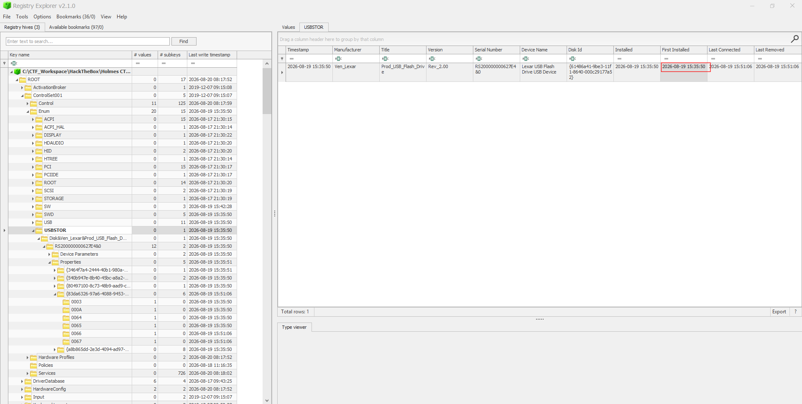
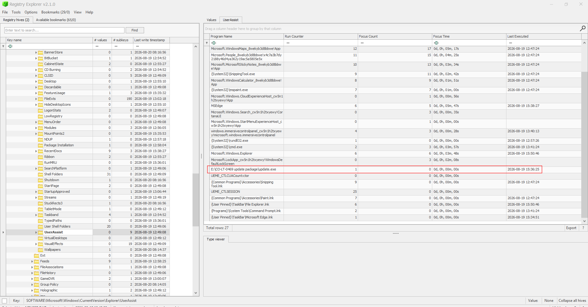
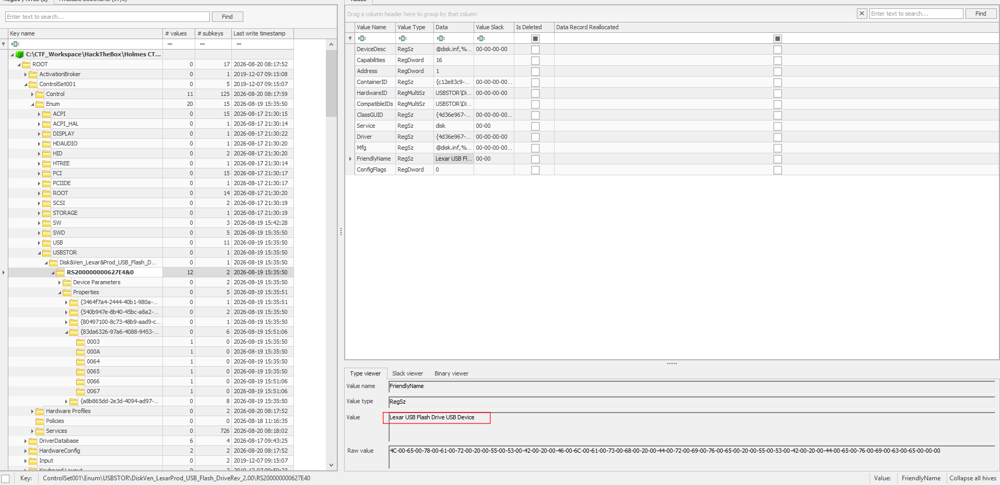
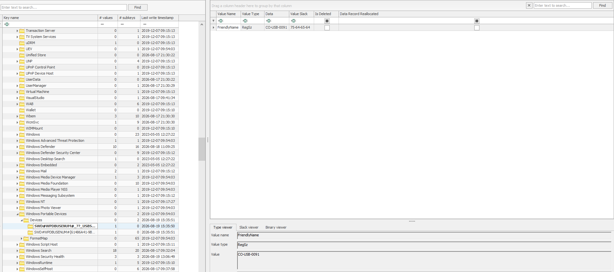
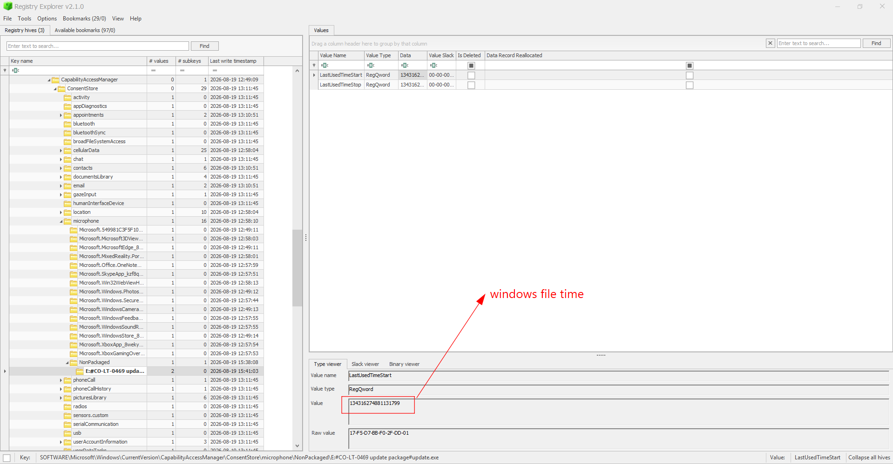
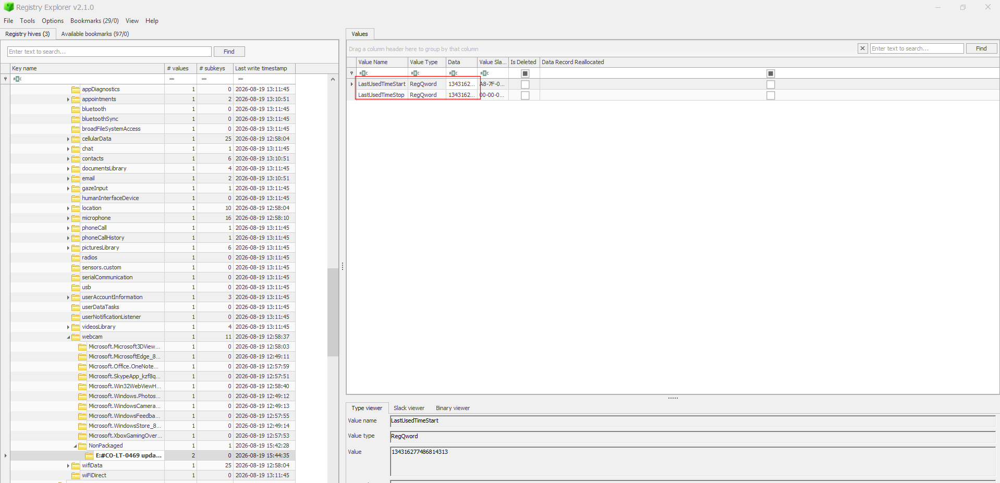
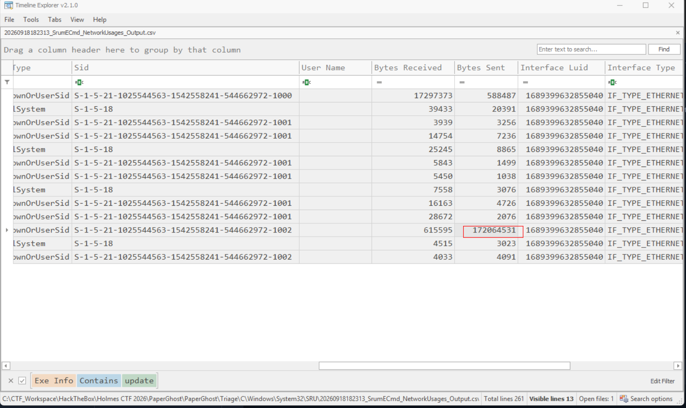
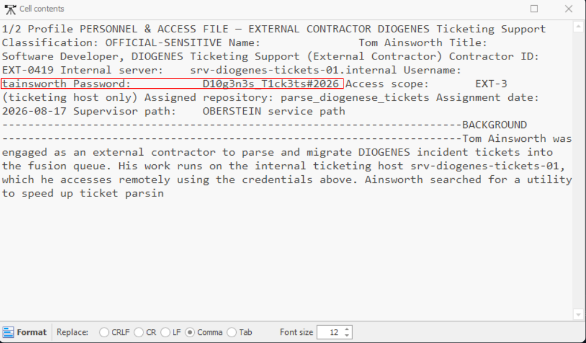

# Paper Ghost

## Given artifacts

KAPE triage of the user's C drive, but only registries left

## Questions

### The rookie's first move was a planted USB. When did Clara Voss first connect the device Elias Venn left at her desk? (YYYY-MM-DD hh:mm:ss)

Parse the SYSTEM hive in Registry Explorer, inside `CurrentControlSet\Enum\USBTOR`, we can see the planted USB, its first installed time, and the serial number for next question as well:

### Every USB carries a serial scar. What serial number did the dropped device leave behind? (string)

Already mentioned

**Answer: RS200000000627E4&0**

### VON BORK's payload hid inside a fake update package Elias delivered. What is the full path of the payload? (full path of file, starting with drive letter)

The user must have executed it, else there would be no challenge for us at all, for evidence of execution, we may use prefetch (which is not available here), Amcache, ShimCache (require more time to parse), and the fastest place to check is `NTUSER.dat\Software\Microsoft\Windows\CurrentVersion\Explorer\UserAssist`:

E drive is often external drive, so it should have been loaded from the mentioned USB

**Answer: E:\CO-LT-0469 update package\update.exe**

### Believing it a routine update, Voss launched the spyware. At what exact timestamp did she execute the malicious package? (YYYY-MM-DD hh:mm:ss)

Can be seen from previous snippet

**Answer: 2026-08-19 15:36:25**

### DIOGENES tagged the USB with an asset name that surfaced as the device name on connection. What was it? (string)

At first I thought this should be the answer:

But nope, this is just the generic Windows hardware-friendly name, not an obvious custom asset tag. Thus, I try looking at `SOFTWARE\Microsoft\Windows Portable Devices\Devices`:

That's it!

**Answer: CO-USB-0091**

### Once C2 Access was live, VON BORK's listening post woke the microphone to spy on Voss's meetings. At what time did capture begin? (YYYY-MM-DD hh:mm:ss)

In Von's NTUSER.dat, we will look at `Software\Microsoft\Windows\CurrentVersion\CapabilityAccessManager\ConsentStore\microphone`, then under `NonPackaged`, there is an entry for the fake updater:

Under `LastUsedTimeStart` we see a windows filetime stamp, use some online converter to convert it back to UTC

**Answer: 2026-08-19 15:38:08**

### VON BORK mapped Voss's office through her webcam — who came and went, what lay on her desk. For how many seconds did the webcam stream? (number)

Still in that place, but instead of `microphone`, we inspect `webcam`:

Just take the difference

**Answer: 127**

### The riverside relay drank Voss's secrets. How many decimal megabytes of outbound traffic flowed from the compromised machine to the C2? (`***.******`)

Time for `SRUDB.dat` to shine! Use Eric Zimmerman's SRUECmd to parse:

In the network usage csv, we can see the number of bytes sent, as they ask for decimal MB not binary, so we divide by 1000000

**Answer: 172.064531**

### Voss reviewed DIOGENES contractors NAPOLEON may now hunt. What set of credentials did the spying surface for a developer working on DIOGENES tickets? (username:password)

In Recent folder, we see the user touching some pdf files, and even though they are not collected here, we have another artifact, the search index `Windows.edb`, it indexes file content and metadata, we will use `sidr.exe` (you may search in github), it produces CSV files, I use Timeline Explorer to inspect them, and in AutoSummary column of a pdf, I see the answer:

**Answer: tainsworth:D10g3n3s_T1ck3ts#2026**