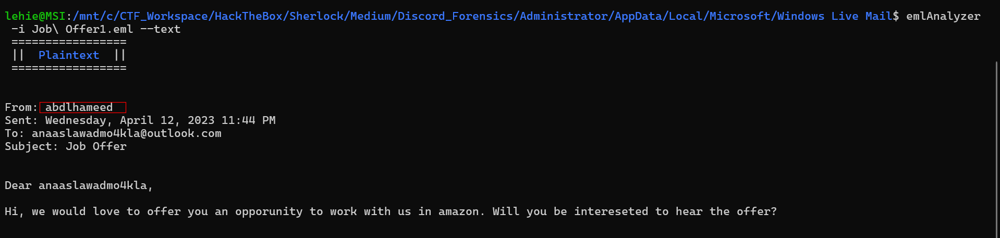
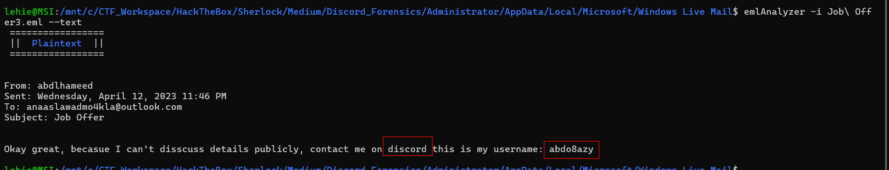
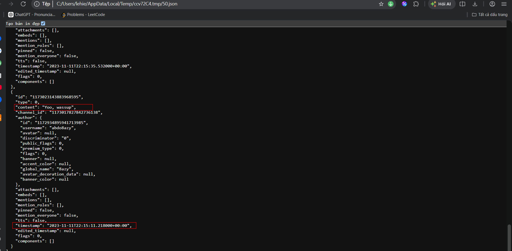
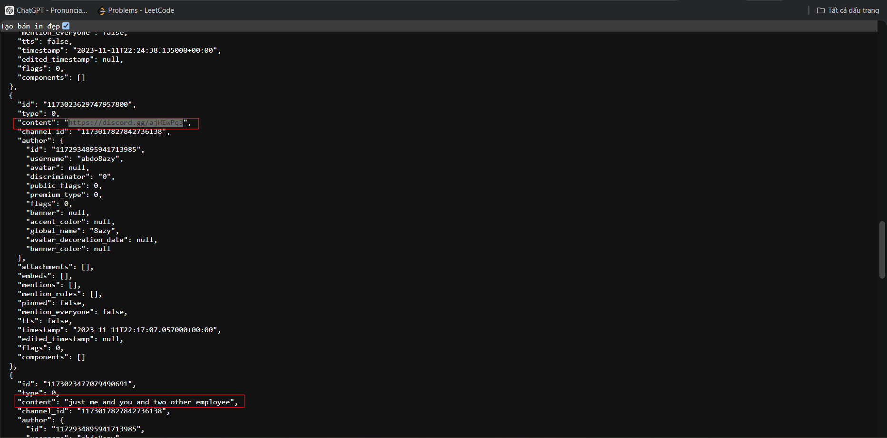
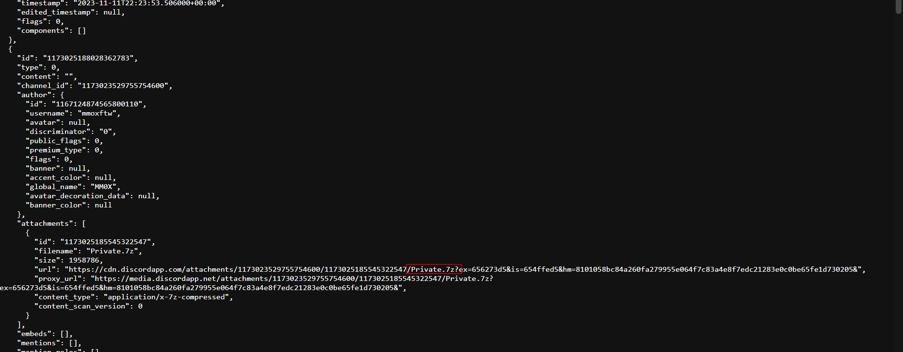
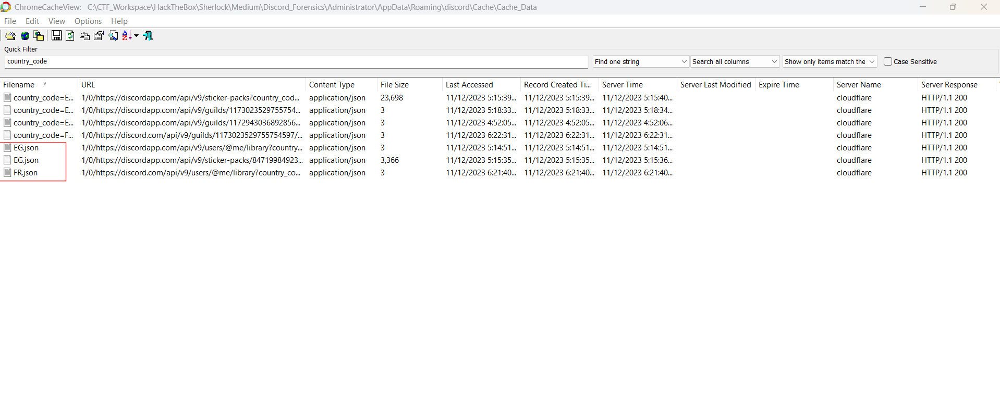
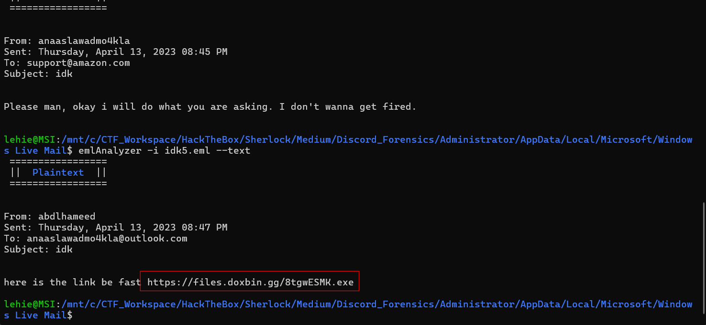

# Discord Forensics

## Sherlock Scenario

Our SIEM alerted that AV blocked malware from running on an employee's machine. For further investigation, the incident response team quickly acquired an image of that machine. To find out how this malware got on the machine, their task is to find the entry point of the attack and trace the attacker.

### 0. What is the name of the attacker?

Even though the challenge name indicates Discord chat, it's not where we can find the answer fot this first question. We will inspect the user's mail, I cannot see Outlook, Thunderbird..., but he uses an older mail client: Windows Live Mail, located in `AppData\Local\Microsoft\Windows Live Mail`:

A lure job offer

`Answer: abdlhameed`

### 1. What application is used for messaging?

In the next email sent from the attacker, he asks our victim to contact him through discord:

`Answer: discord`

### 2. What is the attacker's username on the application?

Can be seen in the previous email

`Answer: abdo8azy`

### 3. When did an attacker send the first message to the victim on this application?Answer Format: YYYY-MM-DDTHH:MM:SS

We know that discord is a chromium app, and funtions like a web server, thus it has cached data in `AppData\Roaming\Discord`, I use `ChromeCacheViewer` to inspect the cached data. The cached messages are stored in json files, the discord app sends requests to `api/v9.../` something like that as I remember, to retrieve messages. Each json corresponds to one channel (private chat or server chat). There are some json files, inspect each of them to get the first message from the attacker:

`Answer: 2023-11-11T22:15:11`

### 4. The attacker has sent a server invitation URL to the victim, what is the full URL?

`Answer: https://discord.gg/ajHEwPq3`

### 5. How many people were on the Discord server?

The attacker, the victim, and two employees

`Answer: 4`

### 6. What is the MD5 hash of the attachment file that the victim sent to the attacker?

Continue reading the messages, we see the victim sends a file named Private.7z:

It's still in the collected triage, under `Documents` folder, just take it hash

`Answer: 4243e8b9c73d6cb5db5b64d64fcd4347`

### 7. What is the victim’s country?

Discord frequently sends requests containing `country_code` to retrieve the user's country, filter for it, we see Egypt and France, and France is the correct answer:

`Answer: France`

### 8. What is the URL of the attachment that the attacker sent to the victim?

I do not truly understand the plot, but it seems that the attacker detected the victim's plagiarism, and he threatens him to public it unlesss he do his command, and his command is to download and run this file:

`Answer: https://files.doxbin.gg/8tgwESMK.exe`
