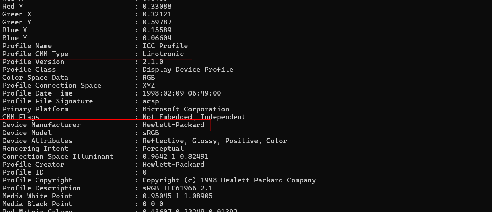
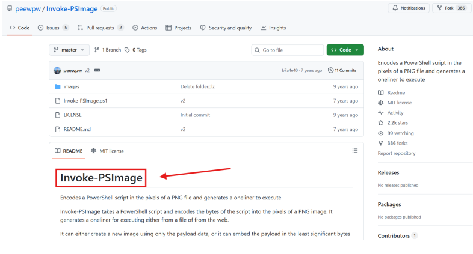
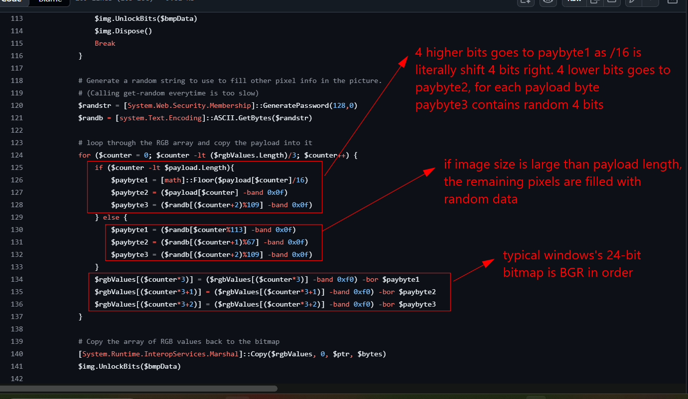
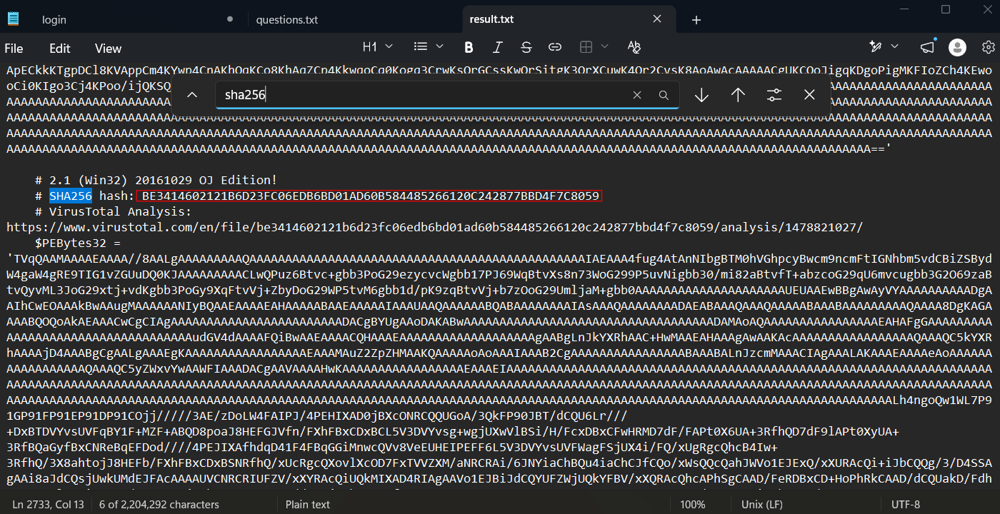
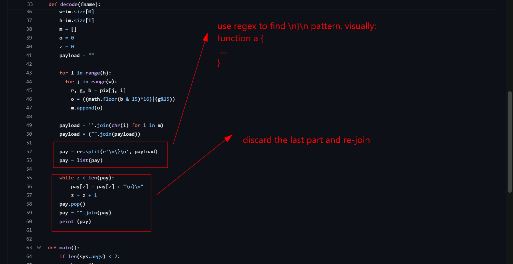

# Image Stegano

## Sherlock scenario

We are certain that there is something malicious in this image, but we do not know what it is. So we need you to investigate it and see if you can find any evidence.

## Given artifacts

A PNG image with extraordinary size

## Questions

### 0. Who is the “Device Manufacturer” according to the metadata?

Alright, I have been always thought of steganography as one of the most meaningless CTF, although it's one of the first kind of challenge in forensic I encountered. But this task somehow makes me excited, maybe truly inspecting how an image is injected and manually extract it is much more meaningful than trying to fix a corrupted image, or using binwalk to pull it out

Let's return to our challenge, just use exiftool:



`Answer: Hewlett-Packard`

### 1. What is the CMM Type?

In above image

`Answer: Linotronic`

### 2. What is the tool that created the payload inside the image?

Not a good question, I think, just follow the hint to search in google, and I found this on github:



`Answer: Invoke-PSImage`

### 3. After decoding the payload, can you find out the function's name?

First let's inspect the behavior of the tool. As the README says, it leverage least-significant bits, a quite familiar approach in image steganography. In this tool, each payload's byte is injected to one pixel, where 4 higher bits goes into blue channel, 4 lower bits to green channel. The prerequisite is that the image's size must be at least the payload's length, which is not so difficult:



To quickly solve this challenge, I use an [available decoder](https://github.com/mertsarica/hack4career/blob/master/codes/psimage_decoder.py), we will discuss about it later. The decoded value yields the function's name

`Answer: Invoke-Mimikatz`

### 4. There are two hidden executables in the decoded payload. What is the sha256 hash of the 32-bit version of the executable?

Just search the decoded script:



`Answer: be3414602121b6d23fc06edb6bd01ad60b584485266120c242877bbd4f7c8059`

## About the decoder script

We see that the decoder works in this case, but notice this part:



You may be wondering what he is doing there, remember that the image size may be larger than the payload, and in that case, the remaining bits are filled with random data. We don't know the exact length of the payload, so the author uses a heuristic approach, assume the powershell functions follow that pattern, use regex to split them, discard the garbage payload and re-join it.

That approach works in this case, but not reliable. We should keep all the decoded binary, then manually remove the redundant part instead of blindly discard like that.

```python
from PIL import Image
import sys

with Image.open(sys.argv[1]) as im:
    im = im.convert("RGB")
    pixels = im.load()
    w, h = im.size

    payload=bytearray()

    for i in range(h):
        for j in range(w):
            r,g,b = pixels[j,i]
            payload.append((b&0x0F)<<4 | (g&0x0F))

with open("decoded.txt", "wb") as f:
    f.write(payload)
```

Or we can avoid manual indexing by using `image.getdata()`, which already helps us traverse the image in row-major order:

```python
from PIL import Image

with Image.open("suspicious.png") as im:
    im = im.convert("RGB")

    payload = bytes(
        ((b & 15) << 4) | (g & 15)
        for r, g, b in im.getdata()
    )

with open("decoded.bin", "wb") as f:
    f.write(payload)
```
