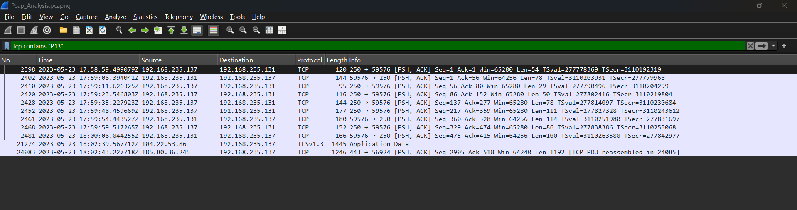
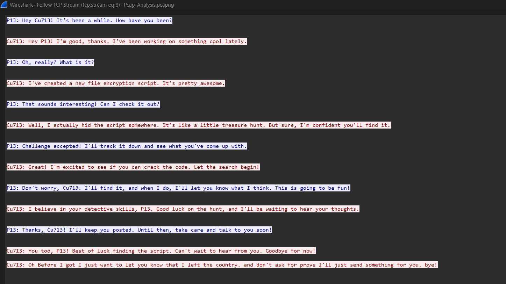
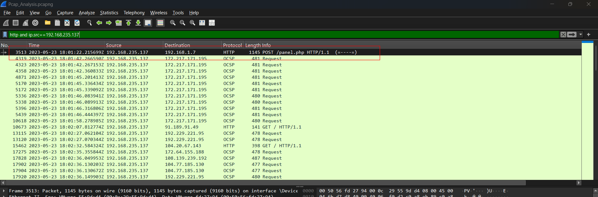
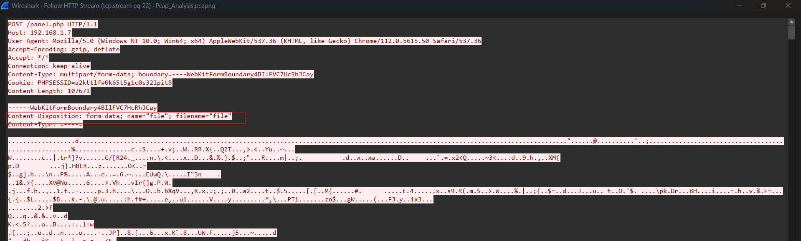
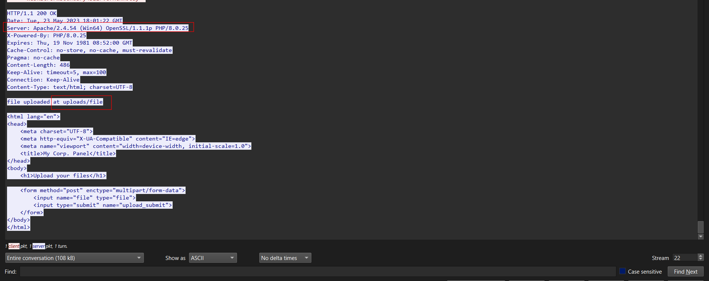
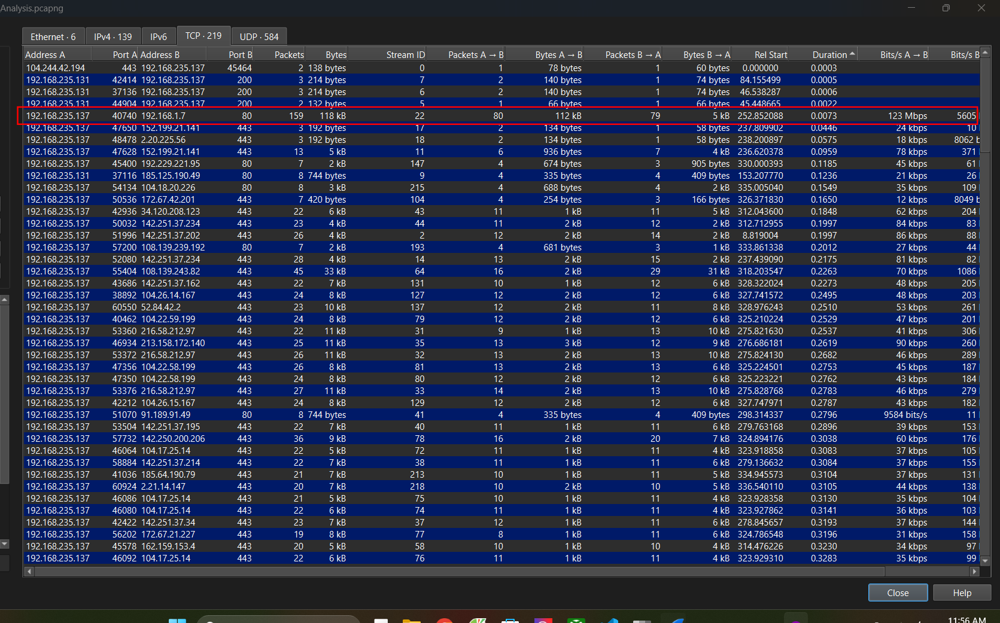

# PCAP Analysis

## Sherlock Scenario

We have captured this traffic from P13's computer. Can you help him?

## Given artifacts

A pcap file

## Note

As this is just a beginner challenge, I won't explain much, just give the evidence

## Questions

### 1. In network communication, what are the IP addresses of the sender and receiver?

The hint says the sender is P13, I filter `tcp.contains "P13"`:

Then follow the stream, it's actually the conversation mentioned:

`Answer: 192.168.235.137,192.168.235.131`

### 2. P13 uploaded a file to the web server. What is the IP address of the server?

Apply the corresponding filter:

`Answer: 192.168.1.7`

### 3. What is the name of the file that was sent through the network?

Follow the HTTP stream:

`Answer: file`

### 4. What web server software is running on the target machine?

See in the response:

`Answer: Apache`

### 5. What directory was the file uploaded to?

Also in the response

`Answer: uploads`

### 6. How long did it take the sender to send the encrypted file?

For this, the stream only contains 2 packet, so the duration of the conversation is also the processing time of the server, for multiple request-response, we may need to inspect the timestamp difference:

`Answer: 0.0073`
