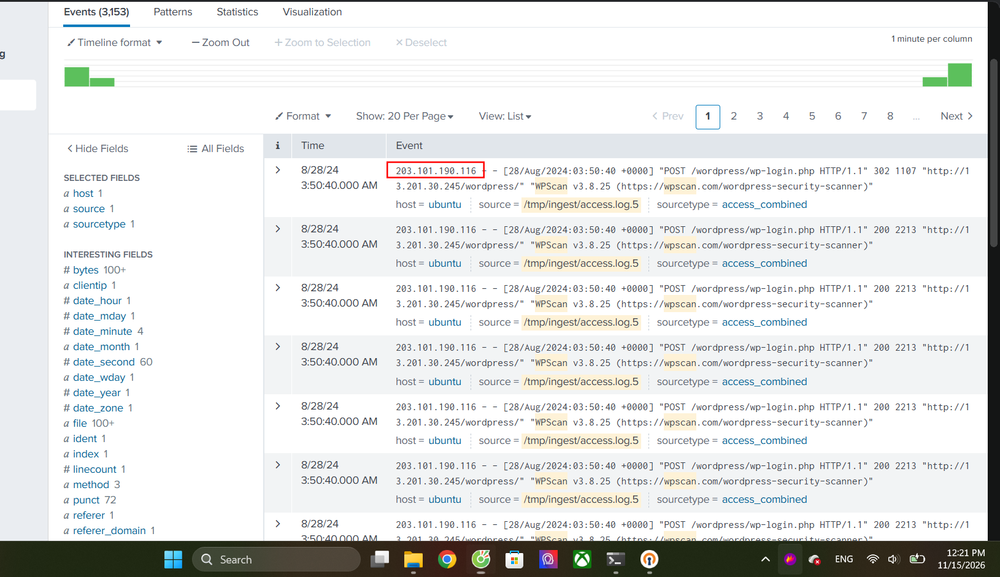
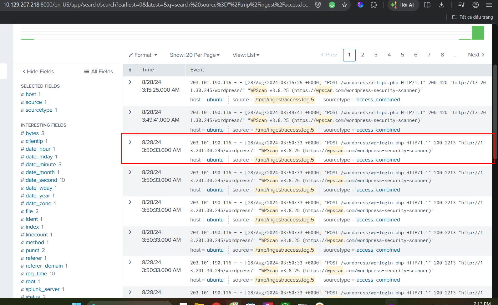
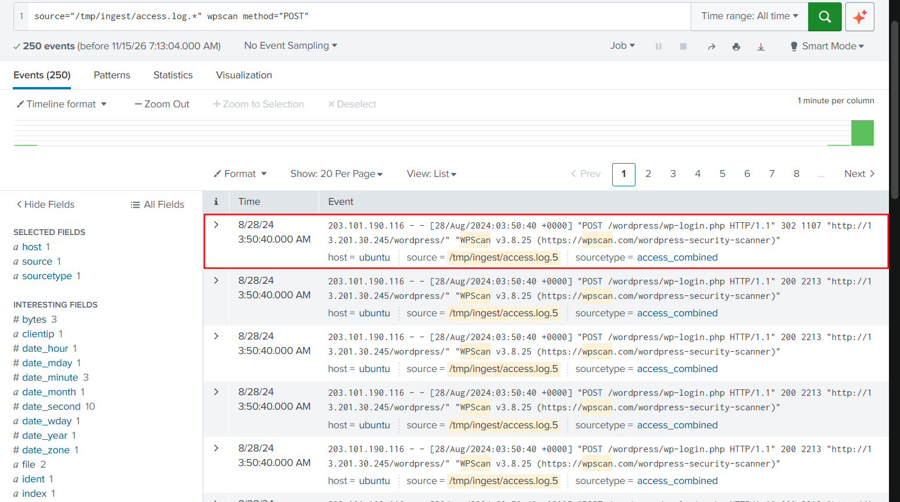
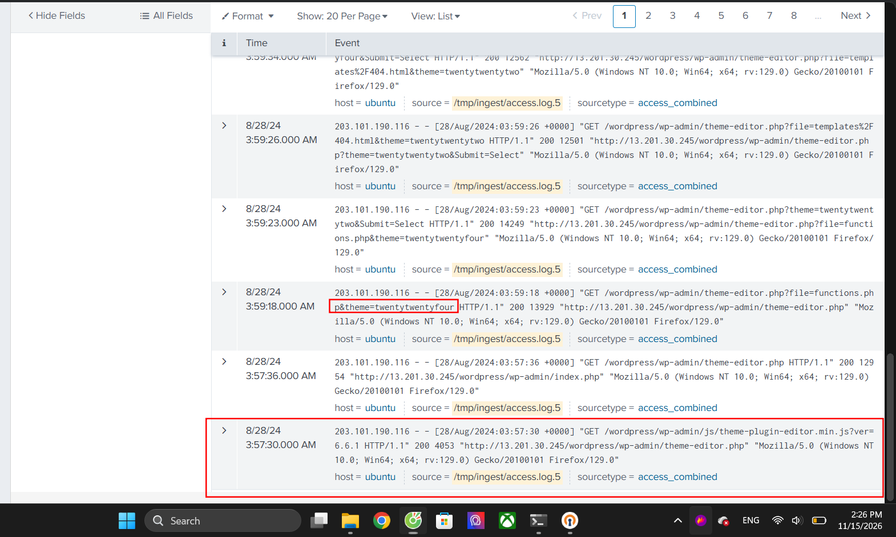
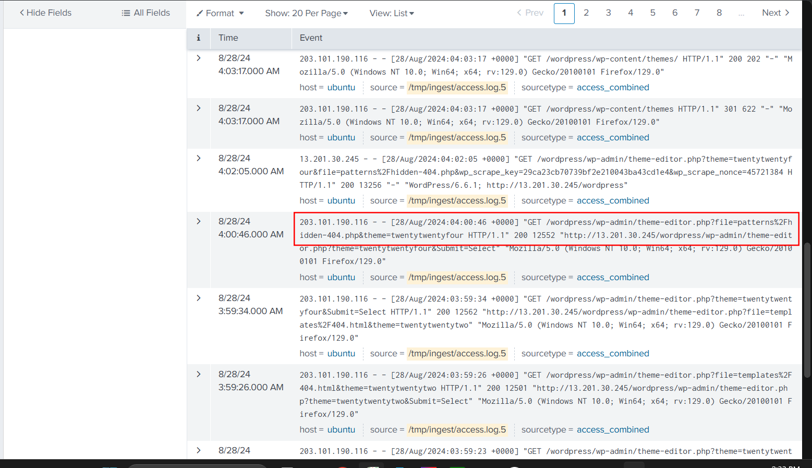
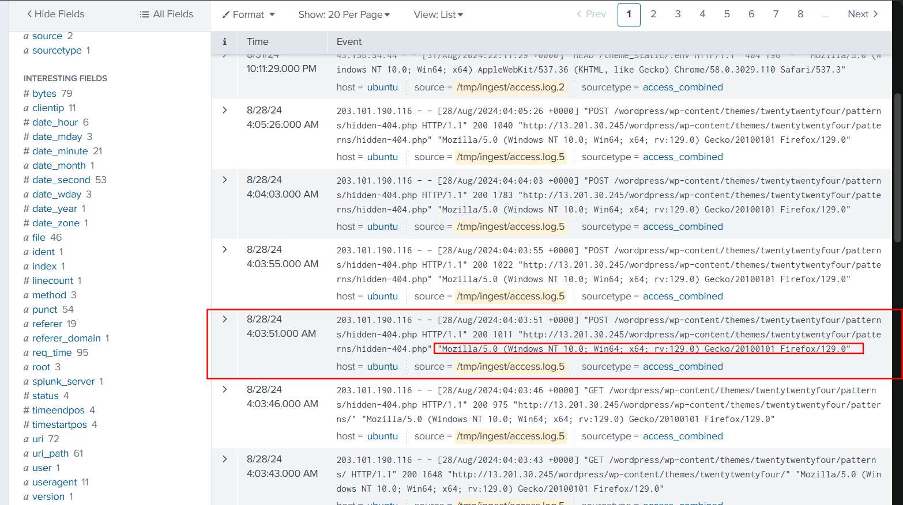

# Wordpress Web Forensics

## Scenario

You are a DFIR (Digital Forensics and Incident Response) Analyst working for a corporation. A recent server breach has caused significant disruption in your digital environment. You are provided with a Splunk instance loaded with Apache2 access and error logs to investigate how the incident occurred.

## Given artifacts

A splunk instance loaded with access log from an apache server running Wordpress

## Questions

### 1. What is the attacker’s IP address from which the WPScan enumeration originated?

We know that the attacker used WPScan to enumerate the web, so any log entry from the attacker would help to identify his address. I just use normal search to find entries with term "wpscan" in splunk:

```text
source="/tmp/ingest/access.log.*" wpscan
```



`Answer: 203.101.190.116`

### 2. When did the attacker begin reconnaissance activity?

Add `| sort _time` to the search query to sort the entries

`Answer: 2024-08-28 03:15:23`

### 3. What is the name and version of the tool used by the attacker?

Can be seen from the above snapshot

`Answer: WPScan v3.8.25`

### 4. The attacker performed a brute-force attack on the WordPress login form. How many seconds did this activity last for before successfully obtaining valid credentials?

I filter for POST request and look at the request landing at the login pane:



Then remove the sort statement to reverse the order of result, we get the last attempt, which may be a success as the return code is 302:



`Answer: 7`

### 5. The attacker manipulated a WordPress theme file to maintain persistent access by uploading a web shell. Which WordPress theme was targeted?

Remove the wpscan search from the query and add `uri=*theme*` to search for theme-related request:



We see the name of a theme selected inthe `theme-editor.php` page

`Answer: twentytwentyfour`

### 6. What is the name of the PHP theme file the attacker edited and used as a web shell entry point?

After that, we see some requests to the theme file named like this:



`Answer: hidden-404.php`

### 7. We see few POST requests to the suspected PHP file that the attacker supposedly edited. The evidence suggests that this is a webshell because the access to the URI is done with few seconds between each attempt, which could be the attacker running commands. When did the attacker first run a command? Provide an answer based on the patterns in the log.

Just look at recent entries with the same search query, those POST aim at the modified theme file, allagedly a web shell now:



`Answer: 2024-08-28 04:03:51`

### 8. List the user-agent used to access the webshell.

Already seen

`Answer: Mozilla/5.0 (Windows NT 10.0; Win64; x64; rv:129.0) Gecko/20100101 Firefox/129.0`
